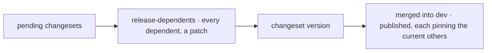

# Changesets

Every pull request that changes a published package (`packages/*`) carries a changeset: a short
Markdown file saying which packages change, how (patch, minor, major) and why, in one sentence a
consumer understands. Create one with:

```sh
pnpm changeset
```

A release branch then runs `pnpm release:version`, which bumps the versions and writes each
package's `CHANGELOG.md`; once merged into `dev`, the Packages workflow publishes the new versions
(decision 0006). The apps are private: they are never versioned nor published.

`pnpm release:version` first releases every package that depends, directly or not, on one already
planned (`tooling/scripts/release-dependents.ts`, a patch each): the packages depend on each other
through aliases (`workspace:@kete-africa/ai@*`), which Changesets does not see, and a dependent left
behind would pin an older version — an app would then install two copies of a package.


