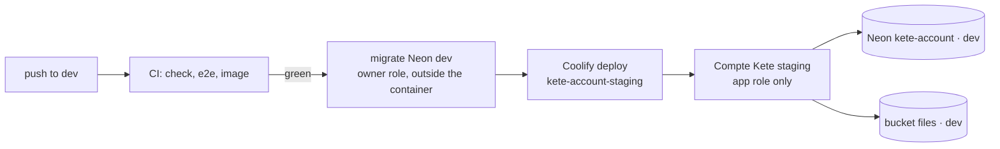
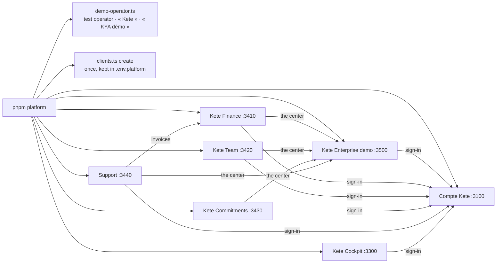

# Operations — Kete Core

Where the Kete Core services run and how they go live. No secret here: values live in Coolify, in
GitHub Actions secrets, and in the author's local `.env` (never committed).

## Compte Kete — staging

| What           | Where                                                                                                                       |
| -------------- | --------------------------------------------------------------------------------------------------------------------------- |
| Address        | <https://compte-kete-staging.13.140.178.49.sslip.io>                                                                        |
| Coolify        | project `Kete`, environment `staging`, application `kete-account-staging` (`lhu4zeod5dbf19tcjfqmhd00`), server `KYA-Server` |
| Source         | GitHub App `kete-coolify` (owned by `kete-africa`, installed on `kete-core` only), branch `dev`                             |
| Image          | `apps/account/Dockerfile`, context at the repository root                                                                   |
| Database       | Neon `kete-account`, branch `dev`, application role `account_app` (no BYPASSRLS)                                            |
| Object storage | bucket `files` of the same branch; credential `kete-account-staging` anchored on `dev`                                      |
| Health         | the image probes its own `/health` (Coolify's probe needs curl, absent from the slim image)                                 |

### Environment of the application

`ACCOUNT_DATABASE_URL` (application role), `BETTER_AUTH_SECRET` (staging's own; it encrypts the
signing keys stored on the branch — losing it means new keys and new sessions), `BETTER_AUTH_URL`
(the address above), `ACCOUNT_STORAGE_*`, `KETE_ENVIRONMENT=staging`, `MAILKITE_API_KEY` and `ACCOUNT_MAIL_FROM` (see E-mails). All
runtime-only, none available at build time.

### Deploying

1. Merge into `dev` once every check is green.
2. Migrate the `dev` branch with the **owner** role — the running container never holds it:
   `ACCOUNT_OWNER_URL=<dev owner URL> pnpm --filter @kete/account db:migrate`.
3. Deploy: `POST /api/v1/deploy` on Coolify with `{"uuid": "lhu4zeod5dbf19tcjfqmhd00"}`.
4. Check: `/health` says `healthy`, `/.well-known/kete` says `staging`, then the journeys:
   `ACCOUNT_E2E_BASE_URL=https://compte-kete-staging.13.140.178.49.sslip.io pnpm test:e2e`.

Coolify also deploys on every push to `dev` (its GitHub App's webhook), one deployment after the
other: migrate the `dev` branch **before** merging a pull request that needs a new migration.
Step 2 runs from the author's machine until a **deploy-only Coolify token** exists. The
instance-wide token is never stored in GitHub.

### Payments

- **Provider**: Chariow. Store, products and the Pulse (notification endpoint) are created in the
  Chariow dashboard; its API cannot create them.
- **Pulse**: URL `https://compte-kete-staging.13.140.178.49.sslip.io/api/payments/notifications`,
  events _successful sale_, _failed sale_, _abandoned sale_. Its signing secret (`whsec_…`) goes to
  `PAYMENTS_CHARIOW_PULSE_SECRET`; the store API key to `PAYMENTS_CHARIOW_API_KEY`.
- **Offers**: `pnpm --filter @kete/account offers set --app nettio --product prd_… --days 30`
  with the branch's owner URL (`ACCOUNT_OWNER_URL`) — the price is read from the provider.
- A Pulse is disabled by Chariow after 5 failed attempts: re-enable it in the dashboard.

### Sign-in for Kete apps and operators

- `KETE_OPERATORS_ORGANIZATION_ID`: Kete's own organization in this Compte Kete. Its owners and
  admins who sign in strongly are operators: two-factor on, or a passkey-only account (spec 016).
- An operator registers each app once (its secret is printed once, then kept with the app's
  secrets):
  `pnpm --filter @kete/account clients create --operator <e-mail> --name "Kete Cockpit" --redirect https://…/auth/callback`
  with the branch's `ACCOUNT_DATABASE_URL`, `BETTER_AUTH_SECRET`, `BETTER_AUTH_URL` and
  `KETE_OPERATORS_ORGANIZATION_ID`. The script asks nothing more: it runs with the service's own
  secrets, checks that the named person is an operator, and acts as her with a session it closes
  (`scripts/operator-session.ts`).

### E-mails (MailKite, doctrine D-031)

1. In MailKite, add and **verify the sending domain** (SPF, DKIM, DMARC records at the DNS host).
2. Create an API key **restricted to that domain** for the Compte Kete; never use the account key
   (unrestricted) in a service.
3. In Coolify, set `MAILKITE_API_KEY` and `ACCOUNT_MAIL_FROM` (an address of the verified domain),
   then redeploy.
4. Check: ask for a new password on `/forgot-password` with a real address, and follow the link.
5. Prefer the zero-retention or encryption-at-rest option; check the data processing agreement
   before sending e-mails for a client.

### Storage CORS

Browsers upload straight to the bucket, only from the Compte Kete's origin:
`ACCOUNT_STORAGE_CORS_ORIGINS=https://compte-kete-staging.13.140.178.49.sslip.io pnpm --filter @kete/account storage:cors`
with the branch's `ACCOUNT_STORAGE_*` variables.

## Kete Cockpit — staging

Kete Cockpit lives in `kete-africa/kete-cockpit` (spec 030): its operations are in its own
repository. Created: Coolify application `kete-cockpit-staging` (branch `dev` of that repository,
its `Dockerfile`, build secret `node_auth_token`),
Neon `kete-cockpit` branch `dev` migrated, `KETE_ACCOUNT_URL`, `COCKPIT_URL`,
`COCKPIT_SESSION_SECRET`, `COCKPIT_ENCRYPTION_KEY` (kept also in the local `.env`: losing it means
new keys for every app) and `COCKPIT_DATABASE_URL` (app role) set — runtime only.

To open it, the author:

1. Signs up on the staging Compte Kete, creates the organization « Kete », and in Mon espace
   Kete → Sécurité either turns on two-factor, or adds a passkey (Bitwarden…) and chooses to sign
   in with passkeys only.
2. Runs `pnpm --filter @kete/account staging:operator` (only the e-mail is asked). It makes that organization the operators' organization on the three
   apps, registers the Cockpit and Firmo (with `kete:people`, below) as Compte Kete clients, hands
   their secrets straight to the hosting environment and redeploys the three apps.
3. In the Cockpit, registers the staging Compte Kete (`https://compte-kete-staging…`), then gives
   the Compte Kete staging app `KETE_EVENTS_URL=https://cockpit-kete-staging…/api/events` and the
   shown `KETE_EVENTS_KID` / `KETE_EVENTS_SECRET`, and redeploys it: its events start flowing.

## Apps that provision people by phone (spec 013)

A messaging app (Firmo) is registered with `--people`: it may then provision people by the phone
number its channel proved (`POST /api/apps/people`) and ask their one-time sign-in links
(`POST /api/apps/sign-in-links`), with a `client_credentials` token carrying `kete:people`:

`pnpm --filter @kete/account clients create --operator <email> --name "Firmo" --redirect https://…/auth/callback --people`

On staging, Firmo (`firmo-staging`, kete-africa/firmo) is registered this way by
`staging:operator`, above.

Links are never e-mailed: the app hands them to the person in her conversation. They work once, for
ten minutes, never for a person with a second factor, and land only on the app's own origin.

## The whole platform on this machine

`pnpm platform` (`tooling/scripts/platform.ts`) runs every Kete app on a developer's machine,
joined: one local Compte Kete, every app signing in through it and seeded in its organization
« KYA démo ». Development only — never a deployment.

| Who              | Where                   |
| ---------------- | ----------------------- |
| Compte Kete      | `http://localhost:3100` |
| Kete Enterprise  | `http://127.0.0.1:3500` |
| Kete Finance     | `http://127.0.0.1:3410` |
| Kete Team        | `http://127.0.0.1:3420` |
| Kete Commitments | `http://127.0.0.1:3430` |
| Support          | `http://127.0.0.1:3440` |
| Kete Cockpit     | `http://127.0.0.1:3300` |

- **Where**: the repositories side by side (`../kete-enterprise`, `../kete-finance`, `../kete-team`,
  `../kete-commitments`, `../kete-helpdesk`, `../kete-cockpit`), each installed, each with its
  `.env` of test addresses. Each app runs its own `pnpm demo` in its joined mode
  (`KETE_DEMO_JOINED=on`): a throwaway schema, seeded as the app alone, then speaking to the others.
- **Who you are**: the test operator, made once by `apps/account/scripts/demo-operator.ts`; its
  credentials are in `apps/account/.env.demo` (ignored by git, never printed). Enter by the Compte
  Kete, choose « KYA démo », then Mes outils. In Kete Enterprise you are Abla Nyuiadzi. The
  Compte Kete runs with the test mailbox (`/admin/mailbox`) and, for the operator, without a second
  factor (`KETE_OPERATORS_SECOND_FACTOR=optional`, refused outside staging, preview or development).
- **Kete Intelligence**: with `OPENAI_API_KEY` in the author's `../../.secrets/atelier-admin.env`,
  the real model answers, speaks and searches the web; with `BOAT_API_KEY`, it has its computer.
- **The apps on 127.0.0.1**: the Compte Kete accepts a loopback return address for a client only
  there; Kete Enterprise accepts loopback app addresses in its registry only with
  `KETE_ENVIRONMENT=development`.
- **Run it from a terminal**, not from an editor's preview: a process started under a TLS-inspecting
  proxy cannot reach the model. `pnpm platform --build` builds each app's screens again; Ctrl C
  stops everything.

## Production

Nothing follows `main` yet. The production application is created when the author decides the
first release (branch `main`, Neon `main`, its own secret, storage credential and domain).
