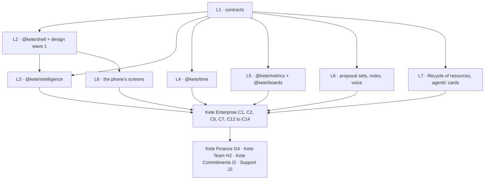
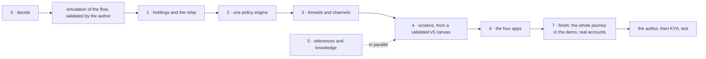

# Roadmap — Kete Core

## Metadata

- **Status**: `candidate`
- **Last updated**: `2026-10-13`
- **Product boundary**: the shared foundation of every Kete app — contracts, shared packages, the
  Compte Kete service with Mon espace Kete, and the app template.
- **Planning axis**: `DEPENDENCIES_AND_EVIDENCE_NOT_TIME`
- **Deployment policy**: `HUMAN_VALIDATION_BEFORE_DEPLOY` (through Pono)

## Goal

A new Kete app starts from the template and is, from its first day: connected to the Compte Kete,
observable by Kete Cockpit, able to take payments through a generic port, and ready for agents
(drafts, commands, capabilities) — with purpose-built screens on the Kete design system.

## Execution rules

- Phases are contiguous and close on their **proof**, never on a date.
- Each phase is driven by Spec Kit: `specify → clarify → plan → tasks → analyze → implement →
converge`, one `NNN-slug` branch per feature, merged into `dev` on green CI only.
- A phase is not closed while its documentation and diagrams are missing.
- `[agent]` is verified automatically; `[blocking]` waits for a human decision or observation.

---

## Phase 0 — Foundation · _closed on the CI of pull request #1_

### Objective

A repository an agent can work in safely.

### Scope

- Constitution, agent context, Spec Kit. _(done)_
- `main` / `dev` branches, feature branches from `dev`. _(done)_
- pnpm workspace, TypeScript strict, lint, formatting, boundary checks, CI. _(done in 001)_

### Proof

- `[agent]` CI runs lint, type-check and tests on every pull request to `dev`.

---

## Phase 1 — Contracts and SDK · _delivered in `specs/001-contracts-and-sdk`, one human proof pending_

### Objective

Any Kete app can describe itself, report its health and send signed integration events reliably.

### Scope

- Contracts v1: `manifest`, `event`, `health` (JSON Schema, versioned, types generated).
- `@kete/sdk`: outbox written in the same transaction as the business change, batched signed
  delivery with retries, signature verification for receivers, `/health`, manifest.
- A test receiver, so the proof does not wait for Kete Cockpit.

### Status

- Proven (`packages/sdk/tests`): atomic recording, RLS isolation, relay under concurrency,
  verification and rotation, exactly-once, manifest and health. **Chaos run: 1,000 events, 1,050
  deliveries (50 duplicates absorbed), 0 lost** (SC-001).
- Pending: SC-005, an adoption timed by a person — when Nettio adopts the SDK.

### Dependencies

Phase 0.

### Proof

- `[agent]` A sample app records a business change and its event atomically; the event reaches the
  test receiver, is verified, and is never duplicated nor lost across simulated failures.
- `[agent]` A tampered or stale event is rejected.

---

## Phase 2 — Compte Kete and design system · _delivered; three human proofs pending_

### Objective

One account for every Kete app, and the visual foundation of every screen.

### Scope

- `apps/account` on Better Auth: e-mail sign-in, organizations, organization roles, invitations,
  the token carrying person, active organization, role and apps.
- Operator identity with mandatory two-factor authentication — moved to Kete Cockpit, where
  operators act (spec 003, assumptions).
- `@kete/auth` for apps: reading the token, active organization, mapping to business roles.
- `@kete/design`: the **v1 rectangle** design system and its `DESIGN.md` (Google DESIGN.md format),
  kept in sync with the tokens and linted in CI.
- `@kete/files` (core): files separated from their stored content, attachments to records, direct
  uploads through a storage port (S3-compatible adapter first), type and size checks, scanning
  before availability, image renditions, time-limited share links, retention policies.
- Mon espace Kete, minimal: my tools, my organization (including its logo, through
  `@kete/files`), generic settings.

### Status

- `specs/002-design-system` delivered: `DESIGN.md` linted with 0 warnings, generated theme checked
  in CI, first components. Author validation happens on the Compte Kete screens.
- `specs/003-compte-kete` delivered: accounts, organizations, roles, invitations, generic settings,
  the token and `@kete/auth`. Proven: isolation between two organizations in the database (SC-002),
  every altered, expired or foreign token refused (SC-003), the journeys in a browser on the
  production build. Pending: a timed sign-up by a person (SC-001) and the author's validation of
  the screens (SC-004).
- `specs/004-files` delivered: `@kete/files` on Neon object storage, the organization's logo in
  Mon espace Kete. Proven on the real database and storage: another organization can neither list,
  read nor reference a file; disguised or oversized files are refused and never served; no
  metadata of the original survives. Scope kept to images: documents wait for an antivirus
  adapter; share links, renditions and retention jobs come with the apps that need them.

### Dependencies

Phase 1.

### Proof

- `[agent]` A person creates an account, an organization, invites a member; two organizations never
  see each other (RLS test).
- `[agent]` An organization uploads its logo and a document; another organization can neither list
  nor download them; an unscanned or rejected file is never served.
- `[blocking]` The author validates the first screens against `DESIGN.md`.

---

## Phase 3 — Payments

### Objective

Take a real payment through a generic port.

### Scope

- `@kete/payments`: the payment port, the **Chariow** adapter first.
- Subscriptions centralized in the Compte Kete; access carried by the token with a grace period.
- "My subscriptions" in Mon espace Kete.

### Status

- Prerequisite delivered in `specs/005-staging`: the Compte Kete runs in staging on Coolify
  (branch `dev`), so providers can reach it and the author can validate screens on a phone.
- `specs/007-single-sign-on` delivered (prerequisite of Kete Cockpit): the Compte Kete signs people
  in to every Kete app (OAuth 2.1 / OIDC, `@kete/auth` `createKeteSignIn`), two-factor
  authentication, operators, and the offers admin API. Proven in a browser with a witness app.
- `specs/006-payments` delivered: `@kete/payments` with the Chariow adapter (checked read-only
  against the real API), offers set by operators from provider products, checkouts and
  subscriptions under RLS, notifications verified and applied once, access in the token
  (`canUse`). Proven in tests: forged, replayed, unpaid or mismatching sales grant nothing.
  Pending: the author's Pulse and a real payment on staging.

### Dependencies

Phase 2.

### Proof

- `[blocking]` A real payment activates access to an app; the sale is re-verified with the
  provider, never trusted from the webhook alone.

---

## Kete Cockpit (in this repository, decision D-022)

Where Kete operators run the Kete apps — doctrine step 1.

- **V0.1 — operators and the offers catalog** · _delivered in `specs/008-cockpit`_: operators sign
  in with their Compte Kete (two-factor), offer and withdraw products; proven in a browser.
  Pending: staging (Coolify) and the author's own sign-in.
- **V0.2 — the app registry** · _delivered in `specs/009-cockpit-registry`_: apps registered from
  their manifest, health read on a schedule, signed events received exactly once (key rotation);
  proven in a browser with the Compte Kete registered. Daily snapshots move to V0.3 with the brief
  that uses them.
- **Events from the Compte Kete** · _delivered in `specs/010-account-events`_: `account.created` and
  `payment.succeeded` through the outbox and its relay.
- **V0.3 — the brief and agents**: daily snapshots; the morning brief on Telegram; read-only MCP tools so an agent
  answers about the apps' state.

Proof of V0 (doctrine): an event from an app in production appears in the next morning's brief; a
simulated outage raises an alert; an agent answers about the apps' state.

---

## Firmo's needs (doctrine D-023, D-024)

Firmo is rewritten on this foundation in its own repository (`kete-africa/firmo`). It needs two
things from here, delivered before its conversation phase.

### 012 — Package distribution · _decision 0005, delivered_

- `@kete-africa/*` published on GitHub Packages by this repository's CI; apps keep importing
  `@kete/*` through aliases.
- `[agent]` Firmo installs them from the registry and passes its CI.

### 013 — The Compte Kete by phone number · _delivered in `specs/013-phone-identity`_

- A person whose phone number is proven by a messaging channel gets a Compte Kete without e-mail,
  password or form, provisioned by a trusted Kete app (Firmo) with its own client credentials;
  her business becomes an organization.
- A one-time, short-lived sign-in link, requested by the app for that person, opens the Compte
  Kete signed in and lands in the app through single sign-on.
- Mon espace Kete shows the phone number; e-mail and password can be added there.
- `[agent]` A test app provisions a person by phone, requests a link, and the link signs her into
  the app once — never twice, never after expiry, never for another app's return address.

### 014 — What an app may know, and paying without an e-mail · _delivered in `specs/014-app-access`_

- A trusted app reads which Kete apps an organization may use, and until when — dates only, never
  a price, a name or a payment (`GET /api/apps/access`): Firmo applies its own quota with it.
- A person provisioned by phone is asked the receipt's e-mail when she pays; a person with an
  e-mail never is.
- `[agent]` Both proven by the account tests; Firmo reads the access in its plans (Firmo spec 007).
- Staging: `staging:operator` registers Firmo with `kete:people` in the same gesture as the
  Cockpit (`docs/OPERATIONS.md`).

### 016 — Passkeys · _delivered in `specs/016-passkeys`_

- A person signs in with a passkey kept by her password manager or device, and may drop her
  password: a passkey-only account signs in strongly, like two-factor, and so may run Kete.
- The operator scripts ask only the operator's e-mail and check that she signs in strongly.
- `[agent]` A virtual authenticator adds a passkey, drops the password and signs in again; the old
  password opens nothing.

---

## Consolidation — doctrine D-030 to D-035

Before the apps and Kete Enterprise run in parallel (D-034), `kete-core` receives every shared
building block already identified (D-030), in dependency order, one Spec Kit feature each, from
spec 020. Phases 4 and 5 below are delivered through these specs. Spec 028 (views, D-037) was added
on 2026-10-01; the template and the Cockpit move to 029 and 030.

| Spec                          | Delivers                                                                                                                  | Proof                                                                                 |
| ----------------------------- | ------------------------------------------------------------------------------------------------------------------------- | ------------------------------------------------------------------------------------- |
| `020-tooling-and-docs`        | Changesets, Renovate, gitleaks, `pnpm audit`, Knip, the Starlight site (decision 0006)                                    | `pnpm check` and `pnpm docs:build` pass in CI; a package change needs a changeset     |
| `021-tenancy-and-testing`     | `@kete/tenancy`, `@kete/testing` (Neon test branch and plain Postgres)                                                    | The RLS tests run through the kit on both                                             |
| `022-commands-records-drafts` | `@kete/commands`, `@kete/records`, `@kete/drafts`                                                                         | Operator gestures journaled; a draft has no effect before validation                  |
| `023-capabilities`            | `capability.v1`, `@kete/capabilities`, the event catalog (AsyncAPI)                                                       | One capability, same rights and journal from MCP and from a model                     |
| `024-ai`                      | `@kete/ai` on the AI SDK, usage and budgets                                                                               | A model call through the port, with its usage measured                                |
| `025-notify`                  | `@kete/notify`, MailKite (D-031); the Compte Kete sends its e-mails                                                       | A real invitation and password reset sent on staging                                  |
| `026-identity`                | `@kete/identity` extracted from the Compte Kete; its OpenAPI description                                                  | Every Compte Kete end-to-end test passes unchanged                                    |
| `027-design-workspace`        | `@kete/design` in three layers, the doctrine's components, the `workspace` design, client brands (D-035)                  | Two designs and a client brand, contrasts checked in CI                               |
| `028-views`                   | Views in copilots (MCP Apps, D-037): `capability.v1` views, `@kete/views`, decisions in the view                          | A draft prepared through MCP is decided by the person in its view, never by the model |
| `029-app-template`            | `templates/app` and `create-kete-app`, `@kete/admin`, `@kete/feedback`, the worker (pg-boss), an app's own design (D-038) | An app from the template passes CI on its first commit                                |
| `030-cockpit-repository`      | Kete Cockpit moves to `kete-africa/kete-cockpit` (D-033)                                                                  | The Cockpit is green in its own repository and redeployed on staging                  |

## What every Kete App needs from D-039 and D-040

The agents, their delegations and the compliance engine live in `kete-enterprise` (D-028). Two
small things belong to every Kete App, so to `kete-core`:

| Spec                      | Delivers                                                                                           | Proof                                                                      |
| ------------------------- | -------------------------------------------------------------------------------------------------- | -------------------------------------------------------------------------- |
| `034-actor-delegation`    | The actor's chain of agents (`delegatedBy`, `traceId`) in `@kete/commands` and its journal (D-039) | A delegated gesture is journaled with its chain; a broken chain is refused |
| `035-manifest-governance` | The app's identity card in `manifest.v1`: owner, data categories, AI use, criticality (D-040)      | The template and the Compte Kete declare it; an incomplete card is refused |

---

## Phase 4 — AI-era primitives

### Objective

Apps let agents prepare and humans decide, the same way everywhere.

### Scope

- `@kete/records`: single schema per record, lifecycle, field provenance.
- `@kete/commands`: named commands, idempotency, actor, reversibility and inverse command, command
  journal.
- `@kete/drafts`: record drafts and change proposals, the verification card, agent states.
- `@kete/capabilities`: declaring agent-facing capabilities and their autonomy level; MCP exposure.
- `@kete/files` (extractions): text, transcription and extracted fields derived from a file (a
  photo, a voice note), used as the traced source of a draft.

### Dependencies

Phases 2 and 3.

### Proof

- `[agent]` An agent prepares a draft through MCP; a human verifies and validates it; the action is
  journaled with its actor and provenance.
- `[agent]` A draft prepared from a photo shows the photo next to the extracted fields.

---

## Phase 5 — App template

### Objective

A new Kete app is born complete.

### Scope

- `templates/app`: everything above wired, plus `@kete/admin` (operator space and audit),
  `@kete/notify`, `@kete/feedback`, i18n, documentation skeleton with diagrams, CI.

### Dependencies

Phase 4.

### Proof

- `[agent]` An app created from the template signs in with the Compte Kete, sends a verified
  event, exposes a capability, and passes CI on its first commit.

---

## Phase 6 — The complete system (decided 2026-10-03)

### Objective

What every Kete app and Kete Enterprise need to offer, at the minimum, what Microsoft 365 Copilot
and OpenAI's Dots offer today: an assistant of the current era, the company's knowledge with its
sources, files and final documents, agents working in the background and with one another, apps
created from a person's space that integrate by themselves. Built on what exists (open source
libraries and standards), never rebuilt.

### Rules decided with it

- **A form never shares its page with a list.** A short form (six fields at most) opens in a
  dialog — on the right when the screen is wide, centered otherwise; a longer one has its page.
- **Every mode.** Dark, light or the device's own, chosen by the person, rendered by the server.
- **Integrated by construction.** An app declares its record types; its tools, its read API, its
  data sets and its events follow, declared in its identity card.
- **Agents under the doctrine.** A chain up to a person, rights that only narrow, budgets, levels
  of autonomy, a person decides every draft; external content is data, never an instruction.

### Specs, in order

| Spec                              | Delivers                                                                                        | Built on                          |
| --------------------------------- | ----------------------------------------------------------------------------------------------- | --------------------------------- |
| `040-page-slots` (done)           | Page slots, view formats, the chat kit                                                          | —                                 |
| `044-forms-and-modes` (done)      | Responsive dialog, `FormPage`, `ThemeChoice`, the template in every mode                        | —                                 |
| `045-integration-contract` (done) | Records → read tools, read API, data sets, identity card                                        | MCP, JSON Schema                  |
| `047-sandbox` (done)              | `@kete/sandbox`: an isolated computer for an agent, behind a neutral port                       | boat.dev, E2B                     |
| `048-app-factory` (done)          | From an approved request to a running app, its first version coded by an agent                  | GitHub App, Neon, Coolify         |
| `049-app-contract` (done)         | What an app declares and what the center offers it — see below                                  | OAuth token exchange, CloudEvents |
| `050-interactive-views`           | An app's views shown in the chat and on the home page, its forms filled there                   | MCP Apps                          |
| `051-references`                  | A record of one app linked from another; external ids kept through a migration                  | —                                 |
| `052-knowledge` (done)            | `@kete/knowledge`: indexing, hybrid search filtered by rights, citations                        | pgvector, Docling                 |
| `053-files-and-documents` (done)  | `@kete/files`: storage, reading, final documents from templates                                 | S3/R2, docxtemplater, Gotenberg   |
| `054-skills` (done)               | `@kete/skills`: Agent Skills folders, versions, test cases, progressive reading                 | Agent Skills                      |
| `055-channels` (partly)           | `@kete/notify`: in-app notifications, Web Push, WhatsApp                                        | Web Push, WhatsApp Cloud API      |
| `056-chat`                        | The chat of the current era: attachments, side canvas, citations, mentions, commands, dictation | assistant-ui, AI SDK              |
| `057-agents`                      | `@kete/agents`: job description, task given, delegation, budgets, kill switch, A2A              | Mastra, A2A                       |
| `058-observability` (done)        | Traces, costs and evaluations of models and agents                                              | Langfuse                          |
| `059-mcp-2026` (done)             | MCP 2026-07-28 through the SDK v2                                                               | MCP                               |
| `060-mcp-client-documents` (done) | MCP clients identified by their metadata document                                               | OAuth client metadata             |

### State on 2026-10-12

- **Delivered since 2026-10-03**: the factory (048), the app contract in four parts (049),
  knowledge (052), documents read, filled and turned into PDF, spreadsheets as typed tables (053),
  skills (054), notifications in the product and on devices (055), traces and costs of model calls
  (058), MCP 2026-07-28 (059), MCP client documents (060), a password added back to a passkey-only
  account, the Kete 2026 shell (`@kete/design` 0.6.0). Decision 0008 (durable workflows) is
  proposed.
- **`055` is partly delivered**: the chat channels have their port and no adapter. Firmo and Nettio
  each carry a copy of the WhatsApp and Telegram adapters (decision 0009).
- **Not opened in this repository**: `050`, `051`, `056`, `057`. Kete Enterprise shows apps' views
  and a chat on `assistant-ui` (its specs 027 and 029b), and wrote its agents by hand on the AI SDK
  (its spec 036) — not on the library named above.
- **Evaluations** of models (058) are not delivered: Nettio has two evaluation scripts of its own.

### The app contract (spec 049)

An app enters the system through its identity card and what the center answers. Five gaps closed
at once, each declared by the template so that an app created by the factory carries them from its
first commit:

| Concept                 | The app declares                                                               | The center offers                                                                  |
| ----------------------- | ------------------------------------------------------------------------------ | ---------------------------------------------------------------------------------- |
| **Permissions**         | Each permission with its label (fr, en), its description and its default roles | Grants per role and position, ticked in Administration › Rights, read by the app   |
| **Events**              | The events it emits (`ticket.opened`…), with their schema and data class       | Signed delivery to the subscribers: agents, briefings, notifications, other apps   |
| **Data classification** | The class of each record type, data set and event (public → secret)            | Secret data never reaches a model nor a shared briefing                            |
| **Directory**           | —                                                                              | The organization read by apps: units, positions, managers, scopes (API and MCP)    |
| **Approvals**           | A request for a decision (amount, subject, requester)                          | The right approver from the structure and thresholds, interim included, the Inbox  |
| **Agent mandate**       | —                                                                              | A token that says « agent X for person Y », never more rights than Y (`act` claim) |
| **Unified journal**     | Its gestures, with their chain                                                 | One journal: who did what, in which app, which agent for whom                      |

### Proof

- `[agent]` An app created from the template exposes its records to the central assistant without
  a line of integration code, under the person's rights.
- `[agent]` An agent given a task delegates part of it to another agent; every gesture carries its
  chain up to the person; the person decides the drafts.
- `[agent]` A permission declared by an app is ticked for a role in Kete Enterprise and changes what
  the app lets a person do, without a deploy.
- `[agent]` An event emitted by an app reaches its subscriber signed; an agent's call carries its
  mandate, and the app records the agent and the person.

---

## Phase 7 — Finished capabilities and the layer of trust (decided 2026-10-12 and 2026-10-13)

### Objective

What an app needs arrives **finished**: a port with its adapter and its example, so that an app
deletes code when the chassis moves instead of writing it again (decision 0009). And what makes Kete
different lives here, once, for every product: an agent acts under a person's mandate, within the
organization's rules, and everything it did can be read afterwards (doctrine D-042 to D-046).

This repository carries steps **A1** and **B1 to B7** of the plan decided on 2026-10-13; Kete
Enterprise carries the center (its roadmap, steps C1 to C11), Kete Cockpit the fleet (D1).

### Specs, in order

| Step | Spec                           | Delivers                                                                                                                                                                                                    | Proof                                                                   |
| ---- | ------------------------------ | ----------------------------------------------------------------------------------------------------------------------------------------------------------------------------------------------------------- | ----------------------------------------------------------------------- |
| A1   | `086-order` (done)             | This roadmap, decision 0009 and its two rules in the constitution, a generated app's test named after the app (`kete-core#84`), the test runner moved to Vitest 4 (two critical advisories)                 | A generated app keeps no trace of the template's name; the audit passes |
| B1   | `087-chat-channels` (done)     | `@kete/notify`: the WhatsApp and Telegram adapters, inbound messages (authenticated webhooks, the provider's business-scoped ids)                                                                           | Nettio deletes its copy; its tests pass unchanged                       |
| B2   | `088-chat-outbox` (done)       | `@kete/notify`: the outbox to people — consent, templates per organization, a sender per organization, the cost of each message                                                                             | A refused message says why; two organizations never share a sender      |
| B3   | `089-agent-runtime` (done)     | A one-day trial of Mastra under Nettio's assistant, then a decision record. If it holds: the runtime on Mastra and a thin Kete layer — capabilities by right, drafts, mandate, journal, what the page shows | Nettio's assistant tests unchanged; RLS proven on the runtime's tables  |
| B4   | `090-memory-and-evals` (done)  | Memory with its governance (consent, retention, erasure, journal), evaluations of models and agents, the rule that a turn which read outside content triggers no action without a person, a dictation port  | A memory erased never comes back; an evaluation fails a worse prompt    |
| B5   | `091-log-and-analytics` (done) | `@kete/log`: structured logs, traces and errors behind a port. `@kete/analytics`: usage events per organization, in Postgres, read by Kete Cockpit                                                          | Kete Cockpit shows who uses what, per organization                      |
| B6   | `092-plans-and-limits` (done)  | Offers with limits in the Compte Kete (people, AI budget, storage, connected apps, agents), read by every app; a trial that ends                                                                            | An app refuses a costly gesture beyond the limit and stays readable     |
| B7   | `093-template-complete` (done) | The template born with what Nettio had to write (`kete-core#86`): the assistant, messaging, the missing form fields, business roles, a gesture that returns a rule's code, the browser test session         | A generated app has them and passes CI on its first commit              |

B1 is proven: Nettio deleted its two adapters and runs on the chassis' own (`kete-africa/nettio#34`,
its 66 messaging, manager, statement and assistant tests passing); Firmo has the issue
`kete-africa/firmo#18`. Not proven: a real message on a real number.

B2 is proven on the test database (`packages/notify/tests/outbox.test.ts`): a message without
consent, without an address or without the organization’s own sender is kept with its reason and
does not leave; two organizations never share a sender, and a notification signed for one is
never heard in the other; no token is readable in the database. Not done: Nettio still runs its
own outbox with one sender for the deployment — moving it is a step of its own lane.

B3 was tried, then decided ([decision 0010](decisions/0010-agents-run-on-mastra-behind-a-thin-layer.md)):
Nettio's 27 assistant tests pass unchanged on Mastra, and its conversation tables hold under
row-level security as the application role. `@kete/agents` is the only package that imports the
runtime. To obtain: Nettio's assistant on the published package. Not proven: a real model on a
real conversation.

B4 is proven on the test database (spec 090): a memory erased is found in no table and comes back to
no agent, the journal keeps gestures without words; after outside content, nothing acts without a
person; an evaluation fails a worse prompt. Dictation has its port, with Voxtral selectable.

B5 is built (spec 091): logs redacted and traced behind a port; usage per organization, with daily
counts in the outbox to Kete Cockpit and no person in them. Cockpit's screen of who uses what is
asked of its lane.

B6 is proven on the Compte Kete's test database (spec 092): offers carry their limits and a trial
starts once per organization and app; the token tells every app what the offer allows; a gesture
beyond a limit is refused, and after the end the organization's data stays readable for its days.

B7 is proven (spec 093): a new app is born with the roles of its trade, gestures whose broken rules
are said in words, « Demander », WhatsApp and Telegram, usage, logs and a session a browser test
writes; its tests and the generated app's pass. The flow diagram of `kete-core#86` and offline stay
for their trigger.

### Built on (open source)

| Library                                             | Where                                     | Status                                                           |
| --------------------------------------------------- | ----------------------------------------- | ---------------------------------------------------------------- |
| AI SDK, assistant-ui, the official MCP SDK, mcp-ui  | `@kete/ai`, the chat, capabilities, views | In use                                                           |
| Better Auth, Postgres, pgvector, Drizzle, pg-boss   | Identity, every database, knowledge, jobs | In use                                                           |
| OpenTelemetry, Langfuse                             | Traces and costs of model calls           | In use                                                           |
| docxtemplater, officeparser, unpdf, sharp           | `@kete/files`                             | In use                                                           |
| Mastra (Apache 2.0; its `ee/` folders are not used) | `@kete/agents`: the agents' runtime       | In use (decision 0010)                                           |
| pino                                                | `@kete/log`: structured logs              | In use                                                           |
| Voxtral (open weights)                              | `@kete/ai`: dictation, behind the port    | Selectable by configuration; not yet compared on real recordings |

Not taken: CopilotKit and AG-UI (a second interface stack beside assistant-ui), Novu (MongoDB and
Redis), PostHog (ClickHouse, Kafka, Redis), Mem0, Zep and Letta (the governance of memory would stay
ours to write anyway). WhatsApp and Telegram are called directly, without a library; usage
analytics are Postgres tables. A library's licence is checked before it is adopted.

### Needs from other lanes (decision 0009)

| Issue          | From   | Answer                                                                                                               |
| -------------- | ------ | -------------------------------------------------------------------------------------------------------------------- |
| `kete-core#84` | Nettio | Taken in `086-order`                                                                                                 |
| `kete-core#86` | Nettio | Answered: channels in B1 and B2, « ask » in B3, the template's pieces in B7; the flow diagram waits for a second app |

### Waiting for its trigger

| Capability                                          | Reopened when                                                                   |
| --------------------------------------------------- | ------------------------------------------------------------------------------- |
| A port for certified invoices, on `@kete/sequences` | The orders applying Togo's 2026 finance law (certified e-invoice) are published |
| A mobile-money adapter in `@kete/payments`          | A pilot wants to be paid through it                                             |
| `@kete/offline` (local command queue)               | A pilot's counter or field team needs it                                        |
| Enterprise directories (SAML, SCIM)                 | A client requires it                                                            |
| `050-interactive-views`, `051-references`           | Two apps need the same thing                                                    |

### Not done

Selling the layer of trust to other software vendors; a second interface stack; a new business tool
inside the center (doctrine D-042).

### Human proofs still open

Recorded above as pending, and not obtained since: a timed adoption of the SDK (phase 1), a timed
sign-up and the author's validation of the screens (phase 2), a real payment on staging (phase 3),
the Cockpit's staging and the author's own sign-in.

### Proof

- `[agent]` Firmo and Nettio run on the chassis' chat adapters; neither keeps its own.
- `[agent]` An agent's gesture refused by a rule is journaled with the rule that refused it.
- `[agent]` An app created from the template has an assistant and messaging on its first commit.
- `[blocking]` One organization uses one Kete product for real, and Kete Cockpit shows it.

---

## Phase 8 — What the generic apps share (decided 2026-10-13)

### Objective

Four apps for every company stand behind the center — Gestion, Équipe, Engagements, Support — and
the center holds the references they all cite: people, third parties, projects (doctrine D-047 to
D-049). What two of them need is written here once: amounts of money, the numbers of documents,
the contract by which a fact of money reaches the center with its project, and the path by which a
message, a photo or a document becomes a draft a person checks.

This repository carries steps **E1 to E4**; Kete Enterprise carries the references and the center's
side (its roadmap, steps F1 to F5); each app has its own repository (steps G, H, I, J there).

### Specs, in order

| Step | Spec                             | Delivers                                                                                                                                                                                                     | Proof                                                               |
| ---- | -------------------------------- | ------------------------------------------------------------------------------------------------------------------------------------------------------------------------------------------------------------ | ------------------------------------------------------------------- |
| E1   | `094-money` (done)               | `@kete/money`: an amount is an integer of its currency's smallest unit — read exactly, added, taxed with one rounding, split without losing a unit, shown in a person's language                             | A split's parts add up to the whole; two currencies never add up    |
| E2   | `095-sequences` (done)           | `@kete/sequences`: a document's number taken in the transaction that writes it, per organization, per series and period                                                                                      | No gap after a failed write; no duplicate under concurrent writers  |
| E3   | `096-references-and-money-facts` | Contracts: a fact of money (expected, received, committed, paid) with its amount, its third party, its project and budget line; `@kete/center` reads third parties and projects, asks a circuit, sends facts | A fact sent by an app is read by the center with its project        |
| E4   | `098-intake` (done)              | The template: a message, a photo or a document becomes a draft whose every field says where it comes from; the person corrects, the correction is kept                                                       | A receipt's photo becomes a draft with the provenance of each field |

E1 is proven (`packages/money/tests/money.test.ts`, 7): amounts are read digit by digit and never
rounded on the way in; ten cents and twenty are thirty; 2 480 000 F split 40/30/30 gives 992 000,
744 000 and 744 000; 100 F in three gives 34, 33 and 33; « 2 480 000 F CFA » in French.

E2 is proven on the test database (`packages/sequences/tests/sequences.test.ts`, 8): numbers follow
each other from 1 per organization, per series and per period; a number taken in a transaction
that fails goes back, and the next document takes it; twelve writers at once get twelve different
numbers; the application role cannot delete a series; `F-{YYYY}-{N:4}` gives `F-2026-0412`.

E3 is proven on its side (`packages/center/tests/references.test.ts`, 6): an app reads a third
party and follows a merged record, opens a project from its own document, and says a fact of money
that validates against `money-fact.v1`. To obtain: the same fact read by the center under its
project (Kete Enterprise, step F4).

E4 is proven with a played model (`packages/ai/tests/intake.test.ts`, 3; `templates/app/tests/intake.test.ts`, 3): a
receipt's photo becomes values each with its source, certainty and passage; what the receipt does
not say is neither guessed nor filled; on the template, a photo becomes a task draft, the person
corrects a field and validates, and her correction is kept. To obtain: a real model on real
receipts, and the apps adopting it on their own records.

### Not done

Exchange rates, a country's taxes, general accounting, payroll, stock: an organization's accountant
keeps her tool, and receives exports. A port for certified invoices waits for its trigger below.

### Proof

- `[agent]` Two apps created from the template number their documents and count their money with
  the same packages; neither writes its own.
- `[agent]` A fact of money sent by an app shows in the center under its project.
- `[blocking]` A real receipt, photographed, becomes a correct draft with a real model.

---

## Phase 9 — The canvas in modules (decided 2026-10-13)

### Objective

The canvas of every Kete product, validated by the author (version 3.1; doctrine D-050 to D-055),
built once as reusable modules that the center and every app consume — never a screen written
twice. Kete Enterprise then rebuilds its places on them (its roadmap, « The method, time and
memory »), and the four apps behind the center adopt them.

Each module has three layers: a **contract** in `contracts/`; **logic** in plain TypeScript, with
vendors behind ports (a port ships with an adapter, decision 0009); **components** in `@kete/design`
or `@kete/shell`. A module enters the core only when two consumers need it.

### Specs, in order

| Step | Spec                      | Delivers                                                                                                                                                                               |
| ---- | ------------------------- | -------------------------------------------------------------------------------------------------------------------------------------------------------------------------------------- |
| L1   | `099-canvas-contracts`    | The manifest's question, places and metrics; dated facts; metrics; proposal sets; resources and lessons; file links; the stream of a Kete Intelligence turn — validated by `@kete/sdk` |
| L2   | `100-shell`               | `@kete/shell`: the frame — top bar, places from the manifest, Ctrl K, the drawer, « Noter », sync state, economy mode, the phone's tab bar — and the design's first wave of parts      |
| L3   | `101-intelligence`        | `@kete/intelligence`: the drawer of Kete Intelligence, extracted from Kete Enterprise's chat; one stream from `@kete/agents`; the template's page `/demander` replaced by the drawer   |
| L4   | `102-time`                | `@kete/time`: dated facts, conflicts and free slots computed by code, an external agenda's port with an ICS adapter                                                                    |
| L5   | `103-metrics-and-boards`  | `@kete/metrics` and `@kete/boards`: figures read under the reader's rights; a board looked at, sent by a routine, frozen as a summary and indexed by choice                            |
| L6   | `104-proposals-and-voice` | Proposal sets in `@kete/drafts`; a note or a transcript understood by `@kete/ai`; the voice through the dictation port, WhatsApp voice notes included                                  |
| L7   | `105-lifecycle`           | Lessons from use, test cases, versions, tiers and their review; an agent's card, triggers, budget, six states and autonomy earned by proofs                                            |
| L8   | `106-phone`               | The phone's own screens in the shell: the morning's pile, the evening's voice, « Terrain » and « Plein soleil »                                                                        |
| L9   | `108-canvas-frame`        | The frame and the drawer of Kete Intelligence rebuilt to the validated canvas v3.1, compared with it on a computer and a phone, light and dark                                         |

### Proof

- `[agent]` A generated app is born with the shell, the drawer of Kete Intelligence and its
  manifest's places; no page `/demander` is left in the template.
- `[agent]` The center and an app show the same frame, the same drawer and the same cards, from the
  same packages.
- `[blocking]` At the end of phase 10, the author, then a person at KYA, use the method: « Pour moi »,
  the threads, Planifier.

---

## Phase 10 — The unification (decided 2026-10-15)

### Objective

One living model for every Kete product (doctrine D-056 to D-058; decision 0011): the **journal**
of events, the **thread** of each object, the **holding** — every thing in progress with its holder,
never nobody — the **gesture**, and the **policy** that decides it. Kete Enterprise's six ways of
saying « a thing in progress », its five ways of talking and its two engines for « who may do
what » melt into them; the four apps adopt them. The screen opens on « Pour moi », with the
conversation in the middle and the state beside it (D-057).

### Steps, in order

| Step | Where                  | Delivers                                                                                                                                                                                                                                                             |
| ---- | ---------------------- | -------------------------------------------------------------------------------------------------------------------------------------------------------------------------------------------------------------------------------------------------------------------- |
| 0    | doctrine, both repos   | D-056 to D-058; decision 0011 here and Kete Enterprise's module decision; Kete Enterprise's spec 085 finished                                                                                                                                                        |
| SIM  | an artifact            | A complete simulation of the system in HTML, CSS and JS: events arriving, the router, holdings and the relay, gestures and policies, threads, « Pour moi », WhatsApp cards; validated                                                                                |
| U    | `@kete/work` (111)     | `holding.v1`, the holding's states, never nobody, the relay (age, nudge, deputy, manager); the references' contracts (person, party, project); Kete Enterprise's six sources write holdings                                                                          |
| P    | `@kete/policies` (112) | A policy evaluated at the gesture; circuits and agents' rules melt into it; compliance controls point to it; the six missing policies                                                                                                                                |
| M    | `@kete/threads` (113)  | Threads attached to objects, members, messages, cards, events; inbound channels (WhatsApp Business, IMAP) on simulators; the router; cards sent to WhatsApp, a voice answer as gestures                                                                              |
| E    | `shell`, `design`      | « Pour moi », the thread with its state, the thread « Kete », Planifier, Mon tableau, an agent's settings, the phone — each compared with the validated v5 canvas                                                                                                    |
| R    | contracts, center      | D-060: settings in layers first (115, « Réglages » 116, in commands 117, the calendar 118; the apps and Kete Enterprise on them); then the solidity test on KYA's journeys; places, the catalogue, stock, the installed base, essential manufacturing; one knowledge |
| A    | the four apps (114)    | Kete Finance, Team, Commitments and Support write their holdings, pass their gestures through policies, have a thread per object, cite the references                                                                                                                |
| F    | the demo, production   | The whole journey as an end-to-end test in the demo (a message or a mail, the card, the gesture, the invoice, the payment, an absence and its relay); fluidity figures; real accounts                                                                                |

### Proof

- `[agent]` No holding without a holder; an absence moves its holdings the same day; « Pour moi »
  gathers every source.
- `[agent]` The same gesture, by a person then by an agent, goes through the same policy; a refusal
  is journaled with its policy.
- `[agent]` A client's WhatsApp message lands in its project's thread with a holder; a card decided
  on WhatsApp is settled everywhere.
- `[blocking]` At the end, the author, then a person at KYA, use it.

---

## Phase 11 — Shipping Kete (decided 2026-10-16)

### Objective

What Kete needs to sell, deploy and watch itself, built as autonomous modules every product shares
(doctrine D-059: generalize at each step), on the order of the doctrine's « La sortie de Kete 1.0 »
(lanes B to E). It starts once phase 10's policy engine (step P) exists.

| Module                  | Used by                                                                      | Delivers                                                                                                                                                                    |
| ----------------------- | ---------------------------------------------------------------------------- | --------------------------------------------------------------------------------------------------------------------------------------------------------------------------- |
| `@kete/connections`     | Kete Enterprise, the apps, the Cockpit, Pono                                 | Connected tools (OAuth or key), secrets sealed and never shown to an agent, a connection's health, revocation                                                               |
| `@kete/metering`        | Kete Enterprise (AI spend), the Cockpit, Pono (sandboxes, branches, deploys) | Who consumed what, how much, each figure known, estimated or unavailable                                                                                                    |
| `@kete/infrastructure`  | the Cockpit's fleet, Pono                                                    | A provisioning port and its adapters (Coolify, Neon or Postgres, S3, DNS, secrets, backups): an instance or an environment created, updated, backed up, restored, destroyed |
| `@kete/environments`    | Pono, kete-core's and Kete Enterprise's own previews                         | A Git branch, a Neon branch and a deployment target bound together; previews created and destroyed                                                                          |
| Compte Kete, Mon espace | every customer                                                               | Self-service deployment of Kete Enterprise (shared, dedicated, at the customer's, autonomous); billing behind the payment port                                              |

Every app, Pono and the Cockpit included, ships with Kete Intelligence inside and its public demo
(principles 8 and 9).

### Delivered so far (KYA's path, D-060)

| Step | Specs          | Delivers                                                                                                                                 |
| ---- | -------------- | ---------------------------------------------------------------------------------------------------------------------------------------- |
| A6   | `115` to `118` | Settings in layers, « Réglages » in every app, settings where a command runs, the organization's calendar                                |
| B1   | `119` to `121` | `@kete/connections`, `@kete/metering`, `@kete/infrastructure` (a test instance created and destroyed through the port alone)             |
| B3   | `123`          | Mon Kete: an organization deploys its Kete Enterprise itself                                                                             |
| B2   | `125`          | The Compte Kete's fleet API; Kete Cockpit's « Flotte » reads and makes the deployments                                                   |
| C4   | `124`, `129`   | Imported tools (OpenAPI, remote MCP); web search and reading, a computer of its own, sub-agents, answers said aloud — under the policies |

Still open here: backups restored through the port and an update pushed to two instances (B2), phone
calls with an agent (after decision 0012), billing (B4, after KYA's test).

### Proof

- `[agent]` A test instance created, backed up, restored and destroyed through the provisioning port
  alone.
- `[agent]` An organization signs up and finds its Kete Enterprise ready, with no Kete operator's
  gesture.
- `[blocking]` At the end, the author, then KYA, use it; prices come after.

---

## Later, when a real need appears

`@kete/ai` (model routing) · phone sign-in by one-time code · additional payment adapters (Moneroo,
Stripe) · a Python SDK if a Python app needs it.
