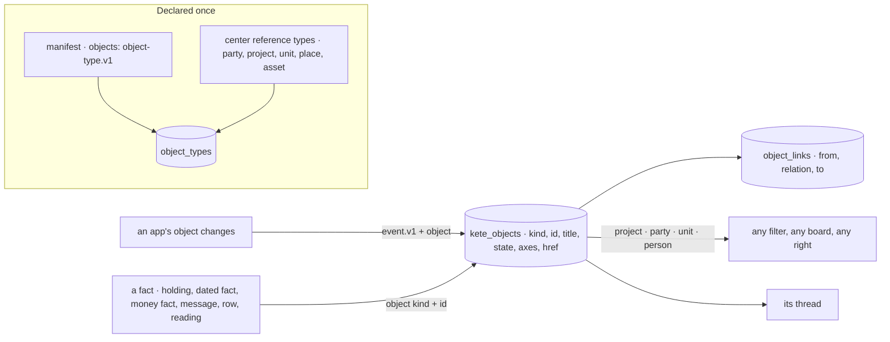

# 0014 — Object types, named links and inherited axes

## Context and Problem Statement

Doctrine D-062 puts the object at the center (R1) and asks that every fact carry its object's four
axes — project, party, unit, person — so that « filter by project » works everywhere (R2). Today
the center knows two reference types of its own (`projects`, `parties`), dossiers, and the apps'
objects only through `thread_objects` (a thread's product, `href`, `party_id`, `project_id`).
Facts point to objects unevenly: a holding carries `object {kind, id}`, a money fact or a dated fact
carries `project_id` and `party_id` but no object, a dataset row carries whatever its app chose.
There is no list of object types, no named link between two objects (a project _produces_ assets;
a contract _covers_ them), and no way to filter a figure by an object that is not a project. The
doctrine already moves places, assets and the installed park into the center (D-056), but nothing
says how a type is declared or how an app's object becomes a center object.

## Decision Drivers

- D-062 R1, R2 (four fixed axes; a site is a kind of unit), R3 (declared once), R4 (same rights),
  R13 (one identity across apps, merges proposed never automatic), R15 (searchable, citable).
- D-047: the center holds the references; apps hold the facts; no app copies a reference.
- `@kete/records` already describes a record once (a Zod schema → form, validation, MCP input,
  drafts) and gives prefixed identifiers (`dep_0199…`).
- Apps keep their data; the center must not become a second database of every app.

## Considered Options

1. Stretch the project: an asset, a contract, a ticket become « projects » of some kind.
2. A generic store in the center: every object of every app copied as rows (an EAV or JSONB table).
3. **Declared object types, a thin object index in the center, named links, axes inherited from the
   index.**

## Decision Outcome

Chosen option: 3, because it gives every fact an object and every object its axes without copying
any app's data, and keeps one owner per type.

- **A type is declared once, by its owner** — `object-type.v1`, a new contract read in the
  manifest (`objects`) or given by the center for its own references:
  - its `kind` and the identifier prefix of `@kete/records` (`prj`, `pty`, `ast`, `tkt`…);
  - its label, its fields' summary (from the record's JSON Schema), its states and their gestures;
  - **its axes mapping**: which of its fields gives the project, the party, the unit, the person;
  - **its links**: named relations to other types (`produces`, `covers`, `concerns`, `part_of`);
  - its `href` pattern, its read capabilities (`get`, `list`), its events.
- **The center keeps an index, not the data** — `kete_objects` (organization, kind, id, product,
  title, state, the four axes, `href`, `updated_at`), fed by the owner's events (0017) and by a
  sync when an app joins; `object_links` keeps the named links. An app's fields stay at the app,
  read through its capabilities with the reader's rights (R4).
- **Every fact points to its object** (`object {kind, id}`) and **inherits its axes** from the
  index: filtering by a project, a party, a unit or a person is a join on the index; filtering by
  one object is a filter on its identifier. No new axis is added for a need (an asset is an object,
  not an axis).
- **The center's own references** are types like the others: party, project, unit, and — per
  D-056 — place and asset (equipment, installed park), with a `subtype` the organization names.
  A project (an affair, with an end) `produces` assets (durable, with their own life).
- **Threads** attach by object: `thread_objects` becomes a view over `kete_objects` for object
  threads; one thread per object, born with it.
- **Identity across apps** (R13): `object_refs` keeps « this app's customer 123 is the center's
  party `pty_…` »; a likely duplicate becomes a merge proposal a person confirms.
- **Rights** stay where they are: the structure axis (units) and the object axis (project teams,
  D-047); the index row's axes are what row-level security and the policies read.

### Consequences

- Good, because a board, an agent's scope, a policy and a search filter by the same four axes for
  every app's objects, and by one object when needed.
- Good, because the center never holds an app's data, only what it needs to find, link and right it.
- Good, because a new type (a contract, an inspection, a site) costs a declaration, not a feature.
- Bad, because the index must stay in step with its owners: an event lost is an object stale. The
  sync on join and a periodic reconciliation are required (R17: a stale row says so).
- Bad, because the money and dated facts' contracts gain `object` (additive, optional at first).

### Confirmation

- `object-type.v1` and the `objects` key of `manifest.v1` are additive; the contract tests cover a
  type with axes and links.
- A test: an app declares a type, sends an event; the object appears in the index with its axes; a
  holding on it is found by « project = X »; its thread opens.
- The audit of D-062 checks each app declares its types (R10, question 1).

## More Information

Doctrine D-047, D-056, D-061 (« # » cites a project, a party, a ticket, an asset…), D-062.
Related: 0015 (figures carry the object), 0017 (events feed the index), 0019 (a connection's
external objects map here). Reversed if the index cannot be kept in step at an acceptable cost; the
fallback is federated reads only, without cross-app filters.
