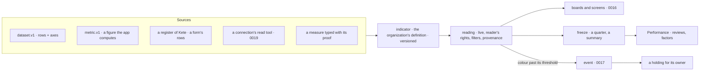

# 0015 — One Measure: sources, indicators, live readings, frozen quarters

## Context and Problem Statement

Four ways of producing a figure live side by side, and none reads another:

1. **Performance** (Kete Enterprise, spec 012): a catalogue of indicators whose formula and source
   are free text, grids per position, quarters frozen and notified, measures typed by hand with a
   proof, and readings an app may send (`indicator_readings`).
2. **Dashboards** (Kete Enterprise, specs 033 and 050): cards over a team's uploaded tables and
   forms only, aggregated in memory after reading up to 50 000 rows.
3. **`@kete/metrics`** (spec 103): figures an app declares (`metric.v1`) and computes with the
   reader's rights, filterable by the center's axes — no app declares one yet, no screen reads one.
4. **Datasets** (`dataset.v1`, spec 045): rows the apps serve (invoices, tickets, time, contracts) —
   the center does not read them.

`@kete/boards` (a board looked at live, sent by a routine, frozen as a summary) waits for its first
consumer. D-062 asks for one system: a figure is live and proven (R7), filtered by the four axes
(R2), declared once (R3), shown missing rather than zero (R17), and a red figure obliges someone to
act.

## Decision Drivers

- D-052 (the board, the routine and the summary are one object), D-062 R2, R3, R7, R11, R17.
- An organization's own referential of indicators (formula, source, frequency, target, alert
  threshold, weight, leading or lagging, penalising or blocking) must be importable as data.
- Aggregation belongs at the source: a phone on 3G and a center must not pull thousands of rows.
- No free SQL or code from users (D-062, what is not taken).

## Considered Options

1. Keep the four, and bridge them where needed.
2. Make Performance the only system and extend it to live figures.
3. **One Measure in four layers — sources, indicators, readings, freezes — with Performance,
   dashboards, `@kete/metrics` and `@kete/boards` as its faces.**

## Decision Outcome

Chosen option: 3, because each existing piece already holds one layer well; what is missing is the
chain between them.

- **Sources** say what can be measured, each with the four axes and its object (0014):
  - `dataset.v1` gains `axes` (which fields are the project, the party, the unit, the person, the
    object) and a **query endpoint** — `POST {api}/datasets/{name}/query` with the existing
    `querySpec` (filters, group by, measures, period) — implemented once in `@kete/capabilities`,
    so every app aggregates at home, under the reader's rights, and returns the result only;
  - `metric.v1` stays as it is: a figure the app's own code computes, on its axes;
  - Kete Enterprise declares its own sources the same way (holdings, money facts, dated facts,
    threads, registers, forms), as one more product;
  - a connection's read tool becomes a source through its adapter (0019).
- **An indicator** is the organization's definition, versioned with the quarter it takes effect
  from: its name and words, **a structured source reference** (a metric, or a dataset query, or
  « typed with proof »), its formula as text for people, frequency, target, alert threshold,
  leading or lagging, penalising or blocking, its owner (a position). Performance's `indicators`
  table becomes this, its free-text `source` kept as a label; grids keep the weights.
- **A reading** is computed when asked, with the reader's rights and the board's filters, and
  carries its provenance: the source, the filters applied (`metric-reading.v1` already says which),
  the moment it was read, and whether the source answered. Missing is a state, drawn red where
  the indicator says so — never a zero.
- **A freeze** is one record for both moments that need it: a board's summary (D-052) and a
  quarter's « arrêté » (Performance). Performance's review lines read the frozen value, not a
  typed copy, when the indicator has a source.
- **A colour has a consequence**: a reading past its threshold emits an event; the indicator's owner
  receives a holding « action corrective » with the figure and its proof (R11, D-056).
- **Packages**: `@kete/metrics` holds the reading contract and the query engine (moved from Kete
  Enterprise's datasets, with `querySpec`), `@kete/boards` the board and its freeze, Kete
  Enterprise keeps Performance's process (quarters, reviews, signatures, factors), now reading
  measures.

### Consequences

- Good, because one figure has one definition, read the same in a board, a review, Kete's answer
  and an agent's work — and its owner is told when it turns red.
- Good, because aggregation moves to the sources: lighter screens, no 50 000-row reads.
- Good, because an organization imports its referential as data and connects its sources over time
  (« progressivity »: unsourced indicators stay typed with proof).
- Bad, because Performance's indicators and the dashboards' cards migrate to source references;
  existing quarters keep their frozen values untouched.
- Bad, because every app must implement the dataset query endpoint — once, in
  `@kete/capabilities`, then a declaration per dataset.

### Confirmation

- Contract tests for `dataset.v1` with `axes` and the query endpoint; a test that a reading of a
  missing source is « missing », never 0.
- An end-to-end test: an indicator on an app's dataset, filtered by a project, read live on a board,
  frozen for a quarter, the frozen value shown in a review; past its threshold, a holding appears.

## More Information

Doctrine D-052, D-062; specs 012, 033, 045, 050, 103. Related: 0014 (axes, objects), 0016 (the
figure and board components), 0017 (the colour's event). Reversed if source-side aggregation
proves impossible for an app; that app then serves pre-aggregated metrics only.
