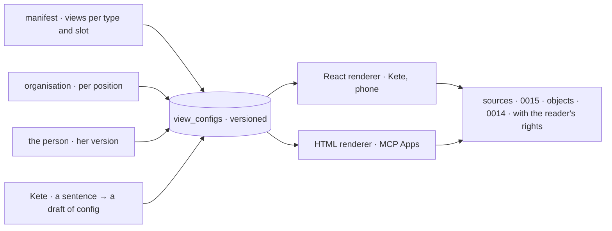

# 0016 — Generic components, configured where they are used

## Context and Problem Statement

D-062 R22 asks for a few generic components configured at the place they serve, the configuration
being versioned data — never code or SQL — at three levels (the app's default, the organization by
position, the person's own version), editable by Kete on a sentence, and rendered the same in Kete,
on the phone and in the copilots (D-037). Today `@kete/design` gives layout slots and parts
(`DataTable`, `BoardGrid`, `WeekCalendar`, `SummaryCard`…), Kete Enterprise draws its charts with
ECharts in its own `chart.tsx`, the dashboards keep their cards in their own JSON, and `@kete/views`
renders four MCP Apps views (review, form, table, detail) as self-contained pages. Each screen
still composes its page in code.

## Decision Drivers

- D-062 R22, R3 (declared once), R4 (reader's rights), R7 (proof), R16 (versioned), R17 (states),
  R19 (phone first, 3G).
- D-037: an app is also a set of views a copilot shows; one configuration, two renderers.
- No user code, no SQL (what D-062 does not take from NocoBase).
- Build on what exists: `@kete/design`, ECharts 6, react-grid-layout 2, `@kete/views`.

## Considered Options

1. Keep composing pages in code, with more shared parts.
2. A page builder in which an administrator draws pages freely.
3. **A small set of component kinds, each configured by a `view.v1` document placed in named
   slots, with one contract shared by all and two renderers.**

## Decision Outcome

Chosen option: 3.

- **One contract for all**, `view.v1`:
  - `kind`: `card` (an object's identity), `collection`, `figure`, `board`, `form`, `timeline`;
    the existing thread, composer and draft card follow the same contract;
  - `source`: an object type (0014), a dataset query, a metric or an indicator (0015), a read tool;
  - `context`: bindings filled by the place (`this object`, `this unit`, `me`, `period`);
  - `filters`, `actions` (capability names — what commits is a draft), `shortcuts` (declared tasks
    and « Demander à Kete » with this view's context);
  - per kind, its options:
    - `collection`: layout (table, list, columns by state, calendar, timeline, map, resource
      planning), fields, sort, group, totals, inline edit as gestures, bulk actions, saved views,
      export;
    - `figure`: the chart (see below), period and comparison, target and threshold lines,
      annotations, drill-down, units;
    - `board`: the grid, tabs, sections, global filters and cross-filter, phone order, meeting and
      story modes, side by side, freeze (0015);
    - `form`: the record's schema (`@kete/records`), conditions, prefill from context, voice and
      photo capture, the gesture it ends in; a **register** is a preset — a form, its collection
      and its figures.
- **Places and slots**: a type's page, a unit's page, « Pour moi », a board, a thread's side panel;
  each has named slots. An app declares what it places by default (`views` in the manifest, per
  type and slot); `view_configs` keeps the organization's and the person's versions, journaled as
  commands; the most precise wins (D-060's order of layers).
- **Kete changes a view on a sentence** through one capability that returns a draft of
  configuration (level 2: reversible, with undo).
- **Two renderers** in `@kete/views`: React for Kete and the phone (on `@kete/design`, ECharts,
  react-grid-layout), and the self-contained HTML it already makes for MCP Apps. Kete Enterprise's
  `chart.tsx` moves there.
- **Every component** draws the common states (loading, empty, missing, denied, stale), shows the
  provenance of a value on demand, updates on events (0017), and has its phone form.
- **The charts**, as options of `figure`: today number, bar, line, pie, table, note; first added:
  bullet, indicator scorecard, bar and line combined, cumulative against a trajectory, waterfall,
  map by region, Pareto, radar, box plot; then grouped, stacked and diverging bars, gauge,
  sparkline, area, histogram, scatter and bubbles, funnel, calendar and matrix heatmaps, pivot
  table; later treemap, Sankey, control chart. Each is added when a real need asks for it.

### Consequences

- Good, because a new object type gets usable pages from declarations, and an organization adapts
  them without code.
- Good, because the same configuration serves Kete, the phone and the copilots.
- Bad, because pages written in code migrate one by one into slots; until then both coexist.
- Bad, because a configuration language must stay small: every option added is kept forever.

### Confirmation

- `view.v1` contract tests; the renderer tests draw each kind in each state.
- A test: an app declares a type with a default page; the organization moves a figure; a person
  makes her version; Kete adds a column on a sentence (a draft, then undo) — all journaled.

## More Information

Doctrine D-037, D-060, D-062 R22. Related: 0014, 0015, 0017. Spec 016 (the slots of the workspace
design). Reversed if a configuration cannot express a needed screen; that screen stays in code.
