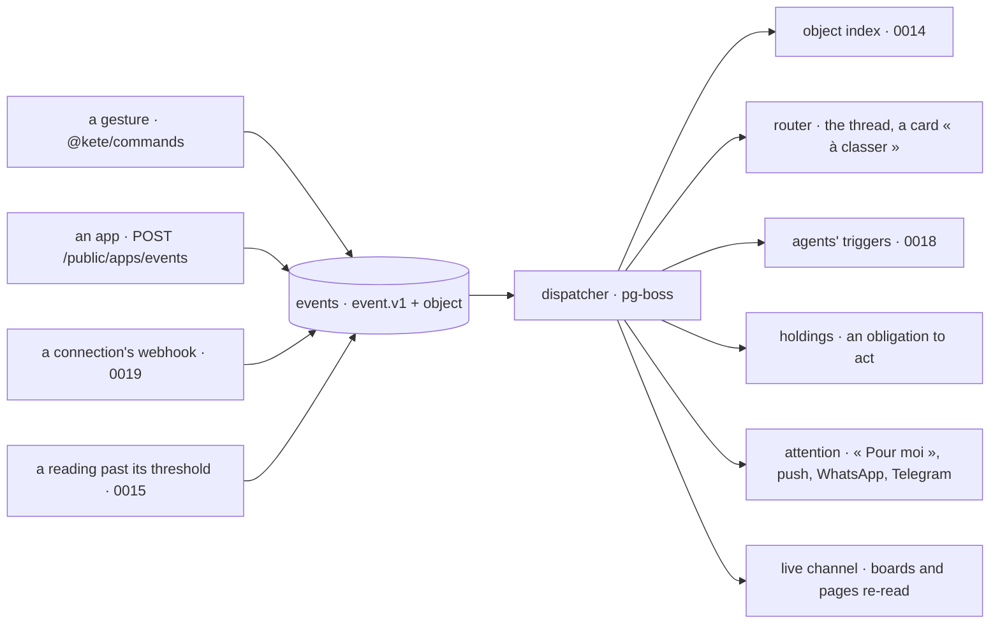

# 0017 — One event path: what changes reaches whoever depends on it

## Context and Problem Statement

D-062 R11: an object that changes says so, and its thread, the agents, the boards and « Pour moi »
learn it; dynamic means updated under the eyes. Today the pieces exist apart:

- every gesture is journaled by `@kete/commands`;
- the apps send their events to the center (spec 025, `event.v1`), kept once, counted as news;
- threads are live through Postgres announcements and Server-Sent Events (spec 098);
- `@kete/notify` has an outbox, `@kete/jobs` runs pg-boss jobs.

But an app's event does not reach the object's thread, an agent cannot wake on it, a board does not
refresh, and a figure turning red tells no one.

## Decision Drivers

- D-062 R11 (no new service; a delivery received twice acts once), R14 (one attention model), R16.
- No extra service when an in-process library does as well (Postgres and pg-boss are there).
- An event carries facts and identifiers only (`event.v1`); the rest is read under the reader's
  rights.

## Considered Options

1. Add a message broker (a queue service) between apps and consumers.
2. Let each consumer poll what it needs.
3. **One event table and a dispatcher on pg-boss, with declared subscriptions and idempotent
   consumers; screens told through the existing live channel.**

## Decision Outcome

Chosen option: 3.

- **`event.v1` gains `object {kind, id}`** (optional, additive): what the fact is about. The
  center's own gestures are written to the same table from the commands journal.
- **A dispatcher** (a pg-boss job) hands each event to the consumers whose **subscription**
  matches (`type`, object kind, filters). Subscriptions are data: the router's, an agent's
  triggers, a watch's, a board's, the attention model's.
- **Idempotent consumers**: `event_deliveries (consumer, event_id)` is unique; a delivery received
  again does nothing. Failures retry with backoff; a consumer stuck is shown (R17).
- **Screens** subscribe through the live channel that already serves threads, widened from
  « a thread changed » to « an object or a board changed »; the screen then reads again from the
  API — what it shows never comes from the stream.
- **Attention** (R14) is one consumer: it decides who is told, on which channel, once, by each
  person's levels per thread and per object.

### Consequences

- Good, because agents wake on facts (« an invoice became overdue »), boards move live, and a red
  figure becomes someone's holding — without a new service.
- Good, because every reaction is traced back to its event (R16).
- Bad, because the event table grows fast; it needs a retention (R12) and partitions by month.
- Bad, because a slow consumer delays only itself, but must be watched.

### Confirmation

- Tests: an event delivered twice acts once; a consumer that fails is retried, then flagged; a
  subscription filtered by object kind receives only its events.
- An end-to-end test: an app's event on an object reaches its thread, wakes an agent subscribed to
  it, and refreshes an open board.

## More Information

Doctrine D-056 (the journal), D-061, D-062 R11, R14. Specs 025, 098. Related: 0014, 0015, 0018, 0019. Reversed if the volume outgrows Postgres; the dispatcher's port then takes a queue adapter.
