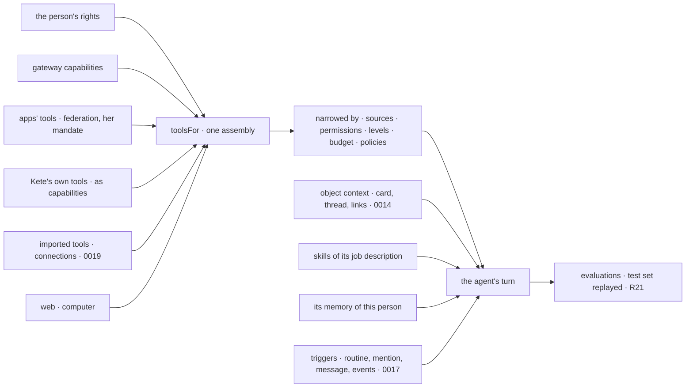

# 0018 — Agents receive Kete's tools, through their job description

## Context and Problem Statement

D-062 R5: an agent is Kete narrowed to a job description. In Kete Enterprise today, Kete's turn
receives the apps' tools through federation with the person's mandate (`appToolsFor`), the
assistant's own tools (holdings, dates, mail, boards, knowledge) and the organization's skills
(`skillsForModel`). An agent's task receives only the gateway's ten capabilities and the imported
tool sets, the web and its computer. It cannot read the apps (an invoice, a ticket), use Kete's
own gestures, or follow the house's know-how. It wakes on a routine, a mention, a message or three
watches only. It has no memory of its own, no evaluation, no face. And there is no catalogue of
agents an organization receives with the system.

## Decision Drivers

- D-062 R5 (sources chosen by the job description), R6 (a face), R11 (event triggers), R18
  (budgets), R21 (evaluations); the three orientations (agents for everyone; what makes a good
  agent: context, tools, know-how, job description, corrections, then the model).
- Principle 4 (never more rights than the person), principle 5 (an evaluation before a rule).
- D-039 (permanent agents and their kinds: a person's, a position's, the system's), D-053 (one
  cycle for what capitalises).

## Considered Options

1. Give agents a separate, hand-picked tool list per agent.
2. Give agents everything Kete has.
3. **One tool assembly for Kete and agents, narrowed by the job description's sources, permissions,
   levels, budget and policies; plus context, skills, triggers, memory, evaluations and a
   catalogue.**

## Decision Outcome

Chosen option: 3.

- **One assembly, `toolsFor(person, narrowing)`**, used by Kete's turn and by agents alike. Kete's
  own tools (today in the assistant's chat tools) become capabilities registered with the gateway,
  so there is one list.
- **The job description gains `sources`** — which products and tool sets it draws from — besides
  its permissions, levels and budget. An agent receives only those sources' tools: better choices,
  lower cost.
- **Context**: when a task is about an object, the agent receives its card, its recent thread and
  its linked objects (0014), within the person's rights.
- **Skills**: the job description names its skills; they are offered as to the assistant. An
  organization's written procedures become its agents' skills (D-053's cycle applies).
- **Triggers**: besides the routine, a mention, a message and the watches, an agent subscribes to
  events (0017) — `type`, object kind, filters. Watches become declared by the apps (`watches` in
  the manifest), each a read capability returning findings.
- **A catalogue**: the core and each app declare agent templates (`agents` in the manifest: name,
  mission, sources, skills, triggers, default take-on, avatar). An administrator enables them; each
  person receives them by position; they act for the person who uses them, with her rights.
- **Memory**: per person and agent, private (not even the agent's maker reads it), viewable and
  erasable by her in chat or on a page, expired after inactivity, off in group threads.
- **Evaluations** (R21): each agent has a test set — cases from its past tasks a person accepted,
  and written cases; a job replays it with a given person's rights, graded by meaning and safety;
  a change of job description, model or tools takes effect only when it passes; the score shows in
  its record.
- **Budgets and inventory**: spend per agent from `@kete/metering`, a budget per agent and unit,
  « ask for more » as a holding in « Décider »; the administrator's inventory lists every agent, its
  rights, sources, connections and cost.
- **A face**: an avatar (a glyph and a tint from its id by default, replaceable), drawn as a rounded
  square everywhere (R6).

### Consequences

- Good, because an agent finally works on the real objects of the apps, with the house's know-how,
  and wakes on facts.
- Good, because agents become a product feature (a catalogue) rather than something each
  organization invents.
- Bad, because more tools enter agents' reach: the narrowing by sources and the policies must be
  tested first; an agent on trial keeps its cap (D-061).
- Bad, because evaluations cost model calls; they run on change, not continuously.

### Confirmation

- Tests: an agent with sources [A] never receives B's tools; a tool above its level returns a
  draft; an event subscription wakes it once; its memory is invisible to another person.
- The evaluation job blocks a job description change that lowers the score below its threshold.

## More Information

Principles 4, 5; doctrine D-039, D-053, D-061, D-062. Specs 036, 052, 066, 099. Related: 0014,
0017, 0019, ADR 0010 (agents run on Mastra behind a thin layer). Reversed for any tool family
whose narrowing cannot be proven.
