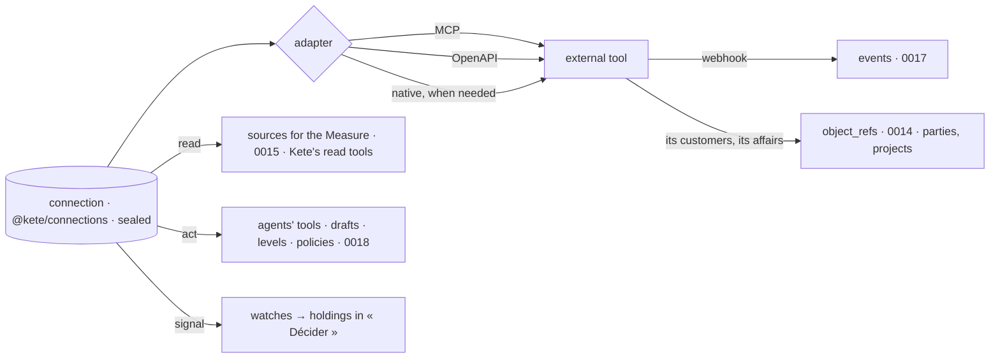

# 0019 — One connection, three uses: read, act, signal

## Context and Problem Statement

D-062 R8: an external tool is connected once and serves to read (boards, Kete), to act (agents, as
drafts) and to signal (« Décider »), read, act and signal being three distinct permissions, act
never granted by default. Today three paths exist, apart:

- **imported tools** (`@kete/tools`, spec 124; Kete Enterprise spec 093): an OpenAPI description or
  a remote MCP server imported as capabilities for agents, with its key sealed;
- **connectors** (Kete Enterprise spec 069): a business tool's MCP server read to put what waits
  for a person in « Décider »;
- **`@kete/connections`** (spec 119): credentials by key or OAuth, sealed, refreshed, revoked,
  journaled — used by no product yet.

An organization's existing system — an ERP, a ticketing tool, a monitoring platform — must also
bring its objects and events (an ERP's customer is the center's party, R13).

## Decision Drivers

- D-062 R8, R13, R16, R17 (« à reconnecter »); principle 4; ADR 0009 (vendors behind ports).
- The public-fetch rules already in place (https only, public addresses, no redirect, bounded).
- One credential store for every product, the Cockpit and Pono (spec 119).

## Considered Options

1. Keep the three paths and share the credential store only.
2. A native connector per vendor.
3. **One connection — `@kete/connections` for its credentials — with protocol adapters (MCP,
   OpenAPI, then native where needed), granted read, act and signal separately, mapping external
   objects and events into the center.**

## Decision Outcome

Chosen option: 3.

- **A connection** is one row of `@kete/connections` (its credential sealed, never shown), with its
  adapter and its **three grants**: `read`, `act`, `signal`. Read is granted at connection; act
  only by an explicit choice, per tool, at a level (D-061: signing and paying come back to a
  person); signal by choosing what to watch.
- **Adapters** turn the external tool into Kete's shapes: read tools become sources (a dataset query
  or a metric) and Kete's read tools; act tools become capabilities with their autonomy, every
  commitment a draft; watches become signal readings. MCP and OpenAPI come from `@kete/tools`; a
  native adapter is written only when a widely used system needs more than both give.
- **Imported tool sets and connectors become two uses of one connection.** Their tables migrate:
  a tool set is a connection with `act` (and `read`), a connector a connection with `signal`.
- **External objects** map to the center (R13): the connection declares which of its types become
  which center types (a customer → a party, an affair → a project, an asset → an asset);
  `object_refs` keeps the pairs; a likely duplicate is a merge proposal a person confirms.
- **External events** arrive through a webhook per connection, checked by its secret, written as
  `event.v1` with their object (0017).
- **Health** is visible (R17): a connection expired or refused says « à reconnecter » where it
  serves; its spend is metered (R18).

### Consequences

- Good, because an organization connects its ERP once and gets figures, agents' tools, « Décider »
  and the ERP's customers as parties, without three setups.
- Good, because act is never accidental: it is granted tool by tool, at a level, under policies.
- Bad, because two existing features migrate their tables (093, 069).
- Bad, because mapping external types needs a person the first time; Kete proposes, a person
  confirms.

### Confirmation

- Tests: a connection with read only never exposes an act tool; act at level 3 returns a draft; a
  webhook replayed acts once; an expired credential shows « à reconnecter » on a board that reads it.

## More Information

Doctrine D-059, D-060 (step C4), D-062. Specs 069, 093, 119, 124. ADR 0009. Related: 0014, 0015,
0017, 0018. Reversed for a system whose API cannot be described by MCP or OpenAPI; it then gets a
native adapter behind the same port.
