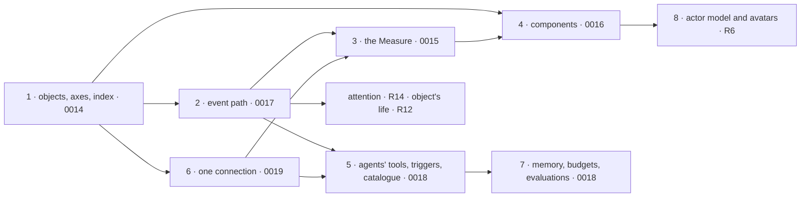

# 0020 — The system map: where each rule of D-062 lives, the smaller architectures, the order of work

## Context and Problem Statement

Doctrine D-062 sets twenty-two rules. Records 0014 to 0019 propose the six architectures that create
the links (objects, the Measure, components, events, agents, connections). The other rules need
smaller pieces, some already in place; the work needs an order, because most pieces depend on the
object index and the event path.

## Decision Drivers

- D-062: R1 and R2 first; then R3, R5, R7 with R11, R8; R12 to R20 are quality guarantees.
- A module enters the core when two consumers need it (phase 9); no extra service.
- Each step starts from its mockup and passes the audit (R10).

## Considered Options

- Build the six architectures in parallel.
- **Build in the order of their dependencies, with the smaller pieces where they belong.**

## Decision Outcome

Chosen option: in the order of dependencies.

### Where each rule lives

| Rule                        | Where                                                                                   | State                              |
| --------------------------- | --------------------------------------------------------------------------------------- | ---------------------------------- |
| R1, R2 objects, axes        | 0014                                                                                    | to build                           |
| R3 declared once            | `manifest.v1` gains `objects`, `views`, `watches`, `agents`; datasets gain `axes`       | to build (additive)                |
| R4 same rights              | rights (structure, projects), policies (`@kete/policies`)                               | in place; extended to the index    |
| R5 agents                   | 0018                                                                                    | to build                           |
| R6 one actor model          | below                                                                                   | to build                           |
| R7 live and proven          | 0015                                                                                    | to build                           |
| R8 one connection           | 0019                                                                                    | to build                           |
| R9 drafts                   | `@kete/drafts`, autonomy levels                                                         | in place                           |
| R10 definition of done      | doctrine checklist; the spec template gains it                                          | to add to the template             |
| R11 events                  | 0017                                                                                    | to build                           |
| R12 an object's life        | below                                                                                   | to build                           |
| R13 one identity            | `object_refs`, merge proposals (0014, 0019)                                             | to build                           |
| R14 attention               | below, a consumer of 0017                                                               | to build                           |
| R15 search and cite         | below                                                                                   | partly in place                    |
| R16 proof                   | `@kete/commands` journal, « Comment ? » (spec 056)                                      | in place; extended to connections  |
| R17 degraded mode           | the components' states (0016), readings' « missing » (0015), connections' health (0019) | to build with them                 |
| R18 visible cost            | `@kete/metering` + budgets (0018)                                                       | partly in place                    |
| R19 the field               | `@kete/design`, the phone (D-054)                                                       | in place; each new screen holds it |
| R20 demonstrates itself     | below                                                                                   | to add to the definition of done   |
| R21 agents prove themselves | 0018                                                                                    | to build                           |
| R22 components              | 0016                                                                                    | to build                           |

### The smaller architectures

- **R6 — One actor model.** One contract, `actor.v1` (`kind`: person, agent, kete, contact; `id`,
  `name`, `avatar`, `provenance`), resolved by the center for any screen; `@kete/design` draws a
  person as a circle, an agent as a rounded square, Kete with its mark, a contact with its channel.
  An agent's default avatar is a glyph and a tint derived from its id.
- **R12 — An object's life.** Each type's states end in `closed` or `archived`; closing cascades as
  data: its thread is put away, agents' subscriptions on it end, its boards freeze a last summary,
  its open holdings are handed back. Retention is a policy per type (the author sets the defaults;
  Kete proposes values); an object exports with its thread, files and proof; erasure follows the
  law and leaves the proof of the erasure.
- **R14 — Attention.** One consumer of the event path decides who is told, on which channel, once:
  the person's level per thread and per object (all, mentions, none), her quiet hours and the
  organization's reserved slots (a policy: « no meeting on Monday morning »), the phone ringing
  only if the computer did not see (D-061).
- **R15 — Search and cite.** The object index (0014) is what « # » and the search read first, with
  the reader's rights; `@kete/knowledge` indexes the documents and summaries already; each object
  keeps « Cité dans » (D-061).
- **R20 — Demonstrates itself.** Each module ships its demo data (the demo's scenario covers its
  objects, sources and agents) and its screenshots beside the mockup (the screens script of Kete
  Enterprise generalises to the core's template).

### The order of work

1. **Objects, axes, the index** (0014) — everything filters and rights through it.
2. **The event path** (0017) — the index is fed by it; nothing is live without it.
3. **The Measure** (0015) — sources with axes, indicators, readings, freezes, the colour's holding.
4. **Components** (0016) — the card and the collection first (they make any type usable), then the
   figure and the board, the form and register, the timeline.
5. **Agents' tools, triggers and catalogue** (0018).
6. **One connection** (0019) — in parallel once 1 is done; it feeds 3 and 5.
7. **Memory, budgets, evaluations** (0018).
8. **The actor model and avatars** (R6), with attention (R14) and an object's life (R12) as their
   consumers land.

Each step: its spec, its mockup (a superset of the last), its code, its tests, its docs and
diagram, its demo data and screenshots, then the audit's line turned « fait ». The audit of every
existing module against R1 to R22 runs alongside step 1 and feeds each step's spec.

### Consequences

- Good, because nothing is built on a missing link: the index and the events come first.
- Bad, because the first visible gain (boards on every app's figures) waits for steps 1 to 3.

### Confirmation

- `docs/ROADMAP.md` takes this order as a phase; each step's PR names the rules it closes.

## More Information

Doctrine D-062 and its journal (2026-10-23). Records 0011 (the core in layers), 0013 (settings in
layers), 0014 to 0019.
