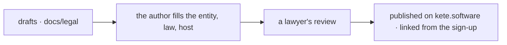

# Legal texts and the customer guide — drafts (phase 11, step E3)

Drafts written on 2026-10-18 on the author's word (« E3 : rédige ce que tu peux »). They are in
**French**, the language of Kete's customers; they will be served by kete.software and linked from
the Compte Kete's sign-up once validated. **None of them is in force.**

| File                           | What it is                                                                      |
| ------------------------------ | ------------------------------------------------------------------------------- |
| `conditions-utilisation.md`    | Terms of use and of service (the contract with an organization)                 |
| `confidentialite.md`           | Privacy policy (what Kete does with personal data, as controller and processor) |
| `accord-traitement-donnees.md` | Data processing agreement (Kete as the organization's processor)                |
| `sous-traitants.md`            | Kete's sub-processors, where each processes data — from the running system      |
| `guide-demarrage.md`           | The customer's getting-started guide: from sign-up to agents                    |

## What waits for the author

Every `[…]` in the texts:

- **The legal entity that sells Kete** (name, form, registered office, registration numbers, contact,
  the person responsible for personal data) — « la structure juridique qui vend Kete ».
- **The governing law and courts** — the drafts propose Togo's law and the courts of Lomé, and
  respect the EU's GDPR for customers there.
- **The host of the application servers** (« l'hébergeur de la zone clients », step E4).
- **Prices and payment terms** (step E6) — the drafts point to the offer chosen in Mon espace.
- **A lawyer's review** before anything is published.

The facts the drafts state (where data is, the sub-processors, the security measures) come from
the system as it runs: keep them true when it changes — a new sub-processor is added to
`sous-traitants.md` before it is used.
