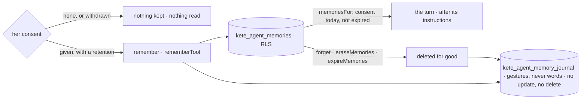
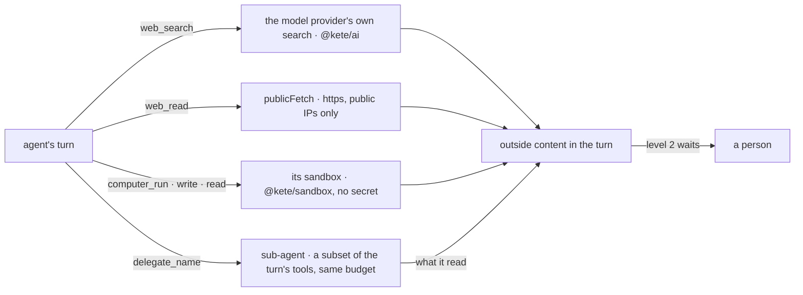

# @kete/agents

A turn of an agent, on a proven runtime — **Mastra** — behind a thin layer (decision 0010). The
loop is the runtime’s: the model, its tools, its steps, its stream, the conversation it remembers.
What makes it a **Kete** agent stays here, and is small:

- its only tools are **the capabilities its caller may use** — so its rights, its mandate, the
  drafts for what commits and the journal come with them (`@kete/capabilities`);
- its usage is **measured**, and a spent budget calls no model (`@kete/ai`);
- a page is told what happens in **four events**, not in the runtime’s own;
- its conversations live in the runtime’s tables **under each organization’s row-level
  security**, on the app’s own pool and role.

No app imports the runtime: this package is the only one that does (a lint rule says so).

```mermaid
flowchart LR
  P[a person asks] --> T[the app builds a turn<br/>instructions · messages]
  R[registry.tools&#40;caller&#41;<br/>the agent acting for her] -->|her capabilities, and nothing else| T
  T --> A{runAgent · streamAgent}
  A -->|budget spent| X[no model is called]
  A --> M[the runtime: the loop<br/>model · tools · steps]
  M -->|a tool is called| C[capability.execute<br/>rights · mandate · journal]
  C -->|reads, or acts within its autonomy| D1[call · done]
  C -->|what commits| D2[call · draft<br/>waits for her]
  M -->|words| E[text]
  A -->|after the turn| U[usage recorded<br/>organization · agent]
  M <-->|the last messages| S[(the runtime’s tables<br/>organization_id · row-level security)]
```



## Use

```ts
// The agent acts for a person: it is offered what she may do, never more.
const caller: Caller = {
  organizationId,
  actor: {
    kind: 'agent',
    id: 'agt_ask',
    channel: 'chat',
    onBehalfOf: { kind: 'person', id: userId },
  },
};
const turn: AgentTurn = {
  agent: 'agt_ask',
  model, // any model of the AI SDK (`@kete/ai` providers)
  instructions,
  messages: [{ role: 'user', content: question }],
  tools: await registry.tools(caller),
  metering: {
    store: budgets,
    context: { organizationId, actor: caller.actor, purpose: 'ask', model: '' },
  },
  // Optional: the conversation is kept, and given back at the next turn.
  conversation: { store: agentConversations({ pool, organizationId }), threadId, personId: userId },
};

// In one piece: for a message, a task, a test.
const { text, calls } = await runAgent(turn);

// As it happens: for a page.
for await (const event of streamAgent(turn)) {
  if (event.type === 'text') write(event.delta);
  if (event.type === 'call' && event.status === 'draft') show(event.draftId); // waits for her
}
```

| Export                           | What it does                                                                                             |
| -------------------------------- | -------------------------------------------------------------------------------------------------------- |
| `runAgent`                       | One turn in one piece: the text, the capabilities called with what became of each, the usage             |
| `streamAgent`                    | The same turn as events: `text`, `call`, then `done` — or `stopped` (`budget_spent`, `failed`), no throw |
| `agentConversationsMigrationSql` | The runtime’s conversation tables, each with its `organization_id` and its policy, for the owner to run  |
| `agentConversations`             | An organization’s conversations: for the runtime, and to `list`, `read` and `erase` a person’s own       |
| `organizationPool`               | A view of the app’s pool where every statement runs inside one organization                              |

### What a call became

| `status`                | What happened                                                                   |
| ----------------------- | ------------------------------------------------------------------------------- |
| `done`                  | It read, or acted within its autonomy                                           |
| `draft`                 | It **prepared** a gesture: `draftId` waits for a person, `view` shows it        |
| `confirmation_required` | Nothing happened: only the product’s own screen confirms this one               |
| `refused`               | Nothing happened: not allowed, unknown, or an input the capability did not take |
| `failed`                | The capability broke                                                            |

## Conversations under row-level security

```ts
// A migration, run by the owner: five tables, each with its organization and its policy.
await owner.query(agentConversationsMigrationSql({ schema, appRole }));

const conversations = agentConversations({ pool, organizationId });
await conversations.list(userId); // her conversations, the latest first
await conversations.read(threadId, userId); // empty when it is not hers
await conversations.erase(threadId, userId); // for good
```

The runtime knows nothing of organizations. It is handed `organizationPool(pool, organizationId)`:
each of its statements runs in a transaction that carries the organization, exactly as
`inOrganization` sets it — local to the transaction, so nothing stays on a connection, whatever
pools them. A row takes the organization of its transaction by default, and cannot be written
outside one.

## Rules

- **An agent never has more rights than the person it acts for.** The tools are
  `registry.tools(caller)`; there is no other way to give it one.
- **Nothing irreversible without a person.** What commits comes back as a `draft`; the agent says
  what it prepared, never that it was done.
- **The runtime’s tables are ours to create.** They are frozen in `src/runtime-tables.ts`; the
  runtime’s own initialisation never runs, so it creates nothing else. A test compares the frozen
  text with what the installed runtime would create: when a raise changes it, the difference is a
  new migration, never an edit of this one.
- **Identifiers are unique across the deployment** in the runtime’s tables: give a thread a
  generated identifier (`newId('thr')`). A person is named `organization/person` there, so that
  someone who belongs to two organizations has two memories.
- **The runtime tells its vendor nothing.** Its usage telemetry is switched off before it loads; a
  deployment that wants it on sets `MASTRA_TELEMETRY_DISABLED=0` itself.
- **Its versions are pinned exactly**, and raised on purpose, with these tests.

## Memory with its governance (spec 090)

What an agent remembers of a person, from one conversation to the next. Hers: nothing is kept
before she agreed, she reads all of it, forgets one thing or erases everything, it expires when she
said, and every gesture on it is written down — without the words remembered.



```ts
await owner.query(agentMemoryMigrationSql({ schema, appRole }));

await setMemoryConsent(db, organizationId, userId, { enabled: true, retentionDays: 365 }, her);
const remembered = await memoriesFor(db, userId); // [] unless she agrees today
await runAgent({
  ...turn,
  remembered,
  tools: [...tools, rememberTool({ organizationId, personId: userId, agent, inOrganization })],
});

// « Forget me »: her memory and her conversations, for good.
await eraseMemories(db, organizationId, userId, her);
await agentConversations({ pool, organizationId }).eraseAll(userId);
```

- What is remembered is given to the model **after** its instructions, as context that never
  outranks them.
- A memory that expired is not read even before the worker deletes it (`expireMemories`).
- 100 memories at most per person; beyond, she forgets something first.

## Outside content (spec 090)

Words nobody of the organization wrote — a message from a stranger, an e-mail, a web page, a
document dropped in — may carry instructions. Once such words are in a turn, a capability that
**acts at once** (level 2) is not run: it answers `confirmation_required`, and waits for a person.
What only prepares (levels 3 and 4) is prepared as always, since a person decides it.

```ts
await runAgent({
  ...turn,
  // The turn starts with outside words, or a tool brings some in.
  outside: { input: heardFromAStranger, tools: ['mail_read', 'web_read', 'documents_read'] },
});
```

## Abilities beyond the product (spec 129)

Doctrine D-060: agents « à niveau » — the web searched and read, a computer of their own,
sub-agents — always under the policies. Each ability is a tool the host gives an agent beside its
capabilities, so the host's policy engine sees it like any other; each brings outside content.



```ts
const tools = [
  ...(await registry.tools(caller)),
  webSearchTool(webSearch(searchingModel(config)!, metering)),
  webReadTool(),
  ...computerTools(sandboxes, {
    get: () => sandboxOf(thread),
    keep: (id) => keepSandbox(thread, id),
  }),
];
await runAgent({
  ...turn,
  tools: ruled(tools), // the host's policies, as for every tool
  outside: { tools: OUTSIDE_ABILITIES },
  subAgents: [
    {
      name: 'researcher',
      description: 'Searches the web and reads pages.',
      instructions: RESEARCHER,
      tools: ['web_search', 'web_read'],
    },
  ],
});
```

- **The web**: `web_search` is the model provider's own search (no service of ours) and sends
  its question outside — its description tells the model never to put anything confidential in
  it. `web_read` reads a page as text over `publicFetch`: https, every resolved IP public, no
  redirection, a bounded answer.
- **A computer**: one sandbox per conversation (`ComputerSession`), created on first use and
  kept; it holds none of the organization's secrets; paths cannot climb out (`..`).
- **Sub-agents**: `delegate_<name>` hands one task to an agent that has only the tools named for
  it among the turn's own — a name the turn does not hold is dropped — the same metering, no
  sub-agent of its own; the outside content it read counts for the turn that delegated.

## Evaluations (spec 090)

Cases played through the very turn of production, each with what must hold, checked by code: the
capabilities called or never called, a gesture prepared rather than done, what the words must say
or never say. A run fails under its threshold — every case by default — and says why.

```ts
const report = await evaluateAgent({
  turn: { agent, model, instructions: SYSTEM, tools },
  cases: [
    {
      name: 'the month, with no advice on price',
      messages: [{ role: 'user', content: 'Combien ce mois-ci ?' }],
      expect: { calls: ['money_month'], says: [/F CFA/], neverSays: [/conseill.*prix/i] },
    },
  ],
});
if (!report.passed) process.exitCode = 1; // in CI, on a real model, before a prompt ships
```

The runtime has its own evaluation runner; it targets its own agent and would bypass this layer
(budgets, the outside-content rule), so the cases run through `runAgent` instead.

## Not here yet

Agents that run for long and wait for a person: Kete Enterprise, step C6. Semantic recall over
past conversations: when an app asks for it, with its own consent. Phone calls with an agent: once
the author has chosen how Kete reaches telephony (decision 0012).
