# @kete/agents

A turn of an agent, on a proven runtime — **Mastra** — behind a thin layer (decision 0010). The
loop is the runtime’s: the model, its tools, its steps, its stream, the conversation it remembers.
What makes it a **Kete** agent stays here, and is small:

- its only tools are **the capabilities its caller may use** — so its rights, its mandate, the
  drafts for what commits and the journal come with them (`@kete/capabilities`);
- its usage is **measured**, and a spent budget calls no model (`@kete/ai`);
- a page is told what happens in **four events**, not in the runtime’s own;
- its conversations live in the runtime’s tables **under each organization’s row-level
  security**, on the app’s own pool and role.

No app imports the runtime: this package is the only one that does (a lint rule says so).

```mermaid
flowchart LR
  P[a person asks] --> T[the app builds a turn<br/>instructions · messages]
  R[registry.tools&#40;caller&#41;<br/>the agent acting for her] -->|her capabilities, and nothing else| T
  T --> A{runAgent · streamAgent}
  A -->|budget spent| X[no model is called]
  A --> M[the runtime: the loop<br/>model · tools · steps]
  M -->|a tool is called| C[capability.execute<br/>rights · mandate · journal]
  C -->|reads, or acts within its autonomy| D1[call · done]
  C -->|what commits| D2[call · draft<br/>waits for her]
  M -->|words| E[text]
  A -->|after the turn| U[usage recorded<br/>organization · agent]
  M <-->|the last messages| S[(the runtime’s tables<br/>organization_id · row-level security)]
```



## Use

```ts
// The agent acts for a person: it is offered what she may do, never more.
const caller: Caller = {
  organizationId,
  actor: {
    kind: 'agent',
    id: 'agt_ask',
    channel: 'chat',
    onBehalfOf: { kind: 'person', id: userId },
  },
};
const turn: AgentTurn = {
  agent: 'agt_ask',
  model, // any model of the AI SDK (`@kete/ai` providers)
  instructions,
  messages: [{ role: 'user', content: question }],
  tools: await registry.tools(caller),
  metering: {
    store: budgets,
    context: { organizationId, actor: caller.actor, purpose: 'ask', model: '' },
  },
  // Optional: the conversation is kept, and given back at the next turn.
  conversation: { store: agentConversations({ pool, organizationId }), threadId, personId: userId },
};

// In one piece: for a message, a task, a test.
const { text, calls } = await runAgent(turn);

// As it happens: for a page.
for await (const event of streamAgent(turn)) {
  if (event.type === 'text') write(event.delta);
  if (event.type === 'call' && event.status === 'draft') show(event.draftId); // waits for her
}
```

| Export                           | What it does                                                                                             |
| -------------------------------- | -------------------------------------------------------------------------------------------------------- |
| `runAgent`                       | One turn in one piece: the text, the capabilities called with what became of each, the usage             |
| `streamAgent`                    | The same turn as events: `text`, `call`, then `done` — or `stopped` (`budget_spent`, `failed`), no throw |
| `agentConversationsMigrationSql` | The runtime’s conversation tables, each with its `organization_id` and its policy, for the owner to run  |
| `agentConversations`             | An organization’s conversations: for the runtime, and to `list`, `read` and `erase` a person’s own       |
| `organizationPool`               | A view of the app’s pool where every statement runs inside one organization                              |

### What a call became

| `status`                | What happened                                                                   |
| ----------------------- | ------------------------------------------------------------------------------- |
| `done`                  | It read, or acted within its autonomy                                           |
| `draft`                 | It **prepared** a gesture: `draftId` waits for a person, `view` shows it        |
| `confirmation_required` | Nothing happened: only the product’s own screen confirms this one               |
| `refused`               | Nothing happened: not allowed, unknown, or an input the capability did not take |
| `failed`                | The capability broke                                                            |

## Conversations under row-level security

```ts
// A migration, run by the owner: five tables, each with its organization and its policy.
await owner.query(agentConversationsMigrationSql({ schema, appRole }));

const conversations = agentConversations({ pool, organizationId });
await conversations.list(userId); // her conversations, the latest first
await conversations.read(threadId, userId); // empty when it is not hers
await conversations.erase(threadId, userId); // for good
```

The runtime knows nothing of organizations. It is handed `organizationPool(pool, organizationId)`:
each of its statements runs in a transaction that carries the organization, exactly as
`inOrganization` sets it — local to the transaction, so nothing stays on a connection, whatever
pools them. A row takes the organization of its transaction by default, and cannot be written
outside one.

## Rules

- **An agent never has more rights than the person it acts for.** The tools are
  `registry.tools(caller)`; there is no other way to give it one.
- **Nothing irreversible without a person.** What commits comes back as a `draft`; the agent says
  what it prepared, never that it was done.
- **The runtime’s tables are ours to create.** They are frozen in `src/runtime-tables.ts`; the
  runtime’s own initialisation never runs, so it creates nothing else. A test compares the frozen
  text with what the installed runtime would create: when a raise changes it, the difference is a
  new migration, never an edit of this one.
- **Identifiers are unique across the deployment** in the runtime’s tables: give a thread a
  generated identifier (`newId('thr')`). A person is named `organization/person` there, so that
  someone who belongs to two organizations has two memories.
- **The runtime tells its vendor nothing.** Its usage telemetry is switched off before it loads; a
  deployment that wants it on sets `MASTRA_TELEMETRY_DISABLED=0` itself.
- **Its versions are pinned exactly**, and raised on purpose, with these tests.

## Not here yet

The governance of memory (consent, retention, erasure with its journal) and evaluations: step B4.
Agents that run for long and wait for a person: Kete Enterprise, step C6.
