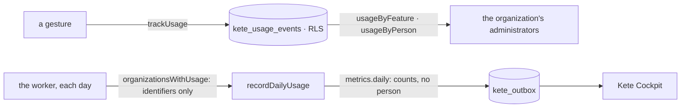

# @kete/analytics

Who uses what, per organization, in the app's own Postgres — no analytics service, no third party
(spec 091). An organization reads its own usage, by feature and by person. Kete Cockpit reads
**counts only**: each day the app records a `metrics.daily` event per organization in its outbox
to Cockpit.



```ts
await owner.query(usageMigrationSql({ schema, appRole }));

await trackUsage(db, organizationId, {
  name: 'deposits.create',
  actor: { kind: 'person', id: userId },
  properties: { pieces: 3 },
});

// The worker, once a day, for each organization that used the app.
for (const organizationId of await organizationsWithUsage(pool, dayPeriod(day))) {
  await inOrganization(pool, organizationId, (db) =>
    recordDailyUsage(db, emitter, organizationId, day),
  );
}
```

## Rules

- **A measure, never a person's words.** An event is `feature.action`, its actor, its surface, and
  ten small facts at most. A value that looks like an e-mail or a phone number is refused, as is a
  text longer than 80 characters.
- **Cockpit sees numbers.** `metrics.daily` carries `usage_events`, `usage_people`, `usage_agents`
  and one `use_<feature>_<action>` counter per feature — no identifier of a person or an agent.
- **Usage is not an archive**: `pruneUsage` forgets what is older than 400 days.
- The application cannot change an event once written.
