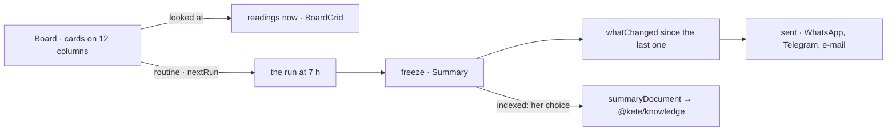

# @kete/boards

One object for a board looked at live, sent by a routine and frozen as a summary (spec 103; doctrine
D-052). Its cards name the apps' declared figures (`@kete/metrics`) — never a query — or carry her
own note; a summary keeps what each said, where it went, whether it reached its goal or passed its
threshold, and her words of the day. Indexed only when she chose so.



## Use

```ts
import { arrange, freeze, nextRun, summaryDocument, whatChanged } from '@kete/boards';

const cards = arrange(board.cards); // inside 12 columns, none over another, none floating
nextRun({ every: 'workday', at: '07:00' }, Date.now()); // next working day, 7 h

const summary = freeze(board, found, { at: new Date(), today: '2026-10-14', note });
whatChanged(lastSummary, summary); // the largest move first, toned by « better »
if (board.indexed)
  await indexDocument(
    db,
    { ...summaryDocument(summary, words), organizationId, sourceId },
    embedder,
  );
```

- **A card proposed by the assistant** is hers to keep or remove: a summary leaves it out.
- **A card whose app does not answer** says so (`missing`); one she may not read says `denied`.
- A summary is never read again: it is what the board said then.
- The grid's editing (drag, resize) stays in Kete Enterprise until a second product needs it; the
  places it writes are those `arrange` keeps.
