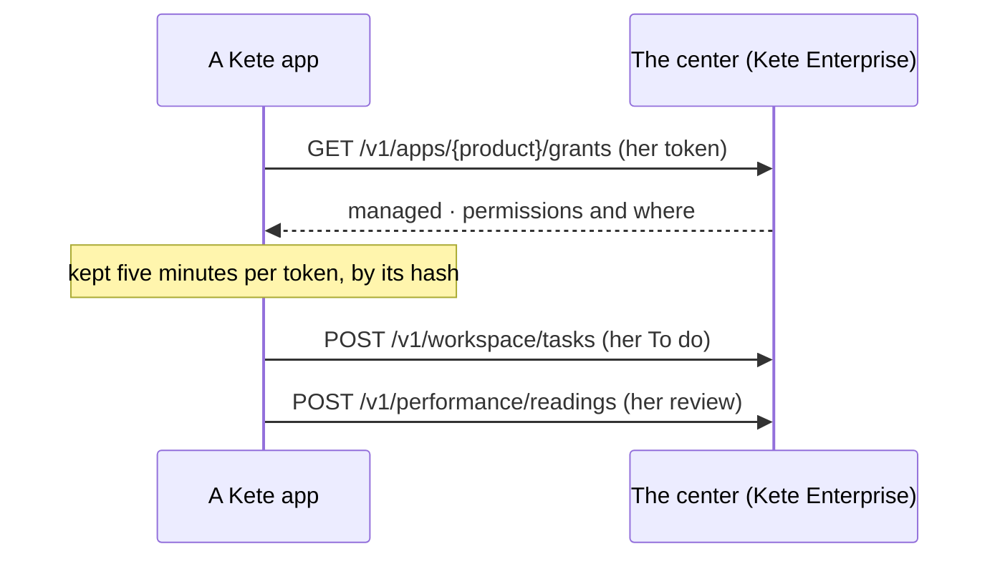

# @kete/center

What a Kete app asks its center — Kete Enterprise — with the **person's token** (kete-core spec
049): the center answers within her rights, never more. Without a center, or when it does not
answer, the app goes on alone: nothing here throws at the app.



```ts
import { createCenter } from '@kete/center';

const center = createCenter({
  url: process.env.ENTERPRISE_API_URL,
  product: 'prd_kete_helpdesk',
  source: 'kete-helpdesk',
});
const grants = await center.grants(token); // null: no center, no token, or no answer
await center.sendTask(token, { key: 'TKT-42', title: 'Rétablir le service', href });
```

## The directory

`center.me(token)` gives the person's positions, units, managers (interim included) and reports;
`center.person(token, userId)` a colleague, `center.unit(token, unitId)` a unit — null whatever she
may not see (Kete Enterprise spec 023).

## Decisions

`center.requestDecision(token, { subject, reference, title, measure })` asks the organization's
circuits, for the person; once decided, the center posts the request's id to the app's
`callbackUrl`, and the app reads the outcome with its own token: `center.decision(appToken,
organizationId, requestId)` (Kete Enterprise spec 023).

A request may carry its `projectId`: a step of the circuit is then decided by the project's lead.
It may come back `returned` — sent back to who asked, `reason` saying what to correct; the app
asks again with the same `subject` and `reference` once corrected, and it is the same request
(Kete Enterprise spec 075).

## Business events

`center.eventsUrl` is where the app delivers its business events, with its own token
(`createAppToken` of `@kete/auth`, scope `kete:center`) through a named outbox of `@kete/sdk`.

- **Grants** feed `createRights` of `@kete/capabilities`: until the organization manages the app's
  rights at the center (`managed: false`), the app keeps its defaults.
- **Never a secret in a cache key**: grants are kept per token's SHA-256, five minutes at most.

## References and money (spec 096)

The center holds the references every app cites — third parties and projects (doctrine D-047) —
and adds up the facts of money the apps say (D-049).

```ts
// A third party: a merged identifier answers with the record that stays.
const party = await center.party(token, invoice.partyId);
if (party && party.partyId !== invoice.partyId) await repoint(invoice, party.partyId);
await center.sayOfParty(token, party.partyId, {
  key: 'F-0412',
  label: 'Facture F-0412',
  state: 'Due',
});

// A project, opened once from this app's own document.
const opened = await center.openProject(token, {
  name: 'Chantier Garage Bè',
  reference: 'D-0081',
  sold: 2_480_000,
  posts: [{ name: 'Matériel', budget: 1_450_000 }],
});

// A fact of money, in the shape of contracts/money-fact.v1.schema.json.
await center.sendMoneyFact(token, {
  key: 'BC-0031',
  kind: 'committed',
  amount: 700_000, // the smallest unit, @kete/money
  currency: 'XOF',
  occurredOn: '2026-10-09',
  label: 'Bon de commande BC-0031',
  projectId: opened.ok ? opened.project.projectId : undefined,
  post: 'Matériel',
});
```

- A fact said again under its key **replaces** itself: keep an invoice at what is still due, a
  commitment at what is still to pay; `dropMoneyFact` takes one back.
- Without a center, reads answer nothing and gestures say `not_connected`: the app goes on.

## Time (spec 102)

What the app says will happen at a time — a leave, a deadline, a task — goes to the center's
Planifier (doctrine D-050), in the shape of `contracts/dated-fact.v1.schema.json`.

```ts
await center.sendDatedFact(token, {
  key: 'leave-kossi',
  kind: 'absence', // never its reason
  label: 'Congé',
  day: '2026-10-15',
  until: '2026-10-16',
  personIds: ['usr_kossi'],
});
await center.dropDatedFact(token, 'leave-kossi'); // it will not happen
```

- Exactly one of `day` and `startsAt`; a fact said again under its key replaces itself.
- What clashes and what is free is computed by `@kete/time`, never guessed.
