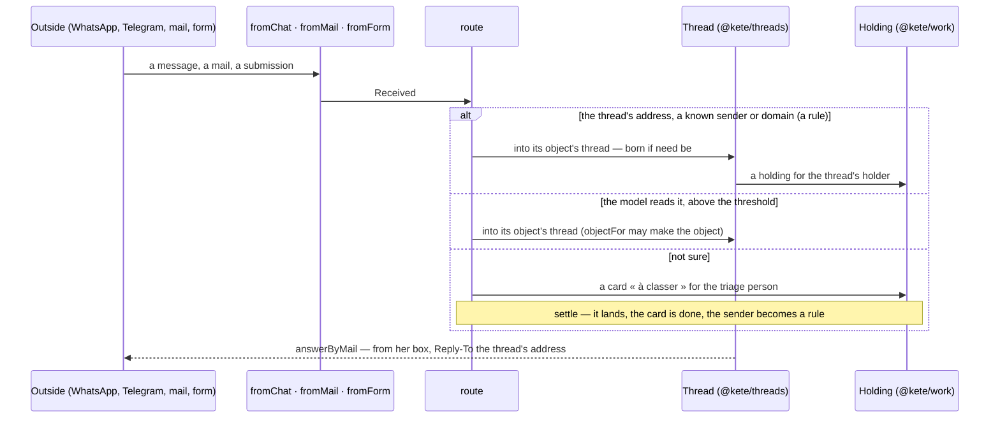

# @kete/channels

What the outside says, and where it belongs (spec 113; doctrine D-056; decision 0012). A WhatsApp
or Telegram message (as `@kete/notify` proved it), a mail read by IMAP, a form's submission: each
is received once, then the **router** ties it to its object's thread (`@kete/threads`) with a
holder (`@kete/work`) — never guessed. Answers written in a thread leave by mail from the person's
own box, with the thread's address for replies, so the answer comes back into the thread.



## Use

```ts
import { fromChat, imapMailbox, readMailbox, route, settle, smtpSender } from '@kete/channels';

const options = {
  triage: { kind: 'person', id: 'usr_abla' }, // who settles what nobody could place
  read: (received) => readIntent(received), // the model, behind @kete/ai; optional
  threshold: 0.8,
  objectFor: async (received, reading) =>
    reading.intent === 'quote_request' ? newProject() : null,
  threadFor: async (object) => ({ title: titleOf(object), holder: holderOf(object) }),
};

await route(tx, organizationId, fromChat(heard.message), options); // a WhatsApp message
await readMailbox(tx, organizationId, { key: 'usr_abla', mailbox: imapMailbox(account) }, options);
await settle(tx, organizationId, { via, ref, object, intent: 'incident', by: abla }, options);
```

## What it does

| Piece                                         | What it does                                                                                                                                                                                                                  |
| --------------------------------------------- | ----------------------------------------------------------------------------------------------------------------------------------------------------------------------------------------------------------------------------- |
| `fromChat`, `fromMail`, `fromForm`            | What was received, the same whatever the channel: its reference there, its sender's key (`whatsapp:228…`, `mail:abla@kya.tg`), its recipients, its words, its files.                                                          |
| `route`                                       | Once per reference: a thread's address, then a rule (a sender, then a mail domain, then a contact the product knows — `known`), then the model above the threshold; otherwise a card « à classer ». Journaled (`routing.v1`). |
| `settle`, `addRoutingRule`                    | A person places a card: it lands in its thread, the card is done, the sender is a rule from now on. An administrator writes a rule for a sender or a domain (`domain:kya.tg`).                                                |
| `readMailbox`, `imapMailbox`, `memoryMailbox` | A person's mailbox read by IMAP (ImapFlow) from where it stopped; each mail routed. In memory for tests and the demo.                                                                                                         |
| `answerByMail`, `smtpSender`, `memorySender`  | A thread's message sent by SMTP (Nodemailer) from her own box to the thread's mail contacts, Reply-To its address, answering the last mail; kept in her Sent folder.                                                          |

## Guarantees

- **Never guessed.** Under the threshold, a person decides; what she decides is learned.
- **Received once.** A provider delivering twice is routed once; the journal is append-only.
- **Secrets stay out.** A mailbox password is given to `imapMailbox` and `smtpSender` by the
  product, which seals it; nothing here writes it.
- **Its own organization only.** `channelsMigrationSql` creates the rules, the journal and the
  mailboxes' cursors with their RLS policy in the same migration (constitution V).

Not here yet: cards with buttons on WhatsApp and Telegram, settled anywhere (FR-006, with the
products' screens); asking the right person in one line when information is missing.
