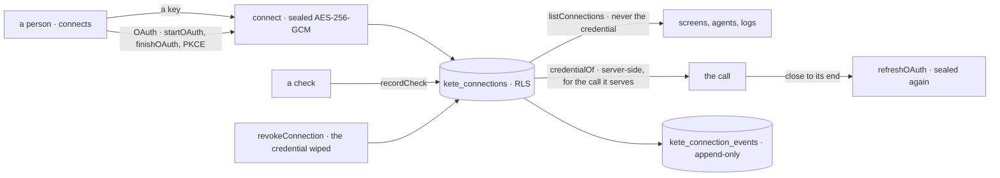
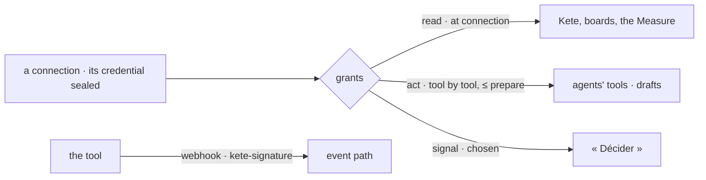

# @kete/connections

The tools an organization connects to a Kete product — its accounting by a key, its mailbox by
OAuth — with their credentials sealed and never shown, their health, their refresh and their
revocation journaled (spec 119; doctrine D-059; phase 11, step B1). Every product, the Cockpit
and Pono share it: a connection is never rebuilt app by app.



```ts
import {
  connect,
  createSealer,
  credentialOf,
  finishOAuth,
  refreshOAuth,
  startOAuth,
} from '@kete/connections';

const sealer = createSealer(process.env.KETE_SECRETS_KEY); // 32 bytes in base64

// A key: sealed at once.
await connect(tx, organizationId, sealer, {
  tool: 'accounting',
  label: 'La comptabilité',
  key,
  by,
});

// OAuth: send her to grant, keep the state and the verifier in her session, then her return.
const { url, state, codeVerifier } = await startOAuth(provider, redirectUri);
const tokens = await finishOAuth(provider, { callbackUrl, redirectUri, state, codeVerifier });
await connect(tx, organizationId, sealer, { tool: 'mailbox', label: 'L’accueil', tokens, by });

// The call: opened server-side, refreshed when close to its end.
const credential = await credentialOf(tx, organizationId, sealer, connectionId, {
  refresh: (token) => refreshOAuth(provider, token),
});
```

## Guarantees

- **Never shown.** A reading (`listConnections`) carries no credential; `credentialOf` opens one
  server-side for the call it serves. A capability never returns it: an agent uses a connection,
  it never sees its secret.
- **Sealed at rest** with AES-256-GCM under the product's key; another product's key opens nothing.
- **Its own organization only**: `kete_connections` and its journal carry their RLS policy in the
  same migration; the journal is never changed nor deleted.
- **No vendor here**: a provider's addresses come from the product's infrastructure layer.
- **Revoked for good**: the credential is wiped, the connection stays in the journal.

## One connection, three uses (spec 147)

Doctrine D-062 (R8) and ADR 0019: a tool connected once serves to **read** (Kete, the boards), to
**act** (agents' tools, as drafts) and to **signal** (what waits, into « Décider »). Three grants,
kept apart: read is given at connection (`defaultGrants`); act only tool by tool, at a level, never
above « prepare » — paying and signing come back to a person; signal by choosing what to watch.
`allows(grants, use, tool)` answers whether, and at which level; `grantsOf` reads kept grants, and
what it does not understand grants nothing. An external tool's events arrive by a webhook signed
with the connection's own secret (`newWebhookSecret`, `signWebhook`, `verifyWebhook` — HMAC-SHA256
of the exact body, compared in constant time).


