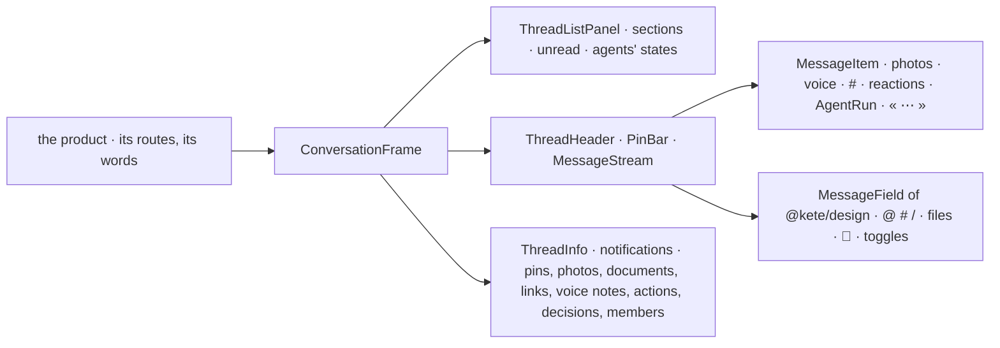

# @kete/conversation

The threads' screen any Kete product shows (spec 140, FR-019; doctrine D-061), built against the
canvas v6.2 (`docs/brief-ui/canevas-v6.2.html`).

It gives:

- **the list**, with the agents' states at a glance;
- **the conversation**: photos, voice notes with their transcripts, citations « # », reactions,
  an agent's work in folded steps, Kete's answer « seulement pour vous », typing;
- **« Infos du fil »**.

The product feeds it with what its center answers (`@kete/threads`' shapes) and gives every word.
No component has a coloured left border.



## Use

```tsx
import {
  ConversationFrame,
  MessageItem,
  MessageStream,
  ThreadHeader,
  ThreadInfo,
  ThreadListPanel,
} from '@kete/conversation';
import { FieldToggle, MessageField } from '@kete/design';

<ConversationFrame
  words={words}
  list={<ThreadListPanel words={words} sections={sections} current={id} hidden={Boolean(id)} />}
  aside={infos ? <ThreadInfo words={words} media={media} … /> : <TheProductsState />}
  asideShown={infos}
  onAsideClose={() => setInfos(false)}
>
  <section>
    <ThreadHeader words={words} title={thread.title} onTitle={() => setInfos(true)} />
    <MessageStream
      words={words}
      label={…}
      messages={messages}
      unreadFrom={firstUnread}
      typing={names}
      renderMessage={(message) => <MessageItem message={message} words={words} … />}
    />
    <MessageField words={fieldWords} triggers={['@', '#']} toggles={…} onSend={…} />
  </section>
</ConversationFrame>;
```

## What it does

| Piece                    | What it shows                                                                                                                                                                                                                                                                                                                                                                                                                 |
| ------------------------ | ----------------------------------------------------------------------------------------------------------------------------------------------------------------------------------------------------------------------------------------------------------------------------------------------------------------------------------------------------------------------------------------------------------------------------- |
| `ConversationFrame`      | The list, the conversation, its state or « Infos du fil ». On a narrower screen the state opens over the thread; on a phone the list and the thread take turns.                                                                                                                                                                                                                                                               |
| `ThreadListPanel`        | Sections of threads. Unread ones in bold with their count; « Rien n'attend » when nothing waits; an agent's state (needs her, works, has finished, idle).                                                                                                                                                                                                                                                                     |
| `ThreadHeader`, `PinBar` | The title, which opens « Infos du fil »; who holds the thread; its gestures; its pinned messages.                                                                                                                                                                                                                                                                                                                             |
| `MessageStream`          | Days between messages, « Nouveaux messages » where she stopped, who is writing, ↓ to the newest with how many arrived, the older pages. It follows the newest when she is at the bottom, and opens at the message a link names.                                                                                                                                                                                               |
| `MessageItem`            | A message: its author, time and channel, the message it answers, its words (Markdown for an agent, mentions and citations standing out), photos, voice notes, files, a link's preview, the turn that wrote it, the product's own blocks, reactions, who read it. On hover: three emojis, « Répondre », « Pour action », « ⋯ ». A message taken back says only that it was. One only for her says why, and offers to share it. |
| `AgentRun`               | A turn of Kete or an agent: its plan in steps with their level, open while it works and folded once finished, with « Arrêter ».                                                                                                                                                                                                                                                                                               |
| `ThreadInfo`             | Search in the thread, her notification level, then pins, photos and videos, documents and their versions, links, voice notes, and the product's actions, decisions and members.                                                                                                                                                                                                                                               |

The composer is `MessageField` of `@kete/design`, the same as Kete Intelligence's.

## Guarantees

- **No word written here.** Every word, date and hour comes through `ConversationWords`, in the
  product's language.
- **Shapes of the center.** `ShownMessage` is `@kete/threads`' `Shown`: a product passes its
  answers through. The package keeps no data and calls no route.
- **The canvas v6.2's rules.** A message taken back hides its words. A message only for one person
  says so, and why. No component has a coloured left border.
