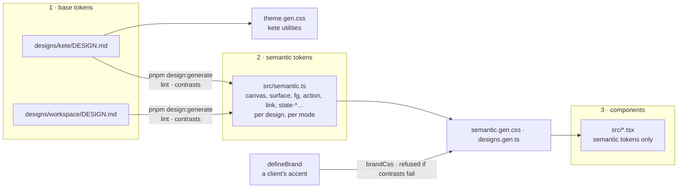
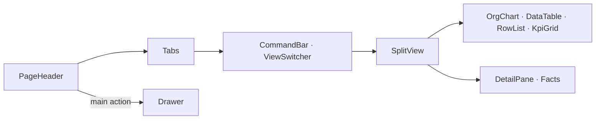
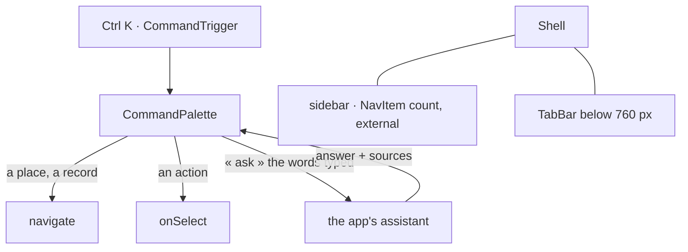
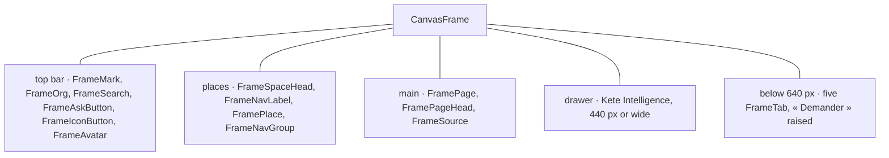

# @kete/design

Two designs, in three layers, and the brand of each client (doctrine D-035):

- **`kete`** — v1 rectangle, warm rigor: the Kete site, the Compte Kete, Mon espace Kete and the
  Kete Apps. [`designs/kete/DESIGN.md`](designs/kete/DESIGN.md).
- **`workspace`** — Kete Enterprise: the system of the `copilot-demo` workspace the author chose,
  reproduced value for value — dark first (#282828, #242424, lines #494949, text #DEDEDE), a 262 px
  sidebar, 34 px items, 5 px corners, 24 px pills, Segoe UI at 14 px, the client's green to guide
  and its orange for the focus. [`designs/workspace/DESIGN.md`](designs/workspace/DESIGN.md).

## Three layers



1. **Base tokens**: each design's `DESIGN.md`, in the
   [DESIGN.md format](https://github.com/google-labs-code/design.md), linted with **no error and no
   warning** (the linter also checks the contrasts of the components it declares), exported as W3C
   Design Tokens (`tokens.gen.json`). The `kete` design's are also the Tailwind utilities its apps
   use (`theme.gen.css`: `bg-sand`, `text-ink`…).
2. **Semantic tokens**: what a color is _for_ — surfaces (`canvas`, `surface`, `surface-raised`,
   `surface-hover`, `surface-selected`, `surface-control`), text (`fg`, `fg-soft`, `fg-muted`),
   lines (`line`, `line-strong`, `line-control`, `line-selected`, `line-overlay`), `accent`,
   `action`, `action-strong`, `on-action`, `link`, `focus`, `agent`, `notice`, and
   `state-{success,verify,error,info}` with `-fg` and `-surface` — plus the fonts (`font-ui`,
   `font-heading`), the corners (`rounded-control`, `-box`, `-pill`, `-menu`, `-overlay`), the
   control height and padding, the icon-button size and the focus offset. `src/semantic.ts` maps
   them onto each design's base tokens, for the light and the dark mode, gives each design its
   default mode, and lists the **contrast pairs** every design meets (WCAG 2.2: 4.5:1 for text, 3:1
   for the accent and the focus).
3. **Components** use semantic tokens only — a test fails on any base color — so the same code
   wears both designs, both modes and a client's brand.

`pnpm design:check` (part of `pnpm check`, in CI) fails on a lint warning, a missed contrast, or a
generated file out of date. Never edit a `*.gen.*` file by hand.

## Page slots and chat (spec 040)

An enterprise page is made of fixed slots, so that whatever is added opens an interface of the
same shape in the same places: `PageHeader` (breadcrumb, title, status, one main action), `Tabs`
(an object's facets), `CommandBar` with `ViewSwitcher` (the view's formats, in the address),
`SplitView` (the content beside its `DetailPane` and `Facts`), and the contents `DataTable`,
`RowList`, `KpiGrid`/`KpiTile` and `OrgChart`. A short form opens in a `Drawer`. The chat kit —
`ChatThread`, `ChatMessage`, `ToolCard`, `Markdown`, `Suggestions`, `Composer`, `CopyButton` —
meets what people expect from an assistant. See [spec 040](../../specs/040-page-slots/spec.md).



## Forms and modes (spec 044)

**A form never shares its page with a list.** A short form (six fields at most) opens in a
`Drawer`: on the right above 1100 px, centered below. A longer one has its own `FormPage`, made of
`FormSection`s, its buttons pinned at the bottom. A person chooses dark, light or automatic with
`ThemeChoice`; `themeFromCookies` lets the server render the chosen mode at once. See
[spec 044](../../specs/044-forms-and-modes/spec.md).

**« Plein soleil »** (spec 106): with `data-sun="on"` on <html> — `useSunlight` of `@kete/shell` sets
it — every design wears its light mode at its strongest, for a screen read outdoors: surfaces in
the surface's color, texts and lines in the text's. The generator derives it from the light mode
of each design, apps' own designs included, and checks its contrasts too.

## Use in an app (Tailwind 4)

```css
@import 'tailwindcss';
@import '@kete/design/styles.css';
@source '../node_modules/@kete/design/src';
```

The page chooses its design and mode on `<html>`:

```html
<html data-design="workspace" data-theme="auto" data-brand="atelier-bleu"></html>
```

`data-design`: `kete` (default) or `workspace`. `data-theme`: `light` or `dark` (or `night`), or
`auto` (the device's); without it, each design's default mode — light for `kete`, dark for
`workspace`. `data-brand`: a client's brand, on `workspace`.

`examples/design-preview` shows both designs and a brand, in both modes, one page at a time.

## Components

| Component                                           | For                                                                                                                                                      |
| --------------------------------------------------- | -------------------------------------------------------------------------------------------------------------------------------------------------------- |
| `Button`, `IconButton`, `TextField`, `Tag`, `Panel` | Controls; a field filled by an agent and uncertain says where it comes from                                                                              |
| `Dialog`                                            | A modal dialog with its named close button; Escape and a click outside close it                                                                          |
| `VerificationCard`                                  | A draft prepared by the agent, each field with its provenance, and the decision's trace                                                                  |
| `AgentState`                                        | Prepared (empty square), corrected, verified, refused (filled: a person decided)                                                                         |
| `ConfirmDialog`                                     | The confirmation of an irreversible gesture (autonomy level 4)                                                                                           |
| `UndoNotice`                                        | What an agent did reversibly, with « Annuler » (level 2)                                                                                                 |
| `EmptyState`                                        | An empty page: what will be here, the gesture that fills it                                                                                              |
| `Shell`, `NavSection`, `NavItem`, `Icon`            | The workspace frame: collapsible sidebar, toolbar, line icons                                                                                            |
| `CountBadge`, `TabBar`, `TabBarItem`                | What waits, as a count; the phone's bar of tabs, its raised « ask » in the middle                                                                        |
| `CommandTrigger`, `CommandPalette`                  | Ctrl K: one field to search, ask and act (cmdk), the answer under it with its sources                                                                    |
| `PageTitle`, `PageSection`, `AppGrid`, `AppCard`    | The page: its title, sections, the company's apps (featured, row, list)                                                                                  |
| `Chip`, `ChipGroup`, `Menu`, `SearchField`          | Filters by category, menus, the search field                                                                                                             |
| `Swatches`                                          | The client's colors, at the bottom of the sidebar                                                                                                        |
| `KeteMark`, `KeteBand`                              | The marks of the `kete` design, in Kete's own palette                                                                                                    |
| `DecisionCard`                                      | A decision waiting for a person: its amount, who asks, its evidence, what it changes, its gestures and « Comment ? » (spec 100)                          |
| `Mention`                                           | An object named anywhere, with its card on hover and the color of its app (spec 100)                                                                     |
| `AgentRunState`                                     | An agent's six states — asleep, working, waiting, blocked, paused, stopped — the same marks everywhere (D-045)                                           |
| `KpiTile` with `why`                                | A figure with « Pourquoi ? » under it (D-045, rule 4)                                                                                                    |
| `KpiTile` with `trend`                              | Where a figure went since the period before, toned by whether that is good news (spec 103)                                                               |
| `BoardGrid`                                         | A board's cards on twelve columns, one under the other on a phone, a proposal dashed (spec 103)                                                          |
| `SummaryCard`                                       | A board frozen at a moment: what changed, each figure, her words, its gestures (spec 103)                                                                |
| `AgentCard`                                         | An agent as a job description: mission, what it reads and never does, what wakes it, its budget, state, gestures and their levels, its proofs (spec 105) |
| `LessonCard`, `TierLadder`                          | A lesson waiting for its owner; the tiers a skill, an agent or an app climbs (spec 105)                                                                  |
| `ProposalList`                                      | What an agent proposes: ticked or not, its level, applied together, undone together (spec 104)                                                           |
| `VoiceCapture`                                      | What she says, recorded in her browser for the app's dictation port; nothing before she presses (spec 104)                                               |
| `WeekCalendar`, `AgendaList`                        | A week hour by hour — whole days on top, a proposal dashed, a clash marked, now — read as a list on a phone (spec 102)                                   |
| `TeamLanes`                                         | Who is there and who is away, day by day, by unit: an absence hatched, never its reason (spec 102)                                                       |

Every visible string comes from the app's translation catalogs, through props. The frame that
assembles these parts from an app's manifest is `@kete/shell`.

### The shell of Kete 2026



`Shell` stays the frame of Compte Kete (spec 046). Every signed-in screen of the center and the apps
wears **`CanvasFrame`**, the validated canvas v3.1 (spec 108), assembled by `@kete/shell`:



- Below 1000 px the places and the drawer slide over the page; below 640 px the tabs appear and the
  search, « Demander » and the organization leave the top bar.
- `CanvasIcon` draws the canvas's own icons (`canvasIconShapes`, generated from the canvas).
- `FramePage` measures the page from the frame's width (container queries on `main`), not the
  window's.
- `VerificationCard` is the canvas's card: a raised head, each field with its provenance, the
  uncertain ones in the verify color, the gestures in its foot, the lesson a correction becomes.

## A client's brand

```ts
import { brandCss, defineBrand } from '@kete/design';

const brand = defineBrand({
  id: 'atelier-bleu',
  name: 'Atelier Bleu',
  logo: { light: '/brand/logo.svg' },
  accent: '#3B82F6', // guides: hover lines, the search field, notifications
  action: '#1D4ED8', // the primary button
  palette: [{ value: '#3B82F6', name: 'Bleu' }],
});
// <style>{brandCss(brand)}</style> and <html data-design="workspace" data-brand="atelier-bleu">
```

Its colors replace the workspace's accent and primary action (and its focus, if given) in both
modes; the text on the action is chosen to read. A palette that misses a contrast against the
workspace's surfaces is **refused** (`BrandContrastError`, with each failing pair and its ratio) —
the client gives a darker action, or other colors for light mode (`light`).

## Rules that matter most

- In `kete`, laterite is the brand and stays rare; in `workspace`, the accent guides and nothing
  else of a client's brand appears but its logo and its charter.
- In `workspace`, white text never sits on the light green (3.2:1): the primary button uses the
  darker green, #177969.
- **Errors are wine**, with a square marker and a word — never the accent.
- Numbers in JetBrains Mono, tabular, aligned right.
- Fonts are self-hosted and free (Archivo, Instrument Sans, Inter, JetBrains Mono). `workspace`
  names Segoe UI first, used where the system provides it, and is never shipped (its file is
  licensed); elsewhere, Inter.
- `workspace` reproduces the demo's system, never another product's name, logo or app icons.
