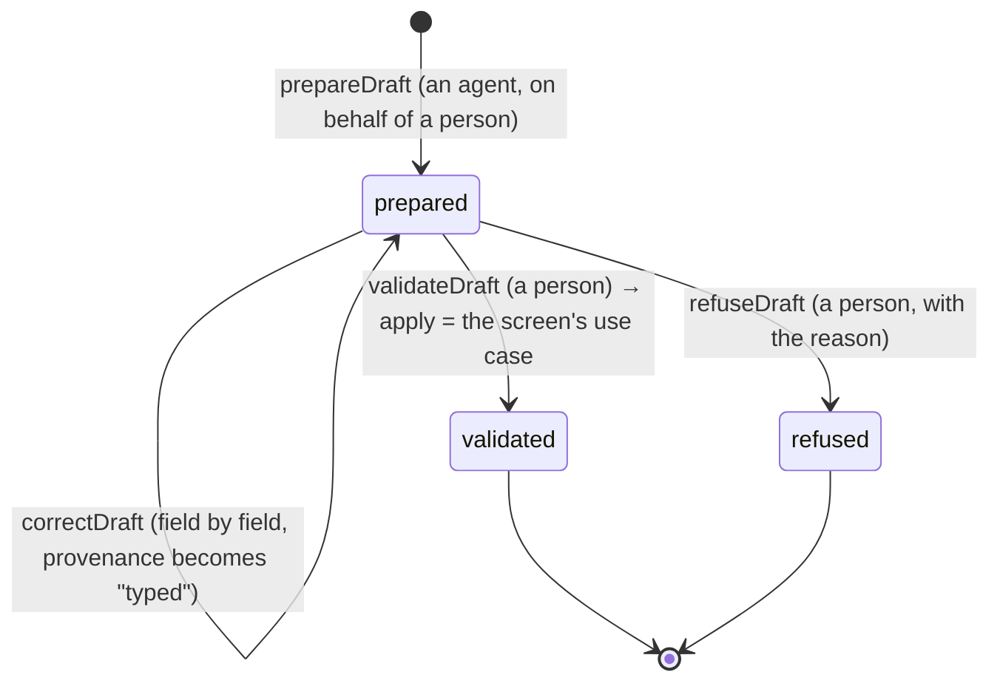
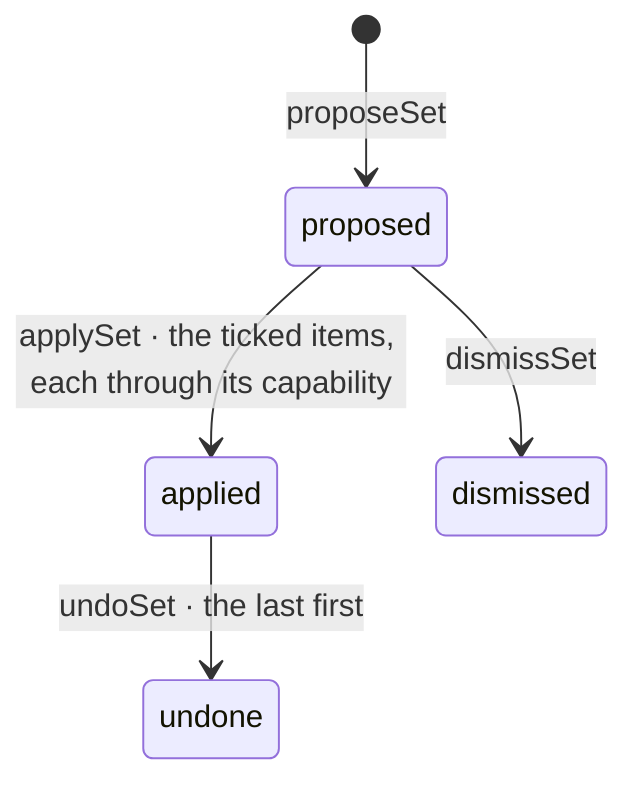

# @kete/drafts

**The AI prepares, a person decides** (doctrine). An agent — through MCP, WhatsApp, a photo, a voice
note — prepares a **draft**: a record not created yet, or a **change proposed** to an existing one.
It has no effect until a person validates it; each field says **where it came from**; the decision
is **traced**; what the person corrected becomes **learning material** (CONCEPTION A.2, A.3, 10).



## Use

```ts
const draft = await prepareDraft(tx, {
  organizationId,
  actor: { kind: 'agent', id: 'agt_firmo', channel: 'whatsapp', onBehalfOf: kofi },
  recordType: 'quote',
  definition: quote, // @kete/records: values checked against the schema (a draft may be incomplete)
  values: { client: 'Ama', total: { amount: 50000, currency: 'XOF' } },
  provenance: {
    client: {
      source: 'voice',
      by: agent,
      certainty: 'medium',
      evidence: fileId,
      quote: 'pour Ama',
    },
  },
});

// The verification link opens the draft; the person corrects, then validates:
await validateDraft(tx, {
  draftId: draft.draftId,
  actor: kofi, // a person, or `human_required`
  definition: quote, // now a complete record
  apply: (values) => executeCommand(tx, createQuote, {/* the same use case as the screen */}),
});
```

## Guarantees

- **No effect before validation.** A draft lives in `kete_drafts`, never in the record's table.
- **Only a person decides.** `validateDraft` and `refuseDraft` refuse an agent, a service or an app.
- **The same use case as the screen.** Validation runs `apply` in the same transaction; if it fails,
  the draft stays waiting.
- **Frozen once decided, by the database.** A restrictive RLS policy lets the application role
  update only drafts still waiting; a validated or refused draft cannot be changed.
- **Provenance per field**: `typed`, `system`, `message`, `photo`, `voice`, `document`, `inferred`,
  `import`, with who, how sure, and the evidence.
- **Corrections kept**: field by field, what was prepared and what was validated.
- `draftsMigrationSql` creates the table with its policies (constitution V).

## Proposal sets (spec 104)

Several things an agent proposes at once — the evening's tidying, a week's plan, what a document
said — each ticked or not by the person, **applied together by one gesture and undone together**
(contract `proposal-set.v1`; doctrine D-051).



```ts
const { set } = await proposeSet(tx, organizationId, { origin: 'closure', for: 'usr_afi', items });
await applySet(tx, set.id, {
  by: afi, // a person, or human_required
  ticked: ['close-tsk_1', 'postpone-tsk_2'],
  apply: (item) => perform(item.capability, item.input), // { ok, result } or { ok: false, reason }
});
await undoSet(tx, set.id, { by: afi, undo: (item, result) => reverse(item, result) });
```

- **A level 4 item is never applied in a batch**: it says `needs_confirmation` and asks its own.
- A failure does not stop the others; each item says what became of it.
- Frozen once dismissed or undone, by the database; `proposalSetsMigrationSql` creates the table
  with its policies (constitution V).

## A draft anyone can read (spec 139)

```ts
import { describeDraft } from '@kete/drafts';

const fields = describeDraft(review, {
  locale: 'fr',
  label: (path, title) => words[path], // `lines.total` for a field inside another
  name: (id) => names.get(id), // prj_…, pty_… by their names
  words: { yes: 'Oui', no: 'Non' },
});
```

Each field with its label (the product's words, else the schema's title, else the key), its value
as people read it — money with its currency (`76 110 F CFA`), dates in their language, a reference
by its name, lines one per line —, where it came from and whether the agent was unsure.
