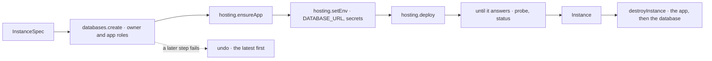

# @kete/infrastructure

The provisioning port and its adapters (spec 121; doctrine D-059; kete-core decision 0009; phase
11, step B1): a Kete instance — its database, its hosted app, its environment, its deployment —
created and destroyed through the port alone. A step that fails undoes what the earlier ones made,
so nothing is left half-built and billed. The factory, the Cockpit's fleet and Pono share it.



```ts
import { coolify, destroyInstance, neon, provisionInstance } from '@kete/infrastructure';

const ports = {
  databases: neon({ apiKey, projectId, branch: 'main' }),
  hosting: coolify({ url, token, projectId, serverId, environment: 'production', githubAppId }),
  probe: async (url: string) => (await fetch(`${url}/health`)).ok,
};
const instance = await provisionInstance(
  ports,
  {
    name: 'kya-enterprise',
    repository: 'kete-africa/kete-enterprise',
    domain: 'kya.kete.software',
    description: 'Kete Enterprise de KYA',
    env: { KETE_ACCOUNT_URL: 'https://compte.kete.software' },
    buildEnv: { NODE_AUTH_TOKEN: packagesToken },
  },
  { onStep: (step, state) => fleet.say(step, state) },
);
await destroyInstance(ports, instance);
```

| Piece                                  | What it does                                                                                                           |
| -------------------------------------- | ---------------------------------------------------------------------------------------------------------------------- |
| `Databases`, `Hosting`                 | The port: a database with its owner and application roles; an app, its environment, its deployment, its state.         |
| `provisionInstance`, `destroyInstance` | The instance step by step, said as it goes; undone the latest first when a step fails, what could not be undone named. |
| `neon`, `coolify`                      | The adapters: the only place a vendor is named. Twice is harmless; so is destroying what is gone.                      |
| `memoryInfrastructure`                 | The port in memory: tests, demos, previews without a provider.                                                         |

Backups and their restoration come with the Cockpit's fleet (step B2).
