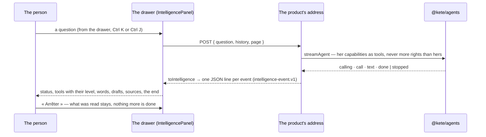

# @kete/intelligence

Kete Intelligence, the same in the center and in every app (spec 101; doctrine D-045, D-051): a
turn of the agents' runtime streamed as the contract `intelligence-event.v1`, and the drawer that
shows it as people expect it in 2026 — what the assistant is doing now, its plan, each capability it
calls with its autonomy level, the answer as it is written, a draft to verify in place, its sources,
and « Arrêter ».



## The server half — `@kete/intelligence/server`

```ts
import { intelligenceResponse, refused, toIntelligence } from '@kete/intelligence/server';

const tools = (await registry.tools(caller)).filter((tool) => tool.autonomy === 1);
const events = streamAgent({ agent: 'agt_ask', model, instructions, tools, messages });
return intelligenceResponse(
  toIntelligence(events, { tools, draftHref: (id) => `/verification/${id}` }),
);
// No model: return intelligenceResponse(refused('not_connected'));
```

No word is written on the server: a reason travels as a code (`not_connected`, `budget_spent`,
`failed`, `confirmation_required`), and the screen words it.

## The screen half — `@kete/intelligence`

```tsx
const { turns, running, send, stop } = useIntelligence(postTo('/api/intelligence', { page }));

<IntelligencePanel
  turns={turns}
  running={running}
  onSend={send}
  onStop={stop}
  words={words} // from the product's catalogs
  context="Devis D-2026-0004"
  suggestions={['Quelles factures relancer ?']}
  toolLabel={(name) => toolWords[name] ?? name}
/>;
```

It goes in `@kete/shell`'s drawer (`AppFrame` `beside`); one question at a time, the next waits.
