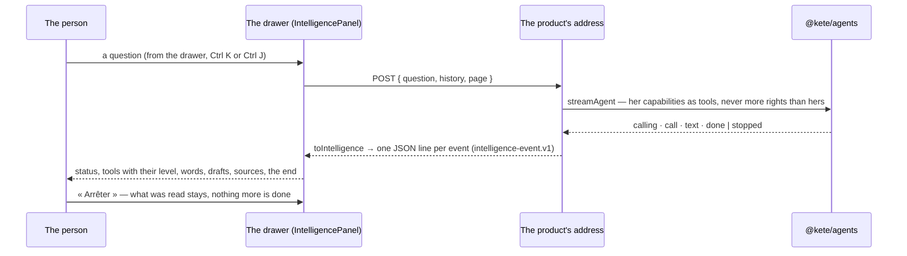

# @kete/intelligence

Kete Intelligence, the same in the center and in every app (spec 101; doctrine D-045, D-051): a
turn of the agents' runtime streamed as the contract `intelligence-event.v1`, and the drawer that
shows it as people expect it in 2026 — what the assistant is doing now, its plan, each capability it
calls with its autonomy level, the answer as it is written, a draft to verify in place, its sources,
and « Arrêter ».



## The server half — `@kete/intelligence/server`

```ts
import { intelligenceResponse, refused, toIntelligence } from '@kete/intelligence/server';

const tools = (await registry.tools(caller)).filter((tool) => tool.autonomy === 1);
const events = streamAgent({ agent: 'agt_ask', model, instructions, tools, messages });
return intelligenceResponse(
  toIntelligence(events, { tools, draftHref: (id) => `/verification/${id}` }),
);
// No model: return intelligenceResponse(refused('not_connected'));
```

No word is written on the server: a reason travels as a code (`not_connected`, `budget_spent`,
`failed`, `confirmation_required`), and the screen words it.

## The screen half — `@kete/intelligence`

```tsx
const { turns, running, send, stop } = useIntelligence(postTo('/api/intelligence', { page }));
// A thread opened again: useIntelligence(transport, turnsAlreadyAnswered)

<IntelligencePanel
  turns={turns}
  running={running}
  onSend={send}
  onStop={stop}
  words={words} // from the product's catalogs
  head={{ tab, onTab, onHistory, onNew, wide, onWide, onClose }} // in the drawer only
  files={<Files />}
  context={{ label: 'Kete Finance', onRemove }}
  scope={{ value, label, options: [{ value: 'kete', label: 'Dans tout Kete' }, …], onChange }}
  intro={<p>Bonjour Afi…</p>}
  suggestions={['Quelles factures relancer ?']}
  renderDraft={(draft) => <VerificationCard … />}
  renderAfter={(turn, index) => <Extras … />} // what the product adds after the words
  onRetry={(turn) => send(turn.question)}
  composerTools={{ attach, cite, gestures, dictate }}
/>;
```

It goes in `@kete/shell`'s drawer (`AppFrame` `beside`), or fills the page « Demander » without
its `head`; one question at a time, the next waits. As the validated canvas v3.1 draws it (spec 108):

- the head: « Demander » and « Fichiers », the threads, a new thread, wider, close;
- the page she asks from as a chip she may remove, and how far it looks;
- its greeting stays on top; each answer shows its seconds, what it does now, its plan checked as it
  goes, each capability with its level — opened, what it was called with (→) and what it found (←) —
  the draft as its verification card, its words, its sources, « Copier », « Régénérer » and its tally;
- the suggestions wait above the field whenever it is not answering.
- a capability is named as the canvas names it — its technical name, in mono — and the line « what
  it does now » says it in her words (`toolLabel`);
- `renderAfter` shows what a product adds beyond the contract after an answer's words: a table it
  read, an app's view.
