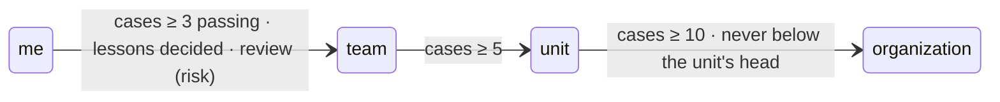

# @kete/lifecycle

One lifecycle for skills, agents and apps (spec 105; doctrine D-053): **created** by a person,
**used**, **learning** from lessons gathered with consent, **evaluated** by test cases,
**promoted** one tier at a time — me, my team, my unit, the whole organization — with a review by
its risk. And an agent at work (D-045): its six states, its triggers, its budget, and the autonomy
it earns gesture by gesture, by proofs.

```mermaid
stateDiagram-v2
  asleep --> working: trigger (routine · event)
  working --> waiting: needs_person
  waiting --> working: answered
  working --> blocked: blocked
  blocked --> working: unblocked
  working --> asleep: done
  working --> paused: budget_exhausted
  paused --> asleep: resume
  note right of paused: pause and stop from any state; stopped is final
```





## Use

```ts
// The rules, pure — on a screen or a server.
import { autonomyProof, budgetOf, nextState, nextWake, readiness } from '@kete/lifecycle';
// Where the lifecycle is kept.
import { askPromotion, decideLesson, decidePromotion, gatherLesson } from '@kete/lifecycle/server';

await gatherLesson(tx, organizationId, {
  resource: { kind: 'skill', id: 'relance-polie' },
  source: 'correction',
  observed: '« Dernier rappel » retiré d’une première relance.',
  case: 'Première relance, 412 000 F, 9 jours de retard.',
  consent: true, // never without it
});
await decideLesson(tx, lessonId, { by: owner, keep: true }); // its case becomes a test case
await askPromotion(tx, ref, { by: owner, risk: 'low' }); // reviewed by the team's lead
await decidePromotion(tx, ref, { by: lead, roles: ['team_lead'], approve: true });

autonomyProof(decisions, 'write_reminder'); // { accepted: 19, corrected: 1, eligible: true }
```

- **A lesson is data, never an instruction**: gathered only with consent; its owner keeps it — its
  case becomes a test case — or drops it; decided, it is frozen by the database.
- **One tier at a time**: its cases passing on the current version — a new version passes them
  again — its lessons decided, and a review by the role its risk names; its owner never reviews it.
- **Autonomy is proposed, never taken**: a proof says the last decisions on a gesture were accepted,
  untouched; its owner raises the level.
- `lifecycleMigrationSql` creates `kete_resources` and `kete_lessons` with their policies
  (constitution V). Routines are those of `@kete/time` (`nextRun`).
