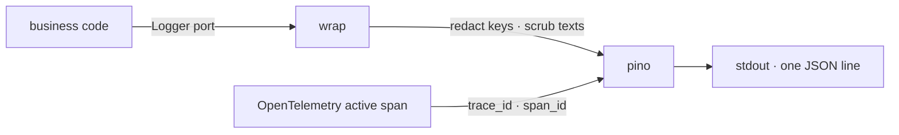

# @kete/log

The logs of a Kete service: one JSON line per event on the standard output, read by whatever
collects the container's output — no service of ours. Business code speaks to a port (`Logger`);
**pino** is its adapter (spec 091).



```ts
const log = createLogger({ service: 'nettio' }); // KETE_LOG_LEVEL, default info
const request = log.child({ requestId, organizationId });
request.info('deposit received', { pieces: 3 });
request.error('delivery failed', { error, messageId });
```

| Export            | What it does                                                               |
| ----------------- | -------------------------------------------------------------------------- |
| `createLogger`    | The service's logger: JSON lines, ISO time, level, service, trace and span |
| `memoryLogger`    | Keeps its lines, redacted as for real: for tests                           |
| `silentLogger`    | Writes nothing, where a port is required                                   |
| `redact`, `scrub` | What a line goes through before it is written                              |

## Rules

- **Nothing that must not be read.** A value under a key such as `authorization`, `cookie`,
  `password`, `token`, `apiKey`, `secret`, `credentials`, `email` or `phone` is written
  `[redacted]`, at any depth. In any text — the message, an error's message, a field — a bearer
  token, a JWT, a provider key, an e-mail address or a phone number is taken out too.
- **An error says what it was**: its kind, its message (scrubbed) and its stack, under `error`.
- **A line belongs to its trace**: with an active OpenTelemetry span, `trace_id` and `span_id` are
  written, so a log and a trace of the same request are found together.
- A message is a fact in English; the details are fields, never pasted into the message.
