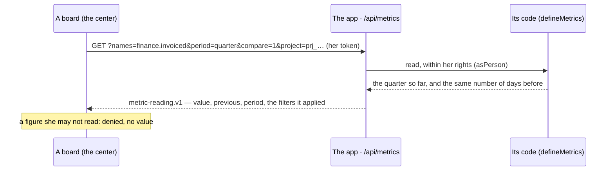

# @kete/metrics

The figures of a Kete app (spec 103; doctrine D-052): each one declared in the manifest
(`metric.v1`), computed by the app's own code **within the reader's rights**, read over a period and
compared with the period before. The center's boards, the app's home and the summaries read them —
no one writes a query.



## Use

```ts
import { defineMetrics, metricsResponse, MetricDenied, readMetrics, trend } from '@kete/metrics';

export const metrics = defineMetrics([
  {
    metric: declared('finance.invoiced'), // from kete.json
    currency: 'XOF',
    compute: async ({ period, filter }) => {
      if (!holds('invoices:read')) throw new MetricDenied();
      return sumInvoices(period, filter.project_id);
    },
  },
]);

// The app's route: GET /api/metrics
metricsResponse(metrics, request, { today, within: (work) => asPerson(identity, work, token) });

// The center, or another app, with her token:
const readings = await readMetrics({ url: financeUrl, token, period: 'quarter', compare: true });
trend(readings[0], 'up'); // { direction: 'up', tone: 'good', change: 2.51 }
```

- **Periods**: `7d`, `30d`, `90d`, `quarter` and `year` so far, `all`; each ends today, and « the
  period before » has as many days.
- **A figure without the `period` axis is a state** — the money available now — and is never dated.
- **A filter applies only on the figure's axes** (`project`, `party`, `person`); the reading says
  which it applied, so a board tells a figure that is not filtered.
- **Its tone comes from `better`**, never from its arrow: more absences is bad news.
- A figure that breaks its contract, has no currency in money, or is declared twice is refused when
  the app starts.
- **Missing is not zero** (spec 144; D-062, R17): asked by name, a figure whose app does not answer
  comes back `missing: true`, its value null — a board draws it missing.
- **The fourth axis**: a figure may be filtered by `unit` as well (`unit_id`).

## Questions to a data set (spec 144)

The Measure's query engine (ADR 0015), the same for an app's data sets (served by
`@kete/capabilities`) and the center's own tables: `answerQuery(dataset, rows, question)` filters
the rows on the axes the data set carries, its own fields and its period, groups them, sums them up
— `count`, `sum`, `avg`, `min`, `max` —, the largest group first, and answers `dataset-answer.v1`.
Nothing to count is a count of 0 and a sum of nothing (null), never a zero sum. From another app,
or the center, with her token: `queryDataset({ api, token, dataset, query })` answers `done`,
`refused`, or `missing` when the app does not answer.
