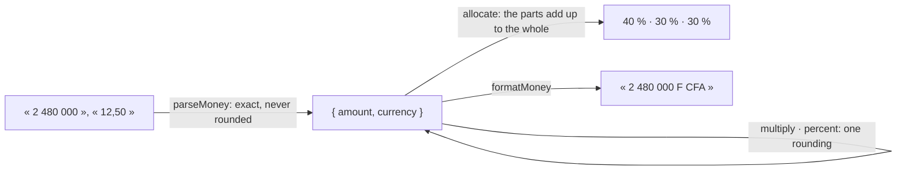

# @kete/money

Amounts of money for Kete apps (spec 094): an integer count of the currency's smallest unit, with
its currency. No float ever holds an amount, two currencies never add up, and a split never loses
a unit. Every figure a screen shows is computed here — never written by a model.



```ts
import { allocate, formatMoney, money, multiply, percent, sum } from '@kete/money';

const line = multiply(money(245_000, 'XOF'), 8); // 1 960 000 F
const tax = percent(line, 18);
const [deposit, onDelivery, onReception] = allocate(money(2_480_000, 'XOF'), [40, 30, 30]);
formatMoney(sum([line, tax], 'XOF')); // « 2 312 800 F CFA »
```

- **The smallest unit** follows ISO 4217, read from the platform: francs for XOF and XAF, cents for
  EUR. `money(12.5, 'XOF')` throws.
- **In a database**, keep `amount` as `bigint` and `currency` as `text`; in a contract,
  `moneySchema`.
- **Rounding** happens once, in `multiply` and `percent`, half away from zero.
- **Not here**: exchange rates, the taxes of a country, accounting.
