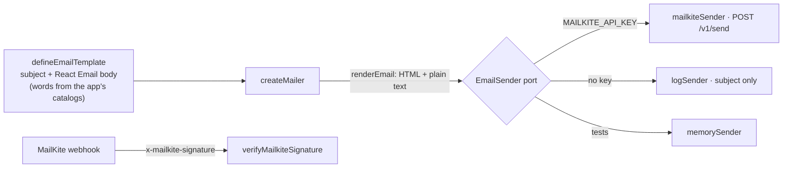
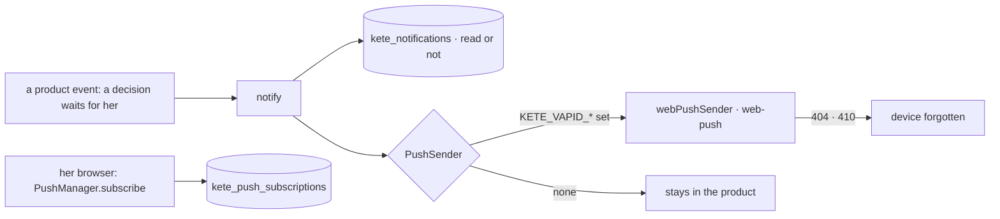
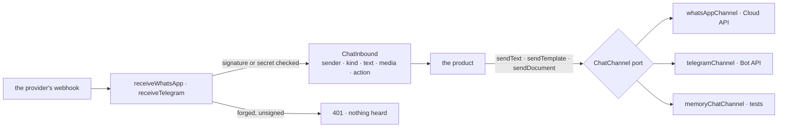
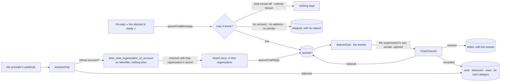

# @kete/notify

How a Kete product speaks to people: **e-mails** rendered with **React Email** and sent through a
**port** (MailKite first, doctrine D-031), **verified provider webhooks**, and the **chat channels** — WhatsApp and Telegram,
the port with its two adapters and what hears them. No vendor name in business code (doctrine
D-014).



## Use

```ts
const invitation = defineEmailTemplate<{ organization: string; link: string }>({
  name: 'invitation',
  render: (values, locale) => ({
    subject: m.email_invitation_subject(values, { locale }),
    body: <Invitation {...values} locale={locale} />, // React Email components
  }),
});

const mailer = createMailer({ sender: emailSenderFromEnv(), from: 'Kete <compte@kete.africa>' });
await mailer.send(invitation, { to, values, locale: 'fr' });
```

| Export                         | What it does                                                                           |
| ------------------------------ | -------------------------------------------------------------------------------------- |
| `mailkiteSender`               | `POST /v1/send` with a domain-restricted key; says whether a failure may be retried    |
| `emailSenderFromEnv`           | MailKite with `MAILKITE_API_KEY`, otherwise `logSender` (nothing leaves)               |
| `logSender`, `memorySender`    | Development without a provider (logs the subject only, never the recipient); tests     |
| `renderEmail`                  | A React Email body to HTML and plain text                                              |
| `verifyMailkiteSignature`      | HMAC-SHA256 of `t.rawBody`, constant-time, within 5 minutes                            |
| `checkEmail`, `isEmailAddress` | Refuse a message without a valid sender, recipient or subject before any provider call |

## Rules

- A service uses a key **restricted to its sending domain**, from its environment; the account key
  administers MailKite only.
- An e-mail's metadata carries facts (the template's name), never personal data.
- A secret link (sign-in, new password) never reaches a log: without a provider, only the subject
  is logged.

## Notifications in the product and on devices (spec 055)

A notification informs a person; what asks for an action lives in the product's « To do ». It is kept
in her list (`kete_notifications`, row-level security) and sent to every device she subscribed with
Web Push — the browsers' standard, with VAPID keys, through the `web-push` library. A device the
push service no longer knows (404, 410) is forgotten.



```ts
await savePushSubscription(tx, { organizationId, userId }, subscription); // from the browser
await notify(
  tx,
  { organizationId, userId, kind: 'decision.waiting', title, href: '/a-faire' },
  pushSenderFromEnv(),
);
const unread = await unreadCount(tx, userId);
await markRead(tx, userId, 'all');
```

`generatePushKeys()` gives an instance its VAPID pair (`KETE_VAPID_PUBLIC_KEY`,
`KETE_VAPID_PRIVATE_KEY`, `KETE_VAPID_SUBJECT`).

## Chat channels: WhatsApp and Telegram (spec 087)

A product writes to a person where she already is, and hears her there. The port (`ChatChannel`)
names no vendor; this package ships its two adapters and what a webhook needs, so that no app
writes them again (decision 0009).



```ts
// A route of the app: the provider calls it.
const { response, messages } = await receiveWhatsApp(request, { appSecret, verifyToken });
for (const message of messages) await hear(message); // hears once per providerMessageId
return response;

// Answering her.
const whatsapp = whatsAppChannel({ accessToken, phoneNumberId });
await whatsapp.sendText(message.sender.address, 'Votre dépôt est prêt.', [
  { id: 'come', label: 'Je passe' },
]);
```

| Export                                              | What it does                                                                                                              |
| --------------------------------------------------- | ------------------------------------------------------------------------------------------------------------------------- |
| `whatsAppChannel`, `telegramChannel`                | Text with buttons, a list, a document, an approved template (WhatsApp), her number asked, a file fetched                  |
| `receiveWhatsApp`, `receiveTelegram`                | The whole webhook: subscription check, signature or secret, the messages heard, the answer to give                        |
| `parseWhatsAppNotification`, `parseTelegramUpdate`  | A verified payload as `ChatInbound`: text, voice, photo, document, contact, pressed button                                |
| `whatsAppSignatureIsValid`, `telegramSecretIsValid` | Constant-time checks, for an app that reads the request itself                                                            |
| `ChatChannelError`                                  | Why a message was refused: `outside_window`, `recipient_unreachable`, `needs_phone_number`, `provider_refused`, `network` |
| `memoryChatChannel`                                 | Keeps what would have left, for an app's own tests                                                                        |

### Who the sender is

A channel proves a sender; a message never does. `ChatSender` carries:

- `id` — the channel's stable identifier of the person **for this business**. On WhatsApp it is the
  business-scoped user id when the provider sends one, her number otherwise; on Telegram, her user id.
- `phone` — her number in digits **when the channel gives it**. Since 2026 a person on WhatsApp may
  hide it behind a username: `phone` is then `null`. Telegram only gives a number she shares
  (`askForContact`, then a `contact` message whose `own` says it is hers).
- `address` — what `sendText` takes to answer her: the number when there is one, the scoped id
  otherwise (the adapter then sends through the provider's `recipient` field).

An app that knew people by their number looks them up by `phone` first, then by `id`, and keeps
both. Some messages cannot go to a scoped id (the provider answers `needs_phone_number`): the
product then asks her number in words.

### Rules

- A webhook that is not signed, or signed for another body, hears nothing and answers 401.
- A group, a channel post or an edited message is not a person talking to the product: ignored.
- A business writes first on WhatsApp only with an approved template (`sendTemplate`); outside the
  24-hour window a free text is refused with `outside_window`.
- A refusal never carries a credential: the error names the provider's code, not the request.
- `sendText`, `sendTemplate` and `sendDocument` may answer with a `ChatReceipt`: the
  provider's identifier of the message, which a status names later. An adapter that answers
  nothing still satisfies the port.
- Without credentials a channel is `null` in `ChatChannels` — not connected, never simulated.

### A voice note's words (spec 104)

`wordsOf(message, { channel, dictate })`: a text as it is, a voice note fetched from its channel and
written down by the dictation port of `@kete/ai`; anything else has no words. The same on
WhatsApp and Telegram.

```ts
const words = await wordsOf(heard.message, { channel, dictate: (audio) => port.dictate(audio) });
if (words) await understand({ model, text: words.text, ... });
```

## The outbox to people (spec 088)

What sits between « something happened » and « a message left »: whether she agreed, in which
words, through which channel, **from whose number**, and what happened to it. The app decides
**when** a message is due and with **which values**; the outbox decides whether it may leave, sends
it through the organization’s own sender, and keeps the trace.



```ts
// The migration: four tables, each with its row-level security, and two identifier-only lookups.
await owner.query(chatOutboxMigrationSql({ schema, appRole }));

// An organization connects its own number: sealed under KETE_SECRETS_KEY before it is stored.
await connectChatSender(db, organizationId, {
  channel: 'whatsapp',
  phoneNumberId,
  accessToken,
  appSecret,
});

// Who can be written to, her consent by a named gesture, the organization’s words.
await saveChatContact(db, organizationId, { reference: customerId, phone: '+228 90 11 22 33' });
await setChatConsent(db, customerId, true);
await saveChatTemplate(
  db,
  organizationId,
  {
    kind: 'deposit.ready',
    enabled: true,
    body: 'Bonjour {client}, votre dépôt {numero} est prêt.',
  },
  ['client', 'numero'],
);

// Something happened: the app says what, the outbox says whether it leaves.
const { status, reason } = await queueChatMessage(db, organizationId, {
  reference: customerId,
  kind: 'deposit.ready',
  values: { client: 'Ama', numero: 'A-0412' },
  subject: orderId,
});
await deliverChat(db); // in the organization’s transaction; a worker visits chatOrganizationsWaiting()

// The webhook of the whole deployment, one address per channel.
const { response, heard } = await receiveChat(request, {
  channel: 'whatsapp',
  lookup: pool,
  inOrganization: (organizationId, work) => inOrganization(pool, organizationId, work),
  verifyToken,
});
for (const one of heard) await answer(one); // queueChatReply(db, one.organizationId, { to: one.messageId, text })
return response;
```

| Export                                                                   | What it does                                                                                              |
| ------------------------------------------------------------------------ | --------------------------------------------------------------------------------------------------------- |
| `chatOutboxMigrationSql`                                                 | `kete_chat_senders`, `kete_chat_contacts`, `kete_chat_templates`, `kete_chat_messages` and their policies |
| `connectChatSender`, `listChatSenders`, `disconnectChatSender`           | The organization’s own number or bot; listed without any credential, « to reconnect » under another key   |
| `chatChannelOf`                                                          | The organization’s channel, opened: to download what she sent, to show that an answer comes               |
| `saveChatContact`, `chatContactOf`, `setChatConsent`, `chatLinkTokenOf`  | Who can be written to, by the app’s own reference of her; her consent; the link she opens                 |
| `saveChatTemplate`, `listChatTemplates`, `unknownChatPlaceholders`       | The organization’s words per kind; an unknown placeholder is refused when saved                           |
| `queueChatMessage`, `queueChatText`, `queueChatReply`                    | A kind in the organization’s words; plain words; the answer to a message that was heard                   |
| `deliverChat`, `requeueChatMessage`, `chatOrganizationsWaiting`          | Sends what waits; puts a failed message back; which organizations a worker visits                         |
| `receiveChat`, `hearChat`, `noteChatStatus`, `organizationOfChatAccount` | The webhook of a deployment with many senders, and its parts for an app that reads the request itself     |
| `listChatMessages`, `chatUsage`                                          | Every message with what happened to it; what left in a month, by channel and cost category                |

### Why a message did not leave

| `status`  | `reason`                                                                            | What it means                                                                   |
| --------- | ----------------------------------------------------------------------------------- | ------------------------------------------------------------------------------- |
| —         | `template_off`, `unknown_contact`                                                   | Nothing is kept: the organization did not turn this kind on, or nobody is known |
| `skipped` | `no_consent`                                                                        | She did not agree, or withdrew (« stop »)                                       |
| `skipped` | `no_channel`, `no_address`                                                          | She chose no channel; no number, or a bot she has not opened yet                |
| `skipped` | `not_connected`                                                                     | The organization has no sender on that channel — never another’s                |
| `queued`  | `network`                                                                           | Tried, will be tried again: after 1 min, 5 min, 30 min, 2 h, then it fails      |
| `failed`  | `outside_window`, `recipient_unreachable`, `needs_phone_number`, `provider_refused` | The provider’s refusal, in `ChatChannelError`’s words; not retried by itself    |
| `failed`  | `not_connected`                                                                     | The sender was removed, or can no longer be opened with this deployment’s key   |

### Rules

- **Consent first.** It is given by a named gesture — `setChatConsent`, or her own link opened —
  never inferred from a message she sent. « stop », « arrêter », « désabonner » or « unsubscribe »
  withdraws it at once; the app is told (`intent: 'stop'`) and chooses its words.
- **A sender per organization.** An account belongs to one organization (a unique index says so).
  Its credentials are sealed with AES-256-GCM under `KETE_SECRETS_KEY` (32 random bytes in base64,
  held by the deployment, never in the database); they are opened only to send or to check a
  webhook, and appear in no answer, error nor log.
- **Two questions cross the organizations’ boundary**, answered by `security definer` functions
  with an organization’s identifier only: whose account a notification names, and which
  organizations have something waiting. Everything else is read inside one organization, under
  its row-level security.
- **A notification is checked with its organization’s own secret.** One signed for another account
  is refused (401); one for an account nobody holds here is heard nowhere.
- **The template or her words.** Where a channel only lets a business write first with an approved
  template, the template leaves unless she wrote in the last 24 hours — then the organization’s
  own words leave, with their buttons. Words the provider refuses afterwards (`outside_window`)
  leave again as the template, once.
- **A count, never an amount.** The provider’s status says whether a message was billed and in
  which category; no price is invented.
- A channel that does not name its account in a notification carries it in its address: the app
  reads it from its route and gives it as `account`.
