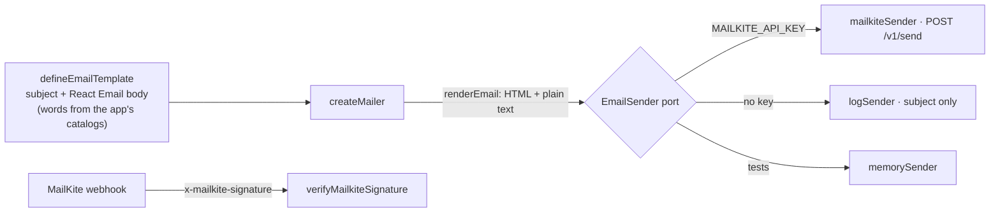
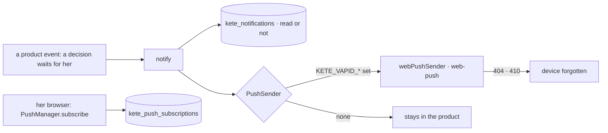
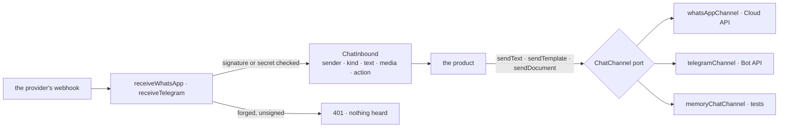

# @kete/notify

How a Kete product speaks to people: **e-mails** rendered with **React Email** and sent through a
**port** (MailKite first, doctrine D-031), **verified provider webhooks**, and the **chat channels** — WhatsApp and Telegram,
the port with its two adapters and what hears them. No vendor name in business code (doctrine
D-014).



## Use

```ts
const invitation = defineEmailTemplate<{ organization: string; link: string }>({
  name: 'invitation',
  render: (values, locale) => ({
    subject: m.email_invitation_subject(values, { locale }),
    body: <Invitation {...values} locale={locale} />, // React Email components
  }),
});

const mailer = createMailer({ sender: emailSenderFromEnv(), from: 'Kete <compte@kete.africa>' });
await mailer.send(invitation, { to, values, locale: 'fr' });
```

| Export                         | What it does                                                                           |
| ------------------------------ | -------------------------------------------------------------------------------------- |
| `mailkiteSender`               | `POST /v1/send` with a domain-restricted key; says whether a failure may be retried    |
| `emailSenderFromEnv`           | MailKite with `MAILKITE_API_KEY`, otherwise `logSender` (nothing leaves)               |
| `logSender`, `memorySender`    | Development without a provider (logs the subject only, never the recipient); tests     |
| `renderEmail`                  | A React Email body to HTML and plain text                                              |
| `verifyMailkiteSignature`      | HMAC-SHA256 of `t.rawBody`, constant-time, within 5 minutes                            |
| `checkEmail`, `isEmailAddress` | Refuse a message without a valid sender, recipient or subject before any provider call |

## Rules

- A service uses a key **restricted to its sending domain**, from its environment; the account key
  administers MailKite only.
- An e-mail's metadata carries facts (the template's name), never personal data.
- A secret link (sign-in, new password) never reaches a log: without a provider, only the subject
  is logged.

## Notifications in the product and on devices (spec 055)

A notification informs a person; what asks for an action lives in the product's « To do ». It is kept
in her list (`kete_notifications`, row-level security) and sent to every device she subscribed with
Web Push — the browsers' standard, with VAPID keys, through the `web-push` library. A device the
push service no longer knows (404, 410) is forgotten.



```ts
await savePushSubscription(tx, { organizationId, userId }, subscription); // from the browser
await notify(
  tx,
  { organizationId, userId, kind: 'decision.waiting', title, href: '/a-faire' },
  pushSenderFromEnv(),
);
const unread = await unreadCount(tx, userId);
await markRead(tx, userId, 'all');
```

`generatePushKeys()` gives an instance its VAPID pair (`KETE_VAPID_PUBLIC_KEY`,
`KETE_VAPID_PRIVATE_KEY`, `KETE_VAPID_SUBJECT`).

## Chat channels: WhatsApp and Telegram (spec 087)

A product writes to a person where she already is, and hears her there. The port (`ChatChannel`)
names no vendor; this package ships its two adapters and what a webhook needs, so that no app
writes them again (decision 0009).



```ts
// A route of the app: the provider calls it.
const { response, messages } = await receiveWhatsApp(request, { appSecret, verifyToken });
for (const message of messages) await hear(message); // hears once per providerMessageId
return response;

// Answering her.
const whatsapp = whatsAppChannel({ accessToken, phoneNumberId });
await whatsapp.sendText(message.sender.address, 'Votre dépôt est prêt.', [
  { id: 'come', label: 'Je passe' },
]);
```

| Export                                              | What it does                                                                                                              |
| --------------------------------------------------- | ------------------------------------------------------------------------------------------------------------------------- |
| `whatsAppChannel`, `telegramChannel`                | Text with buttons, a list, a document, an approved template (WhatsApp), her number asked, a file fetched                  |
| `receiveWhatsApp`, `receiveTelegram`                | The whole webhook: subscription check, signature or secret, the messages heard, the answer to give                        |
| `parseWhatsAppNotification`, `parseTelegramUpdate`  | A verified payload as `ChatInbound`: text, voice, photo, document, contact, pressed button                                |
| `whatsAppSignatureIsValid`, `telegramSecretIsValid` | Constant-time checks, for an app that reads the request itself                                                            |
| `ChatChannelError`                                  | Why a message was refused: `outside_window`, `recipient_unreachable`, `needs_phone_number`, `provider_refused`, `network` |
| `memoryChatChannel`                                 | Keeps what would have left, for an app's own tests                                                                        |

### Who the sender is

A channel proves a sender; a message never does. `ChatSender` carries:

- `id` — the channel's stable identifier of the person **for this business**. On WhatsApp it is the
  business-scoped user id when the provider sends one, her number otherwise; on Telegram, her user id.
- `phone` — her number in digits **when the channel gives it**. Since 2026 a person on WhatsApp may
  hide it behind a username: `phone` is then `null`. Telegram only gives a number she shares
  (`askForContact`, then a `contact` message whose `own` says it is hers).
- `address` — what `sendText` takes to answer her: the number when there is one, the scoped id
  otherwise (the adapter then sends through the provider's `recipient` field).

An app that knew people by their number looks them up by `phone` first, then by `id`, and keeps
both. Some messages cannot go to a scoped id (the provider answers `needs_phone_number`): the
product then asks her number in words.

### Rules

- A webhook that is not signed, or signed for another body, hears nothing and answers 401.
- A group, a channel post or an edited message is not a person talking to the product: ignored.
- A business writes first on WhatsApp only with an approved template (`sendTemplate`); outside the
  24-hour window a free text is refused with `outside_window`.
- A refusal never carries a credential: the error names the provider's code, not the request.
- Without credentials a channel is `null` in `ChatChannels` — not connected, never simulated.
