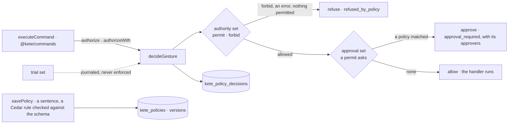

# @kete/policies

One policy engine at the gesture (spec 112; doctrine D-058). Before a command runs, the gesture —
who, what, on what, how much, through which channel, towards whom (`gesture.v1`) — goes through
the organization's policies (`policy.v1`), the same for a person and for her agent. The answer
(`policy-decision.v1`) allows it, asks someone's approval, or refuses it, and says which policies
and versions decided. Each decision is journaled. The engine is [Cedar](https://www.cedarpolicy.com)
(open source, by AWS), run in the process through its WebAssembly build.



## Use

```ts
import { executeCommand } from '@kete/commands';
import {
  authorizeWith,
  createPolicyEngine,
  policiesMigrationSql,
  savePolicy,
} from '@kete/policies';

// The product's Cedar schema: its people, agents, parties, projects and its gestures.
const engine = createPolicyEngine({ schema: keteSchema });

// A policy a person validated: it starts on trial, observed before it is enforced.
await savePolicy(tx, organizationId, engine, {
  id: 'clients.hours',
  sentence: 'Un agent n’écrit pas aux clients avant 8 h ni après 19 h',
  rule: `forbid (principal is Kete::Agent, action == Kete::Action::"message.client", resource)
    when { context.hour < 8 || context.hour >= 19 };`,
  set: 'authority',
  owner: 'usr_abla',
  status: 'trial',
  writtenBy: 'usr_abla',
});

// Every command asks the policies first.
await executeCommand(tx, sendToClient, {
  organizationId,
  actor,
  idempotencyKey,
  input,
  authorize: authorizeWith(tx, organizationId, {
    engine,
    gestureOf: (input, actor) => ({ actor, kind: 'message.client', object, channel, at, context }),
    entitiesOf: (gesture) => entitiesTouchedBy(gesture),
  }),
});
```

## What it does

| Piece                                             | What it does                                                                                                                                                                                                                                                                                                                                                                                                                                                                          |
| ------------------------------------------------- | ------------------------------------------------------------------------------------------------------------------------------------------------------------------------------------------------------------------------------------------------------------------------------------------------------------------------------------------------------------------------------------------------------------------------------------------------------------------------------------- |
| `createPolicyEngine`                              | The engine for a product's schema. `decide` reads the three sets: **authority** (a `forbid` refuses; nothing permitted refuses; a policy that fails to evaluate refuses — never fail open), **approval** (a `permit` means the approver named by the policy must approve), **trial** (what the policies on trial would have said, never enforced). Policy sets are preparsed once per content: about 2 ms a decision. `check` says whether a rule is one policy that fits the schema. |
| `savePolicy`, `currentPolicies`, `policyVersions` | A policy kept as a person validated it; each change is a new version; nothing is edited or deleted.                                                                                                                                                                                                                                                                                                                                                                                   |
| `decideGesture`, `readDecisions`                  | A gesture decided under the current policies and journaled with the policies, versions and trial; the journal read back, by policy.                                                                                                                                                                                                                                                                                                                                                   |
| `authorizeWith`                                   | The `authorize` hook of `executeCommand`: the command's input read as a gesture, decided, journaled. A refusal stops the command with `refused_by_policy`, an approval with `approval_required` and the decision.                                                                                                                                                                                                                                                                     |
| `unmet`                                           | A table of gestures and their expected effects: what catches a contradiction between two policies, in the tests and when a policy is saved (Cedar's symbolic analysis is not in its WebAssembly build).                                                                                                                                                                                                                                                                               |

## Guarantees

- **One engine for people and agents.** An agent is a principal of its own; its policies read the
  person it acts for (`principal.onBehalfOf`).
- **Explained.** Every decision names its policies, their versions and their sentences.
- **Never fail open.** A policy that cannot be evaluated refuses the gesture.
- **Its own organization only, append-only.** `policiesMigrationSql` creates `kete_policies` and
  `kete_policy_decisions` with their RLS policy in the same migration; the application role may
  insert and read them, never change or delete them.
- **The context each action declares.** A gesture gives each action only the context attributes
  its schema declares (Cedar refuses the others).

The first check of Cedar on KYA's six policies: `specs/112-policies/first-check.md`.
