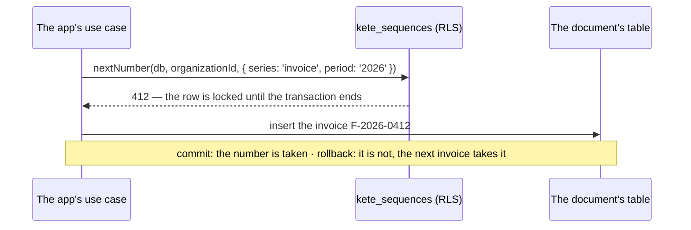

# @kete/sequences

The numbers of an organization's documents (spec 095): quotes, invoices, purchase orders — without
a gap and without a duplicate.



```ts
await owner.query(sequencesMigrationSql({ schema, appRole }));

await inOrganization(pool, organizationId, async (db) => {
  const number = await nextNumber(db, organizationId, { series: 'invoice', period: '2026' });
  const reference = formatNumber('F-{YYYY}-{N:4}', number); // F-2026-0412
  await db.query('insert into invoices (...) values (...)', [reference /* … */]);
});
```

- **In the document's transaction.** That is what makes the series gapless: a failed write gives
  its number back. Never take a number outside of it.
- **Per organization**, under row-level security; **per series** (`invoice`, `quote`) and, when
  given, **per period** (`2026`): the series starts again at 1.
- **Two writers at once** wait for each other on the series' row: they never share a number.
- **The application role cannot delete** a series: a number is never rewound.
