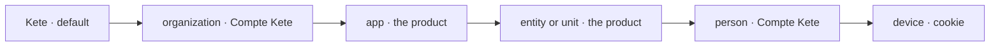

# @kete/settings

Kete's settings in layers (spec 115; decision 0013; doctrine D-060). Each setting is **declared
once** by its owner — the core for `kete.*`, an app for its product's keys — and **resolved by
layers**: the most precise wins, and the screen says where a value comes from.



```ts
import {
  createAccountSettings,
  defineSettings,
  keteSettings,
  readLayers,
  resolve,
  setting,
  settingsHere,
} from '@kete/settings';
import { z } from 'zod';

const registry = defineSettings(keteSettings, [
  setting({
    key: 'prd_nettio.pickup_delay_hours',
    schema: z.number().int().min(1).max(720),
    default: 48,
    layers: ['app', 'entity'],
    permission: 'nettio:settings',
    group: 'deposits',
    label: { fr: 'Délai de retrait', en: 'Pickup delay' },
  }),
]);

const account = createAccountSettings({ url: process.env.KETE_ACCOUNT_URL });
const { organization, person } = await account.read(token); // five minutes per token's hash
const kept = await readLayers(tx, { entityIds: ['unt_be'] }); // this product's own layers
const settings = resolve(registry, { organization, person, ...kept });
settings.value('prd_nettio.pickup_delay_hours'); // 24 at the site of Bè
settings.from('kete.locale'); // 'person'

// In a command, with no person's token at hand (spec 117):
const here = await settingsHere(tx, registry, {
  organization: account.organization(organizationId),
});
here.value('kete.currency');
```

## What it does

| Piece                                      | What it does                                                                                                                                                                                                        |
| ------------------------------------------ | ------------------------------------------------------------------------------------------------------------------------------------------------------------------------------------------------------------------- |
| `defineSettings`, `setting`                | The settings a product knows. A key is declared once; its default fits its schema; a secret is refused. `describe()` gives them as JSON Schema, with the words of their `choices`, for a manifest and « Réglages ». |
| `keteSettings`                             | Kete's own: the organization's identity, language, time zone, currency, channels, working days and hours, holidays; the person's theme, quiet hours, text size…                                                     |
| `resolve`                                  | Each value with the layer it comes from. A stored value out of its schema, or on a layer its declaration does not allow, is skipped.                                                                                |
| `settingsMigrationSql`                     | `kete_settings` (the app's layer and each entity's) with its RLS policy, and `kete_setting_events`, append-only.                                                                                                    |
| `setSetting`, `clearSetting`, `readLayers` | Set a value checked against its layer and schema, take it back to its inheritance, read the layers kept here. Every change is journaled; the caller checks rights.                                                  |
| `settingsHere`                             | The settings where a command or a job runs, in its transaction: the app's and the entities' layers over the organization's as a member last read it (`AccountSettings.organization`); never a person's.             |
| `settingHistory`                           | Who changed a setting, from what to what, when.                                                                                                                                                                     |
| `createAccountSettings`                    | The Compte Kete's two layers with the person's token (`GET /api/apps/settings`), and her preference saved there (`PUT`) so it follows her in every app.                                                             |

## Guarantees

- **One source per value.** The organization's and the person's layers live in the Compte Kete; the
  app's and the entities' in the product; the device's cookie is only a copy, for a page without a
  flash.
- **Never a secret.** Passwords and keys go to the product's sealed secrets.
- **Its own organization only.** `kete_settings` and its journal carry their RLS policy in the same
  migration; the journal is never changed nor deleted.
- **Never a token in a cache key**: the Compte Kete's answer is kept per token's SHA-256, five
  minutes at most, and read again at once after she saves a preference.
