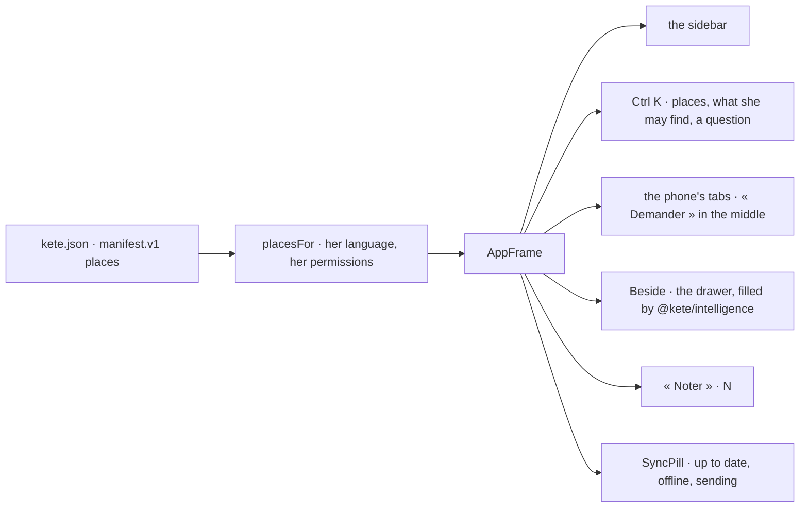
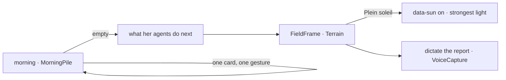

# @kete/shell

The frame every Kete product wears — the center and every app — so that a person never learns two
(spec 100; doctrine D-042, D-045, D-050 to D-054). Its places come from the app's manifest; Ctrl K
goes, finds or asks; « Demander » opens the drawer beside the page; « Noter » works from every page;
the toolbar says whether the gestures reached the center; the phone has its tabs.



## Use

```tsx
import { AppFrame, placesFor } from '@kete/shell';
import app from '../kete.json';

const sections = placesFor(app.places, { lang: 'fr', can: (p) => grants.includes(p) });

<AppFrame
  brand="Kete Finance"
  sections={sections}
  current="quotes"
  person={{ name: 'Afi Mensah', detail: 'Direction' }}
  words={words} // every word from the product's catalogs
  onAsk={(question) => openDrawer(question)}
  beside={{ open, label: 'Kete Intelligence', onClose, content: <Drawer /> }}
  onNote={(text) => keepNote({ data: { text } })}
  sync={{ state: 'ok' }}
  tabs={['home', 'quotes', 'treasury']}
>
  {page}
</AppFrame>;
```

- **Places**: `placesFor` keeps the manifest's order and headings; a place with a permission shows
  only when `can` says she holds it.
- **Keys**: Ctrl K opens the palette, Ctrl J asks, N notes (when she is not typing).
- **Words**: no word is written in the package; `ShellWords` lists them all.
- The parts it composes are `@kete/design`'s: `Shell`, `NavItem`, `CommandPalette`, `TabBar`.

## The phone's own screens (spec 106)

Made for a phone, the same on a computer (doctrine D-051, D-054):

- **`MorningPile`**: what waits for her, one card at a time — where she is in the pile, the card,
  its gestures (48 px high at least), what comes next — and, once empty, what her agents go on
  doing.
- **`FieldFrame`**, « Terrain »: the next thing in large, a few large gestures (dictate the report,
  a photo, a call), « Plein soleil » and the way back.
- **`useSunlight(on)`**: sets « Plein soleil » on the page — `data-sun="on"`, the design's light
  mode at its strongest, generated by `@kete/design` for every design.


