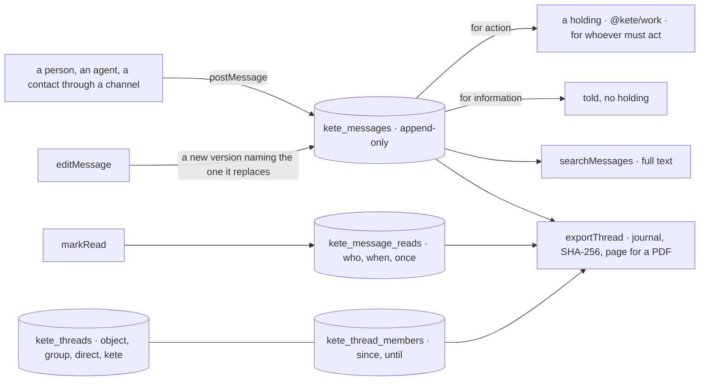

# @kete/threads

Where people talk about one thing (spec 113; doctrine D-056, D-057). A thread is born with its
object and put away when it closes; a group comes from the structure or is created; a direct thread
is between two; each person has her thread with Kete. A thread always has a holder. Its trace is at
least as good as mail — that is why a company like KYA, which writes mail mostly to keep a trace,
can talk here instead.



## Use

```ts
import { messagesOf, openThread, postMessage, threadsMigrationSql } from '@kete/threads';

const thread = await openThread(tx, organizationId, {
  kind: 'object',
  object: { kind: 'asset', id: 'ast_pc_phebe' },
  title: 'L’ordinateur de Phébé',
  holder: { kind: 'person', id: 'usr_it' },
  address: 'fil-pc-phebe@kya.kete.software', // replies by mail come back here (@kete/channels)
});
const { holdingId } = await postMessage(tx, organizationId, {
  thread: thread.id,
  author: { kind: 'person', id: 'usr_phebe' },
  text: 'Mon ordinateur ne démarre plus.',
  for: 'action', // a holding for the thread's holder, or for `to`
  via: 'whatsapp',
});
const shown = await messagesOf(tx, thread.id); // latest versions, edits counted, read by whom
```

## What it does

| Piece                                                         | What it does                                                                                                                                                       |
| ------------------------------------------------------------- | ------------------------------------------------------------------------------------------------------------------------------------------------------------------ |
| `openThread`, `threadOf`, `threadAt`, `threadsOf`             | A thread opened with its holder as a member; one per object (opening it again gives it back); found by its object, by its address for replies, by a member.        |
| `joinThread`, `leaveThread`, `setThreadHolder`, `closeThread` | Members say who knew and since when — one who leaves keeps her dates; a thread changes hands; it is put away, and nothing more is said in it.                      |
| `postMessage`                                                 | A `message.v1` kept; its author becomes a member; « for action » says a holding (`@kete/work`) for `to` or the thread's holder, under the message's first version. |
| `editMessage`, `versionsOf`                                   | Its author edits: a new version naming the one it replaces, the original kept; the holding says the new words. The versions of a message are a line, never a tree. |
| `messagesOf`, `markRead`                                      | The thread as shown: each message in its latest version, how many edits, who read it and when — a read is kept once, never for one's own message.                  |
| `searchMessages`                                              | Full-text search (`simple` dictionary, any language), the closest first, in a thread or everywhere.                                                                |
| `exportThread`                                                | The journal — the thread, its members and dates, every message in every version, every read — its SHA-256 fingerprint, and a page to print as PDF (`@kete/files`). |

## Guarantees

- **Nothing rewritten, nothing deleted.** Messages and reads are append-only for the application
  role; a thread is put away, never removed.
- **Never nobody.** A thread always has a holder; a message for action always makes a holding.
- **Its own organization only.** `threadsMigrationSql` creates the four tables with their RLS
  policy in the same migration (constitution V). A thread's address is unique across the deployment,
  so a reply by mail finds its thread before its organization is known.
