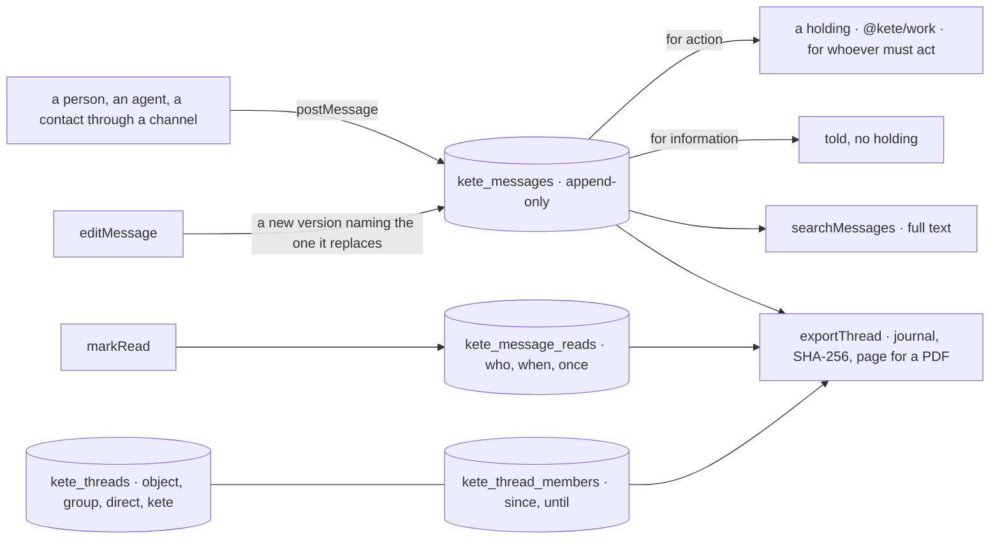
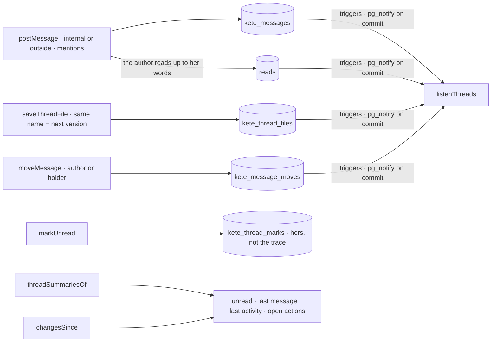
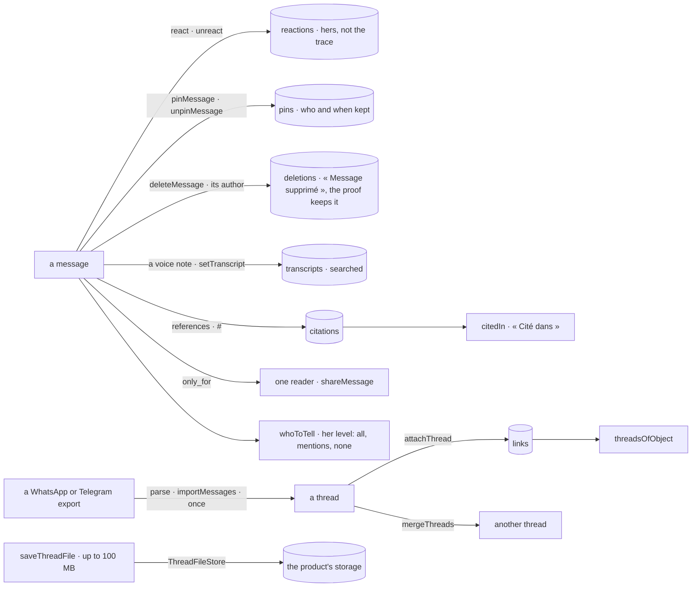

# @kete/threads

Where people talk about one thing (spec 113; doctrine D-056, D-057). A thread is born with its
object and put away when it closes; a group comes from the structure or is created; a direct thread
is between two; each person has her thread with Kete. A thread always has a holder. Its trace is at
least as good as mail — that is why a company like KYA, which writes mail mostly to keep a trace,
can talk here instead.



## Use

```ts
import { messagesOf, openThread, postMessage, threadsMigrationSql } from '@kete/threads';

const thread = await openThread(tx, organizationId, {
  kind: 'object',
  object: { kind: 'asset', id: 'ast_pc_phebe' },
  title: 'L’ordinateur de Phébé',
  holder: { kind: 'person', id: 'usr_it' },
  address: 'fil-pc-phebe@kya.kete.software', // replies by mail come back here (@kete/channels)
});
const { holdingId } = await postMessage(tx, organizationId, {
  thread: thread.id,
  author: { kind: 'person', id: 'usr_phebe' },
  text: 'Mon ordinateur ne démarre plus.',
  for: 'action', // a holding for the thread's holder, or for `to`
  via: 'whatsapp',
});
const shown = await messagesOf(tx, thread.id); // latest versions, edits counted, read by whom
```

## What it does

| Piece                                                         | What it does                                                                                                                                                       |
| ------------------------------------------------------------- | ------------------------------------------------------------------------------------------------------------------------------------------------------------------ |
| `openThread`, `threadOf`, `threadAt`, `threadsOf`             | A thread opened with its holder as a member; one per object (opening it again gives it back); found by its object, by its address for replies, by a member.        |
| `joinThread`, `leaveThread`, `setThreadHolder`, `closeThread` | Members say who knew and since when — one who leaves keeps her dates; a thread changes hands; it is put away, and nothing more is said in it.                      |
| `postMessage`                                                 | A `message.v1` kept; its author becomes a member; « for action » says a holding (`@kete/work`) for `to` or the thread's holder, under the message's first version. |
| `editMessage`, `versionsOf`                                   | Its author edits: a new version naming the one it replaces, the original kept; the holding says the new words. The versions of a message are a line, never a tree. |
| `messagesOf`, `markRead`                                      | The thread as shown: each message in its latest version, how many edits, who read it and when — a read is kept once, never for one's own message.                  |
| `searchMessages`                                              | Full-text search (`simple` dictionary, any language), the closest first, in a thread or everywhere.                                                                |
| `exportThread`                                                | The journal — the thread, its members and dates, every message in every version, every read — its SHA-256 fingerprint, and a page to print as PDF (`@kete/files`). |

## Guarantees

- **Nothing rewritten, nothing deleted.** Messages and reads are append-only for the application
  role; a thread is put away, never removed.
- **Never nobody.** A thread always has a holder; a message for action always makes a holding.
- **Its own organization only.** `threadsMigrationSql` creates the four tables with their RLS
  policy in the same migration (constitution V). A thread's address is unique across the deployment,
  so a reply by mail finds its thread before its organization is known.

## Threads people live in (spec 139)



Run `threadsLiveMigrationSql` after `threadsMigrationSql`. `threadSummariesOf` lists a member's
threads by last activity with their unread count, last message and open actions (a thread with none
is resolved); `markUnread` marks from a message on. A mentioned person joins. A file is kept with its
fingerprint (10 MB at most in the database, 100 MB in the product’s storage — spec 140); the same name again is its next version (`filesOf`, `threadFile`). A
message moves once, by its author or the thread's holder: the target names where it came from
(`moved_from`), the source keeps the original and where it went (`movedTo`). A message is
`internal` unless said `outside`; a contact's words are outside. Every change is announced on the
channel `kete_threads` once it commits: `listenThreads(client, onChange)` on a direct connection,
`changesSince(db, member, since)` without one.

## Threads for everyone (spec 140)



Run `threadsComfortMigrationSql` after `threadsLiveMigrationSql` (and `workDelegatesMigrationSql`).

- **Reactions** belong to the person who gives them, kept apart from the trace (`react`,
  `unreact`).
- **Pins** keep who pinned and when, and who unpinned; `pinsOf` lists the pins standing now.
- **A message taken back** by its author shows « Message supprimé » with who and when. Its words,
  files and citations stay in the trace and the export, and it is never found by search.
- **A voice note** is an audio attachment with its `duration_ms`. `setTranscript` keeps its words
  once, and `searchMessages` finds them.
- **Citations.** `references` names the objects a message cites. `citedIn` says where an object
  was cited, the latest first. `attachThread` attaches a thread to more objects, and
  `threadsOfObject` finds them all.
- **Pages.** `messagesPage` gives fifty messages before a message, or around one a search found,
  and says whether there are older or newer ones.
- **Only for one.** A message `only_for` a person — Kete's answer using what not every member may
  read — is given only to that viewer (`messagesOf`, `messagesPage`, `searchMessages`,
  `threadSummariesOf`). `shareMessage` gives it to everyone, once.
- **Telling.** `setNotifyLevel` sets her level. `whoToTell` names the present members to tell:
  - by their level: all, only when mentioned, or never;
  - always whoever must act;
  - never the author, nor anyone who has read it.

  `announceTyping` announces who is writing, and keeps nothing.

- **What a thread holds.** `mediaOf` gives photos and videos, documents with their version, links,
  voice notes and pins, each naming the message it was posted in.
- **Files** go to the product's `ThreadFileStore` (a bucket or a disk, through
  `@kete-africa/files`), up to 100 MB each. Without a store, they stay in the database, up to
  10 MB, as before.
- **Imports.** `parseWhatsAppExport` reads Android and iPhone exports, in French or English,
  including multi-line messages and attachments. `parseTelegramExport` reads Telegram's
  `result.json`. `importMessages` keeps the messages:
  - dated as they were said;
  - by the members the product recognizes, else as the export names them;
  - marked imported;
  - once: importing again adds nothing.
- **Merging.** `mergeThreads`, by the holder of the thread to merge, moves its messages with their
  dates and authors, then puts it away with `merged_into`.
