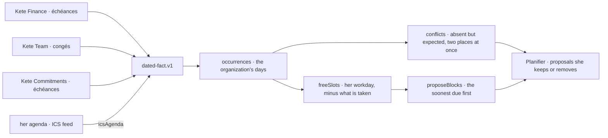
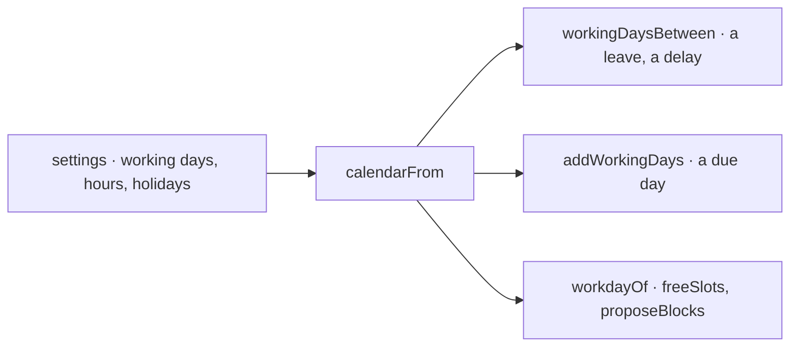

# @kete/time

The time of the whole organization, computed (spec 102; doctrine D-050): every app says what will
happen at a time — a meeting, a deadline, an absence, a task, a milestone, an agent's run — as the
contract `dated-fact.v1`; this package says when each happens, what clashes, what time a person has
free, and where tasks could go. The center's Planifier shows it; the assistant explains and proposes
what it finds — it never guesses a date.



## Use

```ts
import {
  conflicts,
  freeSlots,
  icsAgenda,
  occurrences,
  placeInDays,
  proposeBlocks,
} from '@kete/time';

conflicts(facts); // [{ kind: 'absent', person: 'usr_kossi', absence: 'leave-1', fact: 'reception-1', … }]

const slots = freeSlots({
  facts,
  person: 'usr_afi',
  from: '2026-10-13',
  to: '2026-10-16',
  workday: { start: '08:00', end: '18:00' },
  after: Date.now(),
});
proposeBlocks(
  [{ key: 'report', label: 'Rapport au Fonds', minutes: 90, due: '2026-10-30' }],
  slots,
);

// Laid on the week's days, for WeekCalendar of @kete/design: { allDay, timed }, in minutes.
placeInDays(occurrences(facts), { from: '2026-10-12' });

const agenda = icsAgenda(() => fetch(feedUrl).then((r) => r.text()), { personId: 'usr_afi' });
await agenda.read({ from: '2026-10-12', to: '2026-10-18' }); // « busy » facts
```

- A day is the organization's: give its offset from UTC (`offsetMinutes`, 0 in Lomé or Dakar).
- Blocks start on the half hour (`alignMinutes`); a task that fits nowhere before its day is left
  out — the caller says so.
- An absence never says why; an agenda read from outside is `busy` unless the person shares it.
- `AgendaSource` is the port; `icsAgenda` its first adapter (every agenda exports ICS).

## Routines (spec 105)

`nextRun(routine, after, offsetMinutes)`: when a routine runs next — every day, working day, week on a
day or month on a date, at a time of the organization's day. A board's routine (`@kete/boards`)
and an agent's triggers (`@kete/lifecycle`) both use it.

## The organization's calendar (spec 118)

Working days, hours and holidays as the organization — or a site, a subsidiary — set them in
Kete's settings (`kete.working_days`, `kete.working_hours`, `kete.holidays`; spec 115):

```ts
import { addWorkingDays, calendarFrom, workdayOf, workingDaysBetween } from '@kete/time';

const calendar = calendarFrom(await settingsIn(db, organizationId)); // @kete/settings
workingDaysBetween('2026-11-02', '2026-11-06', calendar); // 4: Monday 2 is a holiday
addWorkingDays('2026-10-30', 1, calendar); // '2026-11-03'
freeSlots({ ...options, workday: workdayOf(calendar) }); // the planner on the same calendar
```


