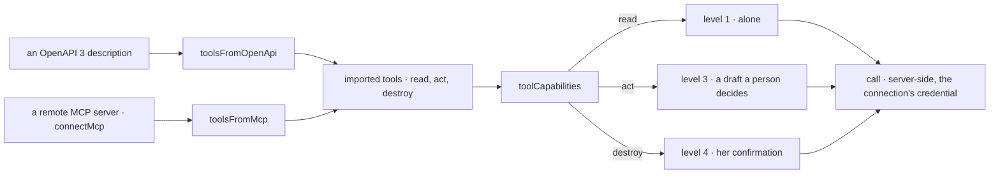

# @kete/tools

An organization's own tools — its CRM described by OpenAPI, its ticketing served by a remote MCP
server — imported as capabilities its agents use under Kete's rules (spec 124; doctrine D-060,
step C4: « l'import d'outils (OpenAPI, serveurs MCP distants) … toujours sous les politiques, les
gestes engageants en brouillon »).



```ts
import { callOpenApi, toolCapabilities, toolsFromOpenApi } from '@kete/tools';

const tools = toolsFromOpenApi(description, { prefix: 'crm' });
const capabilities = toolCapabilities(tools, {
  call: async (tool, input, { db, organizationId }) => {
    const credential = await credentialOf(db, organizationId, sealer, connectionId); // @kete/connections
    return callOpenApi(tool, input, {
      baseUrl,
      credential: { header: 'authorization', value: `Bearer ${credential.key}` },
    });
  },
});
// registered with the product's own: the same gesture, permission, policies and journal.
```

## The public internet only (spec 129)

`publicFetch` is the fetch every import and every call should use: an `https` address whose every
resolved IP is public (`reachable`, `isPublicIp`), no redirection, a timeout and a bounded answer.
Nobody uses Kete to reach a company's private network or the instance's own.

## Guarantees

- **The same rules as the product's own**: a read (`GET`, an MCP tool marked read-only) runs
  alone; an act is a draft a person decides; a destruction (`DELETE`, an MCP tool not marked
  otherwise — MCP's own default) needs her confirmation in the product. Each tool's drafts have
  their own record type (`toolCallDraft(tool)`: `imported_tool_call.crm_create_contact`), so a
  registry finds which tool a draft calls.
- **The credential is the connection's**: an `Authorization` parameter of a description is never an
  input; the call is made server-side.
- **Its answers stay inside**: imported capabilities are `confidential` unless said otherwise.
- **Checked input**: each input is the tool's JSON Schema, read with Zod; references resolved,
  cycles cut.
