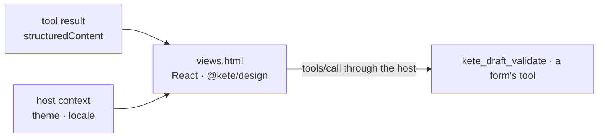

# @kete/views

Kete's **generic views for copilots** (MCP Apps, doctrine D-037): what a Kete App shows in
Kete Enterprise's copilot, Claude or ChatGPT without writing interface code. One self-contained
page (scripts and styles inlined, no request to any origin), in the product's design, following the
host's theme and language.

| View               | Shows                                                                        | From                      |
| ------------------ | ---------------------------------------------------------------------------- | ------------------------- |
| `ui://kete/review` | A draft: each value with its provenance; correct, validate (level 3), refuse | every decision capability |
| `ui://kete/form`   | A form drawn from a JSON Schema, which calls a tool with its values          | `formView({ … })`         |
| `ui://kete/table`  | A table, numbers on the right                                                | `tableView({ … })`        |
| `ui://kete/detail` | One record, field by field                                                   | `detailView({ … })`       |

```ts
import { createMcpHandler, defineCapability } from '@kete/capabilities';
import { keteViews, tableView, VIEWS } from '@kete/views';

const unpaid = defineCapability({
  name: 'invoices_unpaid',
  description: 'The unpaid invoices.',
  permission: 'invoices:read',
  autonomy: 1,
  input: z.object({}),
  view: VIEWS.table,
  run: async (_input, { db }) =>
    tableView({ title: m.unpaid_title(), columns: [/* … */], rows: await unpaidInvoices(db) }),
});

createMcpHandler({ registry, server, caller, views: keteViews({ design: 'kete' }) });
```



- **Words**: the view's own words are in `messages/` (French, English), chosen by the host's
  language; a product's words (titles, columns, field titles) come with its result.
- **A product's own view** (a map, an editor) is its own MCP Apps page, declared the same way in
  `createMcpHandler({ views })`.
- **Build**: `pnpm --filter @kete-africa/views build` writes `dist/views.html` (the tests build it).
  Fonts are not embedded: `workspace` uses the system's Segoe UI, `kete` falls back to the system's.

## Exposing a record (spec 045)

`exposeRecord` turns a record type into two level-1 capabilities, `{type}_list` (a table) and
`{type}_get` (a detail), under its read permission. See
[spec 045](../../specs/045-integration-contract/spec.md).

## Components configured where they are used (spec 145)

Doctrine D-062 (R22) and ADR 0016: a few generic components — card, collection, figure, board,
form, timeline — each configured by a `view.v1` document, data and never code nor a query language,
drawn the same in Kete, on the phone and in the copilots.

```mermaid
flowchart LR
  APP[the app's default] --> L[resolveView · the most precise wins, whole]
  ORG[the organization] --> L
  POS[a position] --> L
  ME[her own version] --> L
  L --> V[view.v1]
  V -->|boundFilter · this object, this unit, me| S[its source · objects, a data set, a figure, indicators]
  V --> F[figureOption · pure] --> R[@kete/views/react · EChart, Bullet, TileMap, states]
```

- `@kete/views/figures` (pure, for any screen): `figureOption(chart, input, palette)` builds the
  ECharts option of a bar, line, pie, bar and line combined, cumulative against a trajectory,
  waterfall, Pareto, radar or box plot; `bulletOf` places a bullet's value, target and alert zone;
  `resolveView` picks the most precise layer of a configuration (her version, her position's, the
  organization's, the app's) — whole, never merged; `checkView` refuses what breaks `view.v1` where
  it is written; `boundFilter` turns what a place gives into a filter on the axes the view takes.
- `@kete/views/react`: `EChart` (ECharts loaded only when a chart is shown, following the theme),
  `Bullet`, `TileMap`, `StateOf` (loading, empty, missing, denied, stale — never a zero for what is
  not known) and `Provenance` (« D'où vient ce chiffre ? »). Every word comes from the place.
