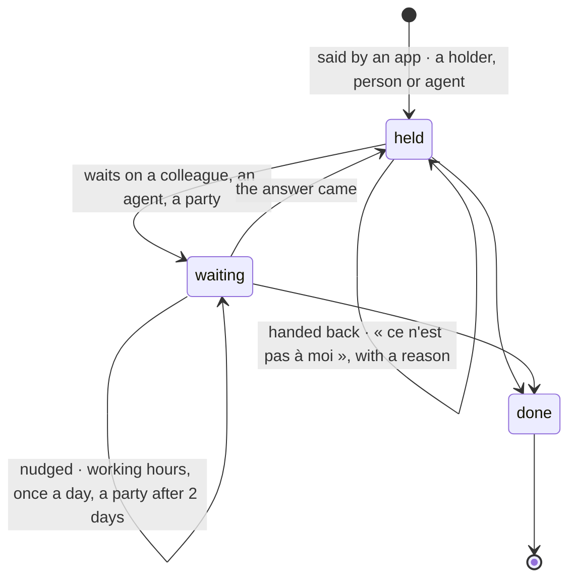

# @kete/work

Holdings (spec 111; doctrine D-056): every thing in progress — a request, a step of a circuit, a
draft to check, an action from a meeting, an agent's task — is one **holding** with one
**holder**, a person or an agent, **never nobody**. Each app says its holdings through the contract
`holding.v1`; `@kete/work` keeps them, relays them when their holder is away, nudges them when they
wait too long, and gathers them for a person in « Pour moi ».



## Use

```ts
import { dueNudges, forMe, relayAbsences, sayHolding, workMigrationSql } from '@kete/work';
import { inOrganization } from '@kete/tenancy';

// The migration, with its RLS, in the product's migrations.
await owner.query(workMigrationSql({ appRole: 'kete_app' }));

// An app says a holding; said again under the same source, it replaces what was said.
await inOrganization(pool, organizationId, (tx) =>
  sayHolding(tx, organizationId, {
    source: { app: 'enterprise', kind: 'request', ref: 'req_123' },
    object: { kind: 'project', id: 'prj_colombe' },
    what: 'Chiffrer le devis Garage Bè',
    holder: { kind: 'person', id: 'usr_kossi' },
    state: 'waiting',
    waiting_on: { kind: 'party', id: 'pty_garage_be' },
    due: '2026-10-23',
  }),
);

// Each morning, then through the day: the relay, then the nudges.
const { moved, stuck } = await relayAbsences(tx, organizationId, { absences, structure });
const nudges = await dueNudges(tx, organizationId, {
  nudger: { kind: 'agent', id: 'agt_relances' },
});

// « Pour moi »: what she must answer, what she holds, what she is told.
const mine = await forMe(tx, personId);
```

## What it does

| Piece                           | What it does                                                                                                                                                                                                                                                                                                                                                                    |
| ------------------------------- | ------------------------------------------------------------------------------------------------------------------------------------------------------------------------------------------------------------------------------------------------------------------------------------------------------------------------------------------------------------------------------- |
| `sayHolding`                    | Keeps a holding as an app says it (FR-001). One without a holder is refused (`holder_required`); one that does not fit `holding.v1` too. Each change of hands, wait or state is journaled.                                                                                                                                                                                      |
| `openHoldings`, `finishHolding` | The open holdings, of one app when asked — what a product compares with its own items; one whose item finished is closed, journaled once.                                                                                                                                                                                                                                       |
| `syncSource`                    | Keeps one source in step with what it holds now (spec 114): what changed is said again, what is no longer said is finished, and a holding the relay gave to someone keeps who stands in. An app's holdings at the center, and the product's own sources.                                                                                                                        |
| `relayAbsences`                 | The relay on absence (FR-003): an open holding of a person away today — due today, overdue or undated — passes to her deputy, else her manager, else the head, the first one present. Returns what moved (to tell the new holder on her channels) and what nobody could take.                                                                                                   |
| `handBack`                      | Who took a holding over gives it back, with her reason.                                                                                                                                                                                                                                                                                                                         |
| `reclaimUnheld`                 | Never nobody (FR-002): the holdings of a person who left or an agent switched off pass to her manager (an agent's to its person) or the head; what nobody can take is returned for a card to the administrator.                                                                                                                                                                 |
| `dueNudges`                     | The relay on age (FR-004), in working hours only (`inWorkingHours`, the organization's offset): a holding waiting on a party for two days is offered to the agent in charge of nudges; one waiting on a colleague or an agent nudges them, once a day. Each nudge is journaled; the product delivers it. Without a nudging agent, `through` is null and the holder is reminded. |
| `forMe`                         | « Pour moi » (FR-005): what waits on her answer, what she holds, what she is told — overdue first, then due soonest, then the oldest (`byUrgency`). The cards to decide and what is to classify come from their own modules.                                                                                                                                                    |
| `fluidity`                      | The figures (FR-006): open and waiting holdings, the oldest wait, the waits over 48 hours by whom they wait on. Computed by code, never by a model.                                                                                                                                                                                                                             |
| `awayOn`, `relayTarget`         | Pure: whether a person is away on a day from absences said as `dated-fact.v1`; who takes over.                                                                                                                                                                                                                                                                                  |

## Guarantees

- **A holder, always.** The database refuses a holding without one; its holder is a person or an
  agent.
- **Where it opens.** `workLinksMigrationSql`, after `workMigrationSql`, adds the `href` its app
  gives a holding (`holding.v1`).
- **Its own organization only.** `workMigrationSql` creates `kete_holdings` and
  `kete_holding_events` with their RLS policy in the same migration.
- **An append-only journal.** The application role may insert and read a holding's events
  (`holding.created`, `holding.waiting`, `holding.nudged`, `holding.taken_over`,
  `holding.handed_back`, `holding.done`), never change or delete them. Nothing is deleted.
- **The structure is the product's.** Deputies, managers and the head come through the
  `Structure` port; absences are the dated facts the apps already say (`dated-fact.v1`).
