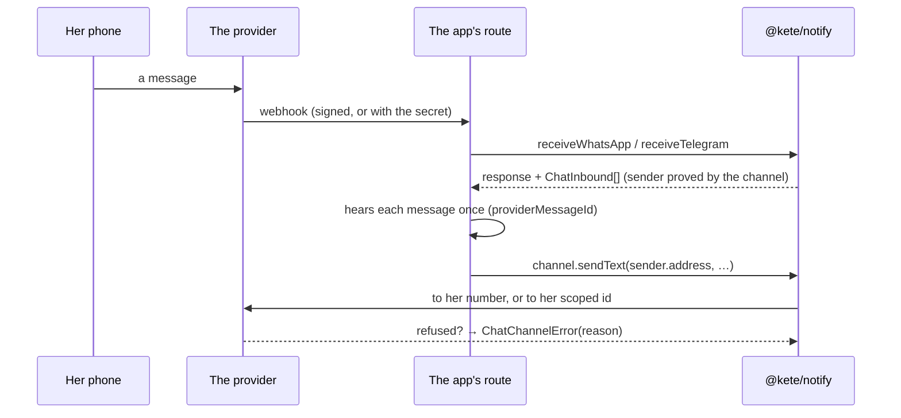

# Spec 087 — Chat channels: the adapters and what hears them

## Why

« Il faut toujours penser WhatsApp et Telegram » (doctrine PRINCIPES 7). `@kete/notify` had the
port of chat channels and no adapter: Firmo wrote them, Nettio copied them (`kete-core#86`), and a
provider's change had to be fixed once per copy. Decision 0009: a port ships with its adapter and
an example. Step **B1** of the plan decided on 2026-10-13.

One change arrived while the copies existed: since 2026 a person on WhatsApp may hide her phone
number behind a username. The provider then names her by a **business-scoped user id**: `from` and
the contact's `wa_id` can be absent, `from_user_id` and `user_id` are always there, and a message is
sent to that id through `recipient` instead of `to`. Both copies read `from` as a phone number.

## Requirements

- **FR-001** — The port keeps `sendText` and `sendDocument` as they were, and gains optional
  gestures a channel may offer: `sendTemplate`, `sendList`, `askForContact`, `download`,
  `acknowledgeAction`, `typing`. An adapter an app already wrote still satisfies the port.
- **FR-002** — `whatsAppChannel` and `telegramChannel` implement it against the providers' HTTP
  APIs, with no library and an injectable `fetch`.
- **FR-003** — `ChatInbound` is what a channel proved: its `sender` (`id`, `phone` or null,
  `address`, `username`, `displayName`), its `kind` (text, voice, photo, document, contact, action,
  unsupported) and its `providerMessageId`.
- **FR-004** — On WhatsApp the sender's `id` is the scoped id when the provider sends one, her
  number otherwise; `phone` is null when the provider hides it; `address` prefers the number. A
  message to a scoped id goes through `recipient`.
- **FR-005** — `receiveWhatsApp` answers the subscription check for its verify token only, and
  hears a notification only when its signature over the raw body is valid; `receiveTelegram` hears
  a POST only with Telegram's secret. Anything else answers 401, 400 or 405 and hears nothing.
- **FR-006** — Telegram: only a private chat whose id is the sender's; a shared contact says
  whether the number is her own.
- **FR-007** — A refusal is a `ChatChannelError` with a reason a product can act on:
  `outside_window`, `recipient_unreachable`, `needs_phone_number`, `provider_refused`, `network`.
  Its message never carries a credential.
- **FR-008** — `memoryChatChannel` keeps what would have left, for an app's tests.

## Not in this spec

The outbox to people — consent, templates per organization, a sender per organization, the cost of
each message, delivery statuses — is spec `088-chat-outbox` (step B2). Asking the provider for a
hidden phone number, calls and groups are not built.

## Proof

- `packages/notify/tests/chat.test.ts` (18 tests, on the providers' documented payloads): a text
  with a number; both identifiers kept; a hidden number heard and answered through `recipient`;
  voice, photo, document and buttons; the subscription check; forged, missing and mismatching
  signatures refused; three buttons of twenty characters; an approved template; a document
  uploaded with the type its name announces; each refusal's reason; a group ignored; a contact's
  owner; Telegram's secret; no credential in an error.
- **To obtain in the apps' lanes**: Nettio deletes `src/platform/whatsapp.ts` and
  `src/platform/telegram.ts` and its tests pass unchanged; Firmo does the same (an issue in its
  repository).
- **Not proven here**: a real message on a real number. It waits for a test number and a test bot.
