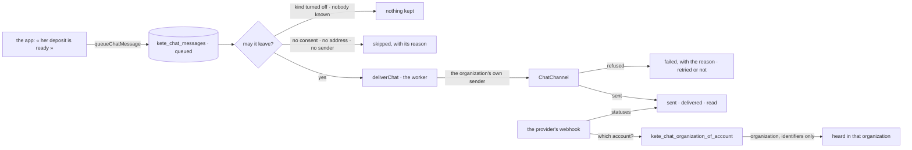

# Spec 088 — The outbox to people: consent, templates, a sender per organization, the cost

Status: **built** in `@kete/notify` (step B2 of the plan decided on 2026-10-13). What the code
changed in the first design is said in « Built differently from the first design ».

## Why

Spec 087 gave the adapters. What every app still writes by hand is what sits between « something
happened » and « a message left »: whether the person agreed to be written to, which words, through
which channel, from whose number, and what happened to it. Nettio wrote it for its customers
(`src/features/messaging`, 1,100 lines); Firmo has its own; Kete Enterprise will need it to carry a
decision to a manager's phone (its step C2).

Nettio's decision 0004 kept one sender per channel for the whole deployment, « acceptable for one
pilot, not for the sale of Nettio alone »: two laundries sharing a number would both answer a
customer they have in common. The chassis ships the durable form: **a sender per organization**.

## What it is

## The tables

Each carries its organization and its row-level security in the same migration (constitution V).

| Table                | Holds                                                                                                                                                         |
| -------------------- | ------------------------------------------------------------------------------------------------------------------------------------------------------------- |
| `kete_chat_senders`  | One row per organization and channel: the provider's account (what routes a webhook), what people see (the number, the bot's name), its credentials **sealed** |
| `kete_chat_contacts` | Who can be written to: the app's own reference of the person, her address on a channel, the provider's scoped id, her consent and its date, her link token    |
| `kete_chat_templates` | The organization's words per kind of message: on or off, the text, the provider's approved template and its language                                         |
| `kete_chat_messages` | Every message, out and in: its kind, its text, its status, the reason when it did not leave, attempts, the provider's id, what it cost                        |

## Requirements

- **FR-001 — Consent first.** Nothing is queued to leave for a contact who did not agree, or who
  withdrew: the message is kept as `skipped` with the reason `no_consent`. Consent is given by a
  named gesture, never inferred from a first message.
- **FR-002 — The organization's words.** A kind of message leaves only when the organization
  switched its template on; a kind that is off keeps nothing at all (a laundry that never turned
  reminders on does not read a list of reminders that did not leave). Its text takes named
  values; an unknown placeholder is refused when the template is saved, not when a message
  leaves.
- **FR-003 — A sender per organization.** A message leaves from the organization's own number or
  bot. Without one, the message is `skipped` with `not_connected` — never sent from another
  organization's sender, never simulated.
- **FR-004 — Credentials sealed.** A sender's token and secrets are sealed with AES-256-GCM under
  a key the deployment holds outside the database (`KETE_SECRETS_KEY`, 32 random bytes), as Kete
  Enterprise already seals a person's own AI key. They are opened only to send or to check a
  webhook; they never appear in a journal, an error, a log or an answer of the API. A row sealed
  under another key opens as nothing: the sender is shown as « to reconnect ».
- **FR-005 — A webhook finds its organization by the provider's account.** One address per
  deployment and channel. A notification names the account it was sent to; one `security definer`
  function answers with the organization's identifier **only**. Its signature is then checked
  with that organization's own secret, inside that organization; the contact is found there,
  under its row-level security. A second function tells a worker which organizations have
  something waiting to leave — identifiers only. Nothing else crosses the organizations’
  boundary; the migration says so and a test proves it. A channel that does not name its account
  in a notification carries it in its address.
- **FR-006 — Every message keeps what happened to it.** `queued`, `sent`, `delivered`, `read`,
  `failed`, `skipped`, `received`, with the reason (`ChatChannelError`'s) and the number of
  attempts. A `network` failure is retried after 1 minute, 5 minutes, 30 minutes and 2 hours,
  then fails. Where a channel only lets a business write first with an approved template, the
  template leaves unless she wrote in the last 24 hours — then the organization’s own words
  leave, with their buttons; words the provider refuses afterwards (`outside_window`, which
  arrives as a status, not as an answer to the request) leave again as the template, once.
  `recipient_unreachable`, `needs_phone_number` and `provider_refused` are not retried.
- **FR-007 — Heard once.** An inbound message is kept by its provider's identifier; a provider
  that delivers twice is heard once.
- **FR-008 — What it cost.** The provider's delivery statuses say whether a message was billed and
  in which category. Each message keeps both; an organization reads its count per month and per
  category. No amount is invented: a price is only shown when the deployment was given one.
- **FR-009 — The port tells what was sent.** `sendText`, `sendTemplate` and `sendDocument` may
  answer with the provider's identifier of the message, so that a status finds its message. An
  adapter that answers nothing still satisfies the port.
- **FR-010 — A contact who hides her number.** A contact is found by her number when the provider
  gives it, by its scoped id otherwise; the first message of an unknown scoped id is kept, and she
  is tied to a contact by her link token.

## What the app keeps

The app decides **when** a message is due and with **which values** (« her deposit A-0412 is
ready »), and what an inbound message means for its trade. The chassis decides whether it may
leave, sends it, and keeps the trace.

## Built differently from the first design

| First design                                              | Built                                                                                         | Why                                                                                                    |
| --------------------------------------------------------- | --------------------------------------------------------------------------------------------- | ------------------------------------------------------------------------------------------------------ |
| Three lookups across organizations (account, address, token) | Two: whose account, and which organizations wait                                           | The account names the organization: her contact and her link are then found inside it, under its RLS   |
| A kind that is off is kept as `skipped`                   | Nothing is kept                                                                               | A kind nobody turned on would fill the list with messages that were never meant to leave               |
| `outside_window` falls back to the template               | The template leaves first unless she wrote in the last 24 hours; a late refusal falls back    | The provider accepts the request and refuses later, by a status: waiting for it delays every reminder  |
| One address per deployment and channel                    | Telegram’s address ends with the bot’s identifier                                             | An update does not name its bot                                                                        |

## Open questions, with the answer taken until the author says otherwise

1. **The key.** One `KETE_SECRETS_KEY` per deployment seals every organization’s sender. Losing it
   means every organization reconnects its number: `listChatSenders` then shows « to reconnect »,
   and nothing leaves in the meantime (`failed`, `not_connected`). A key per organization would
   need a place to keep those keys, which is the same question one level down.
2. **Who connects a number.** `connectChatSender` is the gesture; the screen that calls it is each
   app’s (an administrator of the organization) or Kete Cockpit’s (an operator, for the first
   clients). Neither screen is in this spec.
## Not in this spec

Calls, groups, broadcast campaigns, a shared inbox for a team. The price list of a provider. A
document through the queue: an app sends one through the organization's channel (`chatChannelOf`).

## Proof

`packages/notify/tests/outbox.test.ts`, on the workshop’s test database, as the application role:

- Two organizations with two senders: a message of one never leaves from the other’s number; a
  notification for one account signed with the other’s secret is refused, and is heard nowhere.
- A message for a contact without consent is `skipped` with `no_consent`, and nothing leaves; an
  organization without its own sender gets `not_connected`.
- No token is readable in `kete_chat_senders`, by the owner nor by the application; a sender
  sealed under another key is « to reconnect » and opens nothing; outside any organization the
  application reads no row.
- A provider that delivers twice is heard once; a status finds its message and records its cost
  category; a late `outside_window` leaves again as the template.
- A failure of the network is tried again later; a refusal keeps its reason and can be requeued.
- « stop » withdraws her consent; a bot reaches her only once she opened her link; a contact who
  hides her number is tied by her link and answered at her scoped identifier.

Not proven: a real message on a real number (it waits for a test number and a test bot). Nettio
still runs its own outbox, with one sender for the whole deployment: moving it here is a step of
its own lane, since its customers’ consent and channel move to `kete_chat_contacts`.
