# Spec 089 — The agents’ runtime: a proven loop, a thin Kete layer

Step **B3** of the plan decided on 2026-10-13 (`docs/ROADMAP.md`, phase 7). The trial and its
measures are in decision 0010; this spec says what was built once it held.

## Why

Each product wrote its assistant’s loop on `ask` and `askStream` (decision 0009): Kete Enterprise
about 6,000 lines, Nettio 200. What comes next in the plan — conversations that are remembered,
memory with its governance, agents that work for long — is what a runtime gives. The loop is not
what makes an agent a Kete agent; its rights, its mandate, its drafts, its journal, its budget and
its organization are, and they must not be written again in each app either.

```mermaid
flowchart LR
  P[a person asks] --> T[the app builds a turn<br/>instructions · messages]
  R[registry.tools&#40;caller&#41;<br/>the agent acting for her] -->|her capabilities, and nothing else| T
  T --> A{runAgent · streamAgent}
  A -->|budget spent| X[no model is called]
  A --> M[the runtime: the loop<br/>model · tools · steps]
  M -->|a tool is called| C[capability.execute<br/>rights · mandate · journal]
  C -->|reads, or acts within its autonomy| D1[call · done]
  C -->|what commits| D2[call · draft<br/>waits for her]
  M -->|words| E[text]
  A -->|after the turn| U[usage recorded<br/>organization · agent]
  M <-->|the last messages| S[(the runtime’s tables<br/>organization_id · row-level security)]
```

## Requirements

- **FR-001 — One place for the runtime.** `@kete/agents` is the only package that imports it; a
  lint rule refuses the import anywhere else. `@kete/ai` keeps the port of models, with no runtime.
- **FR-002 — Capabilities by right.** An agent’s only tools are the capabilities its caller may
  use, as the registry gives them. The layer adds none and removes none; an app filters before
  (what sets a price is never offered by Nettio).
- **FR-003 — What commits is prepared.** A capability that answers with a draft is reported as
  `draft`, with the draft’s identifier and its view; the layer never confirms anything.
- **FR-004 — Measured, and stopped.** Budgets are checked before a turn — a spent budget calls no
  model — and usage is recorded after it, once, with the model’s name.
- **FR-005 — What a page shows.** A turn as it happens is four events: `text`, `call`, `done`,
  `stopped`. The stream never throws.
- **FR-006 — Conversations under row-level security.** The runtime’s conversation tables are
  created by a migration of ours, each with its `organization_id`, its policy and its grant to the
  application role. The runtime reads and writes them as that role, on the app’s pool, every
  statement inside one organization. A row cannot be written outside an organization.
- **FR-007 — A person’s own.** A conversation is listed, read and erased by its person only: not
  by a colleague, not by the same identifier in another organization.
- **FR-008 — Nothing by surprise.** The runtime’s own initialisation never runs; its tables are
  frozen in our source and compared with what the installed version would create. Its telemetry
  is off unless the deployment turns it on. Its versions are pinned exactly.

## Not in this spec

The governance of memory and evaluations (step B4). Long runs that suspend and resume, sub-agents
(Kete Enterprise, step C6). The runtime’s server, studio, authentication, agent builder, deployers
and channels: not taken (decision 0010).

## Proof

- The trial: Nettio’s 27 assistant tests pass unchanged on the runtime (decision 0010).
- `packages/agents/tests/runtime.test.ts` (6 cases): the tools offered are the caller’s
  capabilities and nothing else; a gesture is prepared with its draft and its view; usage is
  recorded once as the agent acting for the person; a spent budget calls no model; the turn stops
  at its steps; the stream gives its events and ends with `stopped` when the model fails.
- `packages/agents/tests/conversations.test.ts` (8 cases), on the test database as the
  application role: every runtime table has row-level security and one policy; a conversation is
  remembered from one turn to the next; it is not a colleague’s nor another organization’s with
  the same identifiers; the same person has two memories in two organizations; nothing is read nor
  written outside an organization; no organization stays on a connection; erased is for good.

To obtain: Nettio’s assistant on the published package, its tests unchanged. Not proven: a real
model on a real conversation; the scripted model proves the wiring, not an answer’s quality.
