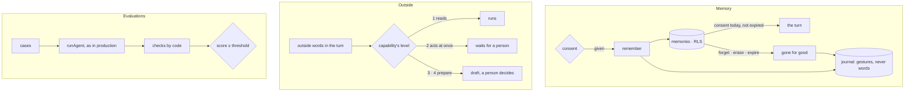

# Spec 090 — Memory and its governance, outside content, evaluations, dictation

Step **B4** of the plan decided on 2026-10-13 (`docs/ROADMAP.md`, phase 7), on the runtime of
spec 089 (decision 0010).

## Why

An agent that remembers a person is useful and dangerous in the same measure. Kete Enterprise
kept its assistant's memory in a table of its own (spec 029), without consent, retention nor a
journal; Nettio kept none. What makes it acceptable in a company is the same everywhere — she
agrees, she reads, she erases, it expires, it is written down — so it belongs to the chassis.

Two more risks of the current era come with agents: words from outside the organization carrying
instructions (a stranger's message, an e-mail, a page), and a prompt changed for the worse
without anyone noticing. And every app dictates: Nettio wrote its own transcription.

## Requirements

- **FR-001 — Consent first.** Nothing is remembered of a person before she agreed, by a named
  gesture. Withdrawn, her agents stop reading and remembering at once; what was kept stays hers to
  read and to erase.
- **FR-002 — Retention.** She says how long (or until she forgets it herself). What expired is
  never read, even before the worker deletes it; its deletion is journaled.
- **FR-003 — Erased is gone.** One thing, or everything — her memories and her conversations
  (`eraseAll`). Nothing comes back: not to her, not to an agent, not in a table, not in the journal.
- **FR-004 — A journal without words.** Every gesture on a memory — consented, withdrew,
  remembered, forgot, expired, erased — with who and when, never what was remembered. The
  application writes lines and cannot change nor delete them.
- **FR-005 — Context, not orders.** What is remembered is given to the model after its
  instructions, said as context that never outranks them.
- **FR-006 — Outside content.** Once a turn holds words nobody of the organization wrote — from
  the start, or brought by a capability named as such — a capability that acts at once is not run:
  it answers `confirmation_required`. Drafts are prepared as always.
- **FR-007 — Evaluations.** Cases played through the production turn, checked by code (calls,
  drafts, words said or never said), scored against a threshold; a case that throws fails, the
  run reports.
- **FR-008 — Dictation.** One port on any transcription model of the AI SDK, OpenAI's or
  Mistral's Voxtral; budget checked before, call counted after, silence heard as nothing.

## Not in this spec

Semantic recall over past conversations; evaluations on a real model in CI (they need a key and a
budget: an app runs them before a prompt ships); a comparison of Voxtral against what runs today
on real recordings; the screens where she reads and erases her memory (each app's).

## Proof

- `packages/agents/tests/memory.test.ts` (8 cases), on the test database as the application role:
  nothing before consent; remembered and given after the instructions; withdrawn closes at once;
  another organization reads nothing; expired is not read and is swept with its journal line; one
  thing forgotten; memories and conversations erased whole, found in no table, the journal holding
  none of the words; the journal cannot be updated nor deleted by the application.
- `packages/agents/tests/evaluate.test.ts` (6 cases): a payment runs when nothing outside was read;
  after an e-mail was read, the payment waits and the draft is prepared; a turn that starts with a
  stranger's words runs nothing that acts; an evaluation passes the prompt that keeps the rule,
  **fails a worse prompt** and says which check failed; a case that throws fails alone.
- `packages/ai/tests/dictate.test.ts` (4 cases): written down and counted; no call on a spent
  budget; silence counted, heard as nothing; Voxtral accepted.

Not proven: a real model, a real recording.
