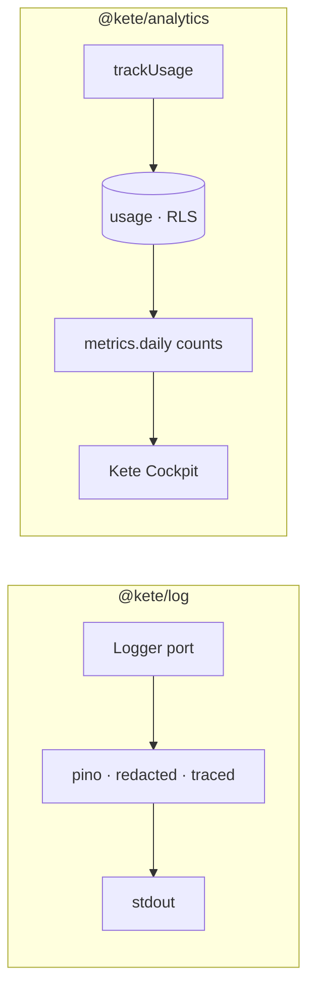

# Spec 091 — Logs and usage

Step **B5** of the plan decided on 2026-10-13 (`docs/ROADMAP.md`, phase 7).

## Why

Each service wrote `console.warn` lines by hand, with no shape, no trace and nothing keeping a
token or a phone number out of them. And nobody could say which organization uses what: the
fleet (Kete Cockpit, step D1) and the offers with limits (B6) both need it.

## Requirements

- **FR-001 — One port for logs**, pino behind it: JSON lines with service, level, ISO time, the
  fields given, and the active trace.
- **FR-002 — Nothing that must not be read**: redacted keys at any depth, and secrets, e-mail
  addresses and phone numbers scrubbed from every text, an error's message included.
- **FR-003 — Usage per organization** in the app's Postgres with its row-level security; read by
  feature and by person inside the organization only.
- **FR-004 — No person in analytics.** Properties are small facts; a value that looks like an
  e-mail or a phone is refused.
- **FR-005 — Cockpit reads counts**: a `metrics.daily` event per organization and day, recorded in
  the outbox to Cockpit in the organization's transaction; nothing for a day without use. One
  `security definer` function names the organizations that used the app, identifiers only.
- **FR-006 — Retention**: usage older than 400 days is forgotten.

## Not in this spec

Cockpit's screen of who uses what: Cockpit's lane, asked by an issue. Moving each service's
`console` lines to the port: each repository, as it next touches them. Metrics of performance
(latency, errors per route): the traces already carry them.

## Proof

- `packages/log/tests/log.test.ts` (5): the line's shape; no secret, token, e-mail nor phone at any
  depth nor in the message; an error with its kind, scrubbed message and stack; a child's fields and
  the trace and span of the active request.
- `packages/analytics/tests/usage.test.ts` (6), on the test database as the application role: usage
  by feature and by person; another organization reads only its own, nothing outside one; personal
  data refused; the day's counts recorded in the outbox to Cockpit with no person in them; nothing
  for a day without use; retention.

Not proven: Kete Cockpit showing these counts — its lane.
