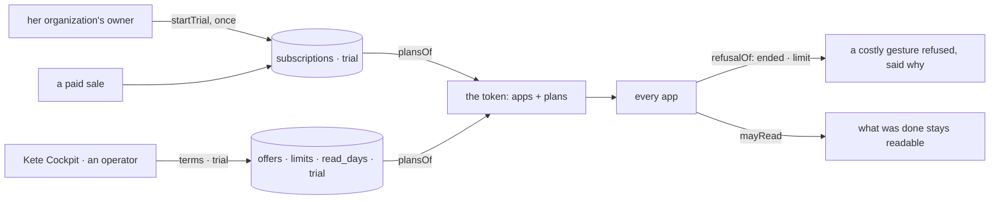

# Spec 092 — Offers with limits, a trial that ends

Step **B6** of the plan decided on 2026-10-13 (`docs/ROADMAP.md`, phase 7), doctrine D-046.

## Why

An organization could only pay a period for an app. It could not try one without paying, and an
offer said nothing of what it allowed: a laundry with three people and a company with three
hundred paid the same and got the same, and an app could not tell which gesture was beyond the
offer. When a period ended, access stopped at once — including to the organization's own data.

## Requirements

- **FR-001 — An offer says what it allows**: people, AI tokens a month, storage, connected apps,
  agents. A limit not set is no limit. Only an operator sets them, through an owner function; the
  service cannot change the catalog.
- **FR-002 — A trial**: free, for a number of days, with its own limits; one per app; started by
  the organization's owner or an administrator, **once** per organization and app — never for an
  app it already had, as a trial or paid. It ends by itself. Its start is announced to Kete
  Cockpit (`account.activated`, `trial:<app>`).
- **FR-003 — Read after the end**: each offer says for how many days what was done stays
  readable once its use (grace included) has ended (90 by default).
- **FR-004 — In the token, for every app**: the `plans` claim carries, per app, the offer, the
  trial, the end of use, the end of reading and the limits. An offer whose reading has ended is no
  longer carried.
- **FR-005 — Read by every app**: `@kete/auth` tells whether a gesture is within the offer
  (`refusalOf`: `no_plan`, `ended`, `limit` with the limit, what is allowed and what is used) and
  whether what was done may still be read (`mayRead`). A token without `plans` is read as before.
- **FR-006 — Shown**: the subscriptions page lists each offer's limits, the trial an organization
  may still start, and until when its data stays readable after an end.

## Not in this spec

Counting what is used (each app counts its own people, agents and files; the AI tokens are the
budgets of `@kete/ai`); Cockpit's screen to set terms and trials (its lane, through
`/api/admin/offers`); the shared instance's offers and prices (D2).

## Proof

- `apps/account/tests/plans.test.ts` (7), on the Compte Kete's test database: terms set by the
  operator function and refused when malformed; the catalog read-only for the service; offers
  shown with their limits and the trial apart; a member cannot start a trial, an owner can, once;
  the token carries its limits and **a gesture beyond one is refused**; after its end nothing new
  is allowed and **it stays readable** for its days, then is no longer carried.
- `packages/auth/tests/plans.test.ts` (6): the claim read and refused when malformed; within and
  beyond a limit; ended but readable; no plan.

Not proven: an app of the fleet refusing a gesture on a real token — the template does it in B7.
