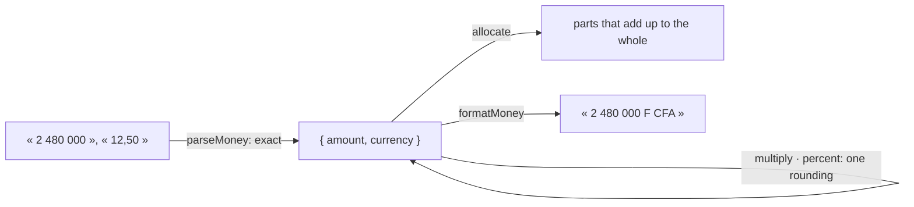

# Spec 094 — Amounts of money

Step **E1** of the plan decided on 2026-10-13 (`docs/ROADMAP.md`, phase 8; doctrine D-049).

## Why

Gestion, Équipe and Support all count money: a quote's lines, a budget's posts, an advance, an
intervention to invoice. A float loses a franc in a sum of a thousand lines, and each app would
round its own way. Kete's rule is that every figure is computed by code — once, the same way.

## Requirements

- **FR-001 — An integer and a currency.** An amount is a safe integer of the currency's smallest
  unit, with its ISO 4217 code; the number of decimals comes from the platform, not from a table.
- **FR-002 — Read exactly.** « 2 480 000 », « 12,50 », « 1 250.5 » are read digit by digit; more
  decimals than the currency has is refused, never rounded.
- **FR-003 — One currency per sum.** Adding, subtracting or comparing two currencies throws.
- **FR-004 — One rounding.** A price by a quantity and a share in percent are rounded once, half
  away from zero.
- **FR-005 — A split loses nothing.** The parts of an amount split by ratios add up to it.
- **FR-006 — Shown in her language**, with the currency's symbol or its code.

## Not in this spec

Exchange rates, a country's taxes, accounting. A column type for Postgres: an app keeps `bigint`
and `text`.

## Proof

`packages/money/tests/money.test.ts` (7 tests).
