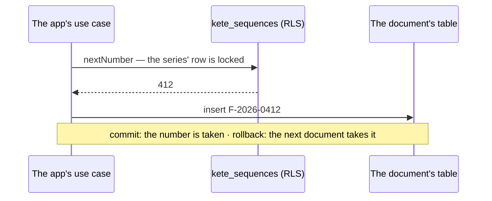

# Spec 095 — The numbers of documents

Step **E2** of the plan decided on 2026-10-13 (`docs/ROADMAP.md`, phase 8; doctrine D-048).

## Why

Gestion numbers quotes, invoices and purchase orders. An invoice series with a hole or a
duplicate is what a tax office and an auditor look for first. The package was waiting for a
trigger; the app is it.

## Requirements

- **FR-001 — In the document's transaction.** A number is taken by the transaction that writes the
  document: both commit, or neither.
- **FR-002 — No gap, no duplicate.** A failed write gives its number back; two writers at once
  never share one.
- **FR-003 — Per organization**, under row-level security created with the table; per series and,
  when given, per period.
- **FR-004 — Never rewound.** The application role cannot delete a series.
- **FR-005 — A reference from a pattern**: `F-{YYYY}-{N:4}` gives `F-2026-0412`.

## Not in this spec

Certified invoices (a port, when Togo's orders are published); renumbering; a pattern per
organization kept in settings — the app chooses its pattern.

## Proof

`packages/sequences/tests/sequences.test.ts` (8 tests, on the test database).
