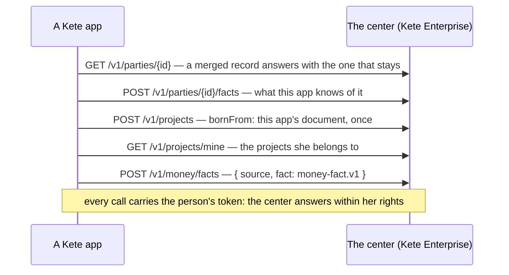

# Spec 096 — The center's references, and the facts of money

Step **E3** of the plan decided on 2026-10-13 (`docs/ROADMAP.md`, phase 8; doctrine D-047 and
D-049).

## Why

The four generic apps cite the same third parties and the same projects, held by the center
(Kete Enterprise specs 073 and 074), and every fact of money must carry its project. Without a
shared contract each app would send its money its own way, and the center could not add up what a
project received, committed and spent.

## Requirements

- **FR-001 — A contract for a fact of money** (`contracts/money-fact.v1.schema.json`): a key, a
  kind — `invoiced`, `received`, `committed`, `spent` — an amount as an integer of the currency's
  smallest unit, never negative; the day it became true; a label; and, when it has them, its
  project, its budget post by name, its third party, and where its piece is read.
- **FR-002 — Said again, a fact replaces itself.** An app keeps an invoice's amount at what is
  still due and a commitment's at what is still to pay; it takes back a fact that was not true.
- **FR-003 — `@kete/center` cites the references**: third parties (found, read — a merged
  identifier answers with the record that stays — and what the app knows of one, said and taken
  back) and projects (hers, one, their identifiers, and one opened from the app's own document,
  once).
- **FR-004 — `@kete/center` says a fact of money** in the contract's shape, under the app's name.
- **FR-005 — Alone without a center**: nothing throws; reads answer nothing, gestures say
  `not_connected`.
- **FR-006 — The SDK validates the contract** (`validateMoneyFact`).

## Not in this spec

What the center does with the facts — a project's received, committed, spent and available, the
three states of money: Kete Enterprise's step F4. A signed batch of facts from an app's worker
without a person's token. Exchange rates.

## Proof

`packages/center/tests/references.test.ts` (6): a third party is read with her token and a merged
record is followed; what the app knows of it is said under its own name and taken back; her
projects are read and one is opened from its own document; **a fact of money travels in the
contract's shape with its project and its post, and validates against it**; the contract refuses a
float, a negative amount, an unknown kind, a date that is not one; without a center nothing throws.

To obtain: a fact sent by an app read by the center under its project — Kete Enterprise's F4.
