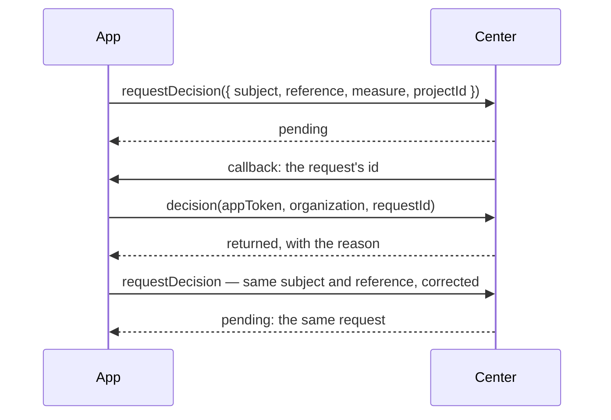

# Spec 097 — A decision with its project, and sent back

A small follow-up of spec 096, asked by the first app that needed it (Kete Gestion, step G2):
what Kete Enterprise's circuits learned in its spec 075 reaches the apps through `@kete/center`.

## What changes

- `DecisionAsked.projectId`: the project of the center the request belongs to; a step of the
  circuit may then be decided by its lead.
- `CenterDecision.status` may be `returned`: sent back to who asked; `decidedBy` and `reason` say
  who and why.
- `packages/create-app/README.md` says how to get today's template on the day it changes.

## Proof

- `packages/center/tests/center.test.ts`: an app asks with the request's project, and reads a
  request sent back with its reason.
